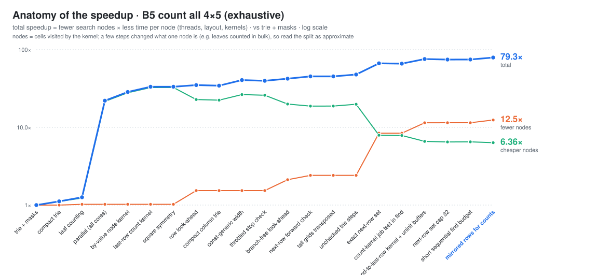
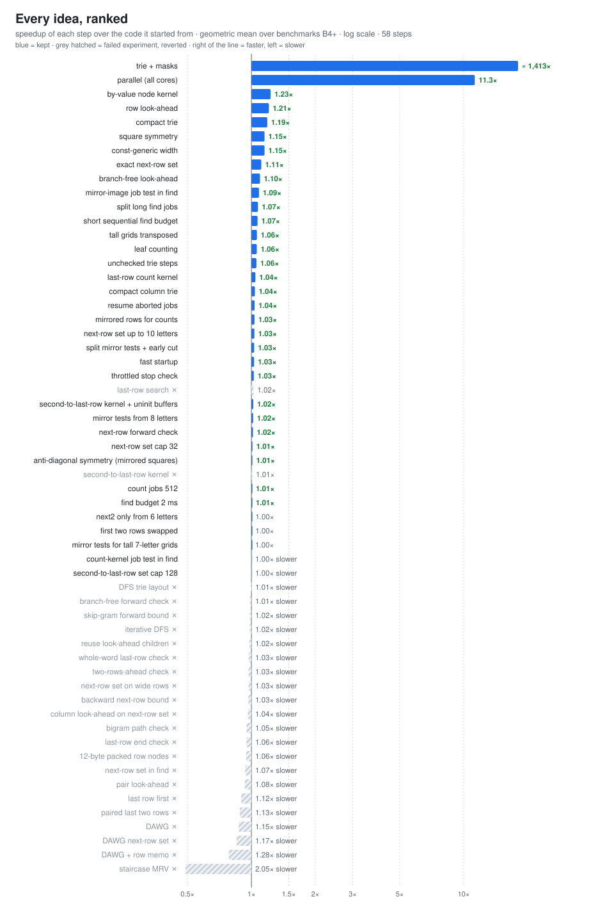
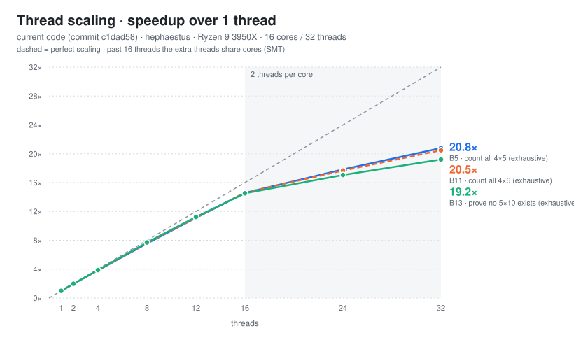
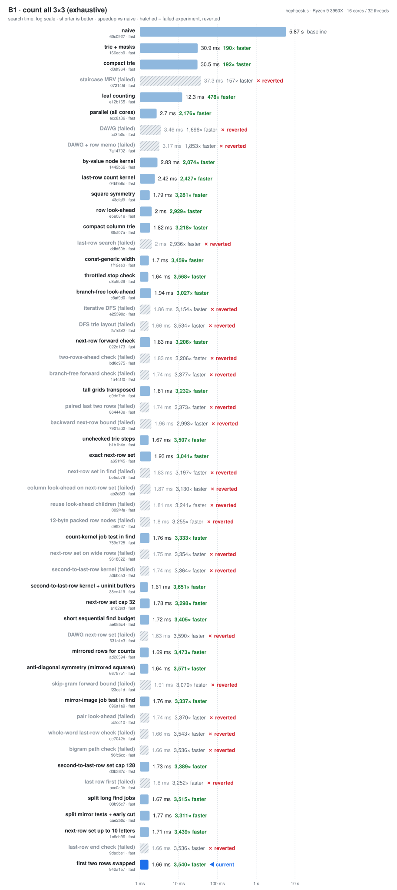
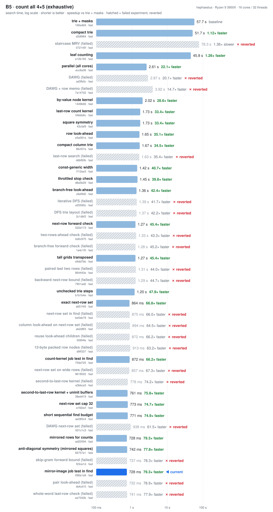
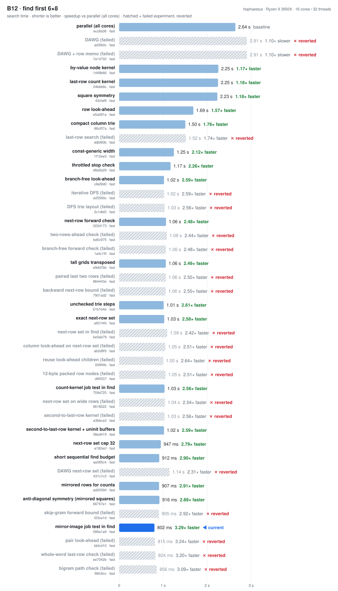
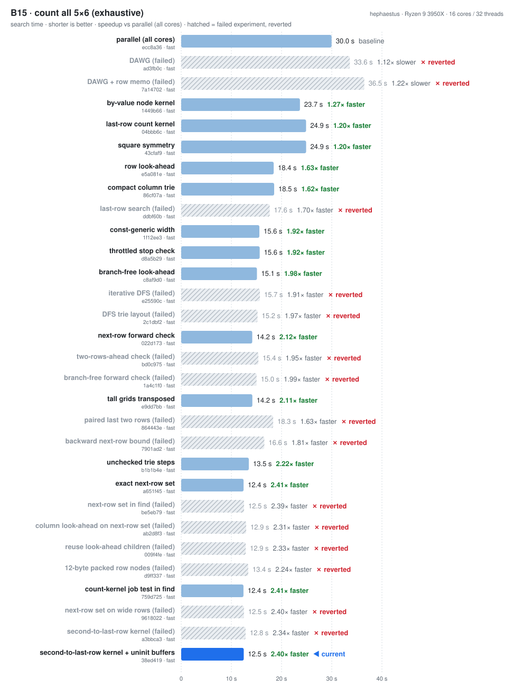
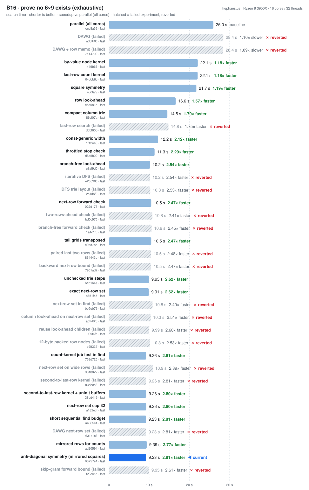

# 🔤 Word Rectangles — an ultra-optimized solver in Rust

> Find the **largest grid of letters where every row and every column is a real word** — and make the search absurdly fast.

```
C A T
A P E
T E N
```

Rows: `CAT`, `APE`, `TEN`. Columns: `CAT`, `APE`, `TEN`. That's a 3×3. The goal of this project is to push as far as a single CPU can go.

> **🆕 Latest (night of 2026-11-21):** the whole history was re-run on one machine, and
> **every grid size up to 10×22 is now settled**: the largest word rectangle in the dictionary is
> **8×8 (exactly five, all symmetric squares)**. New tricks: exact next-row sets, counting the
> **mirror image** of the grid (rows filled from their last letter: up to 1.7× faster), an
> **anti-diagonal symmetry** for mirrored squares, and mirror-image tests for `find` (proofs that no
> grid exists: 1.5–1.7× faster). 21 benchmarked steps that night (9 kept, 12 failed), all documented:
> [`results/journal.md`](results/journal.md).

---

## 🗺️ What the dictionary allows


Every size from 2×2 to 10×22 is settled by this solver ([`scripts/atlas.py`](scripts/atlas.py)): an
exact count, or a proof that none exists. **The largest word rectangle in the dictionary is 8×8:
there are exactly five, and all five are symmetric word squares.** 7×8 is impossible even though 8×8
isn't, and nothing at 9×9 or beyond exists. 3×13 has exactly one solution in the whole dictionary:


Among squares, the classic **symmetric word squares** (row i = column i) become the rule as the size
grows: 2% of the 4×4s, 58% of the 6×6s, 90% of the 7×7s and all five 8×8s (`wordrect squares --rows N`):


**The dictionary decides.** The same atlas with an everyday word list (the system's American English
list, lowercase entries only, about a third of ENABLE's size) tops out at **7×7: exactly 32 grids, all
symmetric squares**. Most of ENABLE's big rectangles rely on rare words (`serriednesses`, `strasses`, …).


<sub>Regenerate: `grep -x '[a-z]*' /usr/share/dict/american-english > /tmp/american.txt` then
`python3 scripts/atlas.py --max-rows 10 --max-cols 22 --dict /tmp/american.txt --name american`.</sub>

---

## 📈 Progress


**Where the speed came from**: every step either visits fewer nodes or makes each node cheaper:



**Every idea ever tried, ranked**: kept and failed, by how much each one changed the speed:



**Where the search spends its time**: nodes per grid cell, for the current kernel:


**How it uses the machine**: speedup vs number of threads:



Regenerate with `python3 scripts/heatmap.py` and `python3 scripts/scaling.py` (both describe the
current code), and `python3 scripts/atlas.py` for the atlas.

### Per-benchmark history

One bar per step, oldest at the top. Every optimization step ever tried — including the failed ones — was rebuilt from its commit and
re-run on **one machine** (hephaestus · Ryzen 9 3950X · 32 threads), so every bar below is directly
comparable. **Solid blue** = kept, **bright blue ◀ current** = the code in the tree now,
**grey hatched ✗ reverted** = a failed experiment (measured, then undone; never part of the code).
Full tables: [`results/BENCHMARKS.md`](results/BENCHMARKS.md), story of each step:
[`results/journal.md`](results/journal.md).

**Quick suite** (baseline = naive, the only suite it can finish):




**Heavy suite** (baseline = trie + masks; naive can't finish these):





**Huge suite** (baseline = the first parallel version; single-threaded steps would take hours):









---

## ⚡ Quick start

**Braindead mode** — `./wr` builds automatically, you never call cargo yourself:

```bash
./wr              # do EVERYTHING: build, test, benchmark
./wr 6x6          # find one 6×6   (./wr 6 works too)
./wr count 3x3    # count all 3×3
./wr test         # tests
./wr bench        # full benchmark suite (~1 min now)
./wr bench quick  # B1–B3 only (seconds); ./wr bench heavy = B4–B9; ./wr bench huge = B10–B18; ./wr bench B2 = one
./wr bench --label "my step"   # record an optimization step → charts
./wr charts       # regenerate charts from results/bench-log.csv
./wr release      # benchmark with full release build (official numbers)
./wr info         # dictionary stats
./wr help
```

Underneath, it runs:

```bash
# Build (fast profile: ~2 s, binary nearly as fast as full release)
cargo build --profile fast
B=target/fast/wordrect

$B info                              # words per length in the dictionary
$B find  --rows 4 --cols 4 --stats   # first 4×4, with nodes / time
$B count --rows 3 --cols 3 --stats   # exhaustive count (trie: ~0.08 s, naive: ~12 s)
$B find  --rows 6 --cols 6 --solver naive   # pick a solver (default: trie)
$B count --rows 3 --cols 3 --print   # list every solution

cargo test                           # naive vs brute force, trie vs naive, validator, transpose
scripts/bench.sh                     # run B1–B3, append to results/bench-log.csv, redraw charts
scripts/bench.sh B2 --runs 5         # one benchmark
scripts/bench.sh --release           # official numbers (full LTO build, slower to compile)
```

Build profiles:

| Profile | Command | Build time | Use for |
|---|---|---|---|
| `dev` | `cargo build` / `cargo test` | fastest | tests, debugging (`opt-level=1`) |
| `fast` | `cargo build --profile fast` | ~2 s | everyday benchmarking |
| `release` | `cargo build --release` | slower (fat LTO, 1 codegen unit) | journal / records numbers |

Compile-speed tricks already in place: **zero dependencies**, linking with **lld** (`.cargo/config.toml`),
incremental `fast` profile. `target-cpu=native` is set globally.

Current status: Levels 0–3 and 5–7 done, Level 4 partly (look-ahead, exact next-row sets). Every size up to 10×22 is settled (see the atlas). Next steps: [`PLAN.md`](PLAN.md).

---

## Table of contents

1. [The problem](#1-the-problem)
2. [Rules and variants](#2-rules-and-variants)
3. [Why it's hard](#3-why-its-hard)
4. [Goals](#4-goals)
5. [Dictionaries](#5-dictionaries)
6. [Architecture](#6-architecture)
7. [Core algorithm](#7-core-algorithm)
8. [Optimization roadmap](#8-optimization-roadmap)
9. [Benchmarking](#9-benchmarking)
10. [Correctness and testing](#10-correctness-and-testing)
11. [Project layout](#11-project-layout)
12. [CLI design](#12-cli-design)
13. [Milestones](#13-milestones)
14. [Ideas backlog](#14-ideas-backlog)
15. [Records log](#15-records-log)
16. [Optimization journal](#16-optimization-journal)
17. [References and further reading](#17-references-and-further-reading)

---

## 1. The problem

Given a dictionary, find an `R × C` grid of letters such that:

- each of the `R` rows, read left to right, is a `C`-letter word, and
- each of the `C` columns, read top to bottom, is an `R`-letter word.

**Score = area (`R × C`).** Bigger is better.

The famous special case is the **word square** (`R = C`). In a *perfect* word square, row `i` equals column `i` (the grid is symmetric). In a *double* word square, rows and columns are all different words.

A 10×10 square made only from words in a standard dictionary is the long-standing holy grail of word-puzzle enthusiasts. Known big squares usually rely on obscure words, place names, or old dictionaries.

---

## 2. Rules and variants

Records only mean something if the rules are fixed. Every result in this repo must state:

| Rule | Options |
|---|---|
| Dictionary | Exact file + version + hash (see [§5](#5-dictionaries)) |
| Shape | Rectangle (`R ≠ C`), perfect square, double square |
| Repeats | Words may repeat / all words distinct |
| Case & letters | Lowercase `a–z` only, no accents, no hyphens |

Default ruleset for this project: **rectangles, repeats allowed, ENABLE dictionary, `a–z` only.** Other variants are side quests.

---

## 3. Why it's hard

- Every letter belongs to **one row and one column at once**, so each placement constrains two words.
- The number of candidate grids explodes combinatorially. Even with a trie, naive backtracking spends almost all its time in branches that are doomed several rows later.
- As size grows, the number of valid words of that length **shrinks**, and the number of valid prefixes shrinks even faster. Big grids are a needle-in-a-haystack problem: solutions are extremely rare, so **proving there is no solution** (exhausting a size) is the expensive part.

The good news: this is exactly the kind of problem where clever pruning and tight data structures give 100×–10,000× speedups, and hardware barely matters.

---

## 4. Goals

**Primary**

- [ ] A correct solver for any `R × C` and any dictionary.
- [ ] Exhaustively search every size up to the limit of a laptop, and record **time to exhaust** each size.
- [ ] Find the largest-area rectangle for the default ruleset.

**Secondary**

- [ ] Largest perfect word square and largest double word square.
- [ ] Count *all* solutions for small sizes (great for correctness checks and for comparing algorithms).
- [ ] Keep every benchmark run **under a few seconds** during development (fast feedback loop).

**Non-goals**

- GPUs, clusters, cloud compute. This is a CPU-only, one-laptop project.
- Fancy UI. A CLI and a results file are enough.

---

## 5. Dictionaries

| Name | Approx. size | Notes |
|---|---|---|
| ENABLE | ~173k words | Public domain, standard for word-game research. **Default.** |
| Small common-words list | ~10k–40k | Fast to search; good for testing and for "human-readable" results |
| SOWPODS / Collins | ~270k | Huge, but check the license before redistributing |

Rules for dictionaries:

- Store dictionaries in `dicts/` and record a SHA-256 hash of each one in `dicts/HASHES.txt`.
- Preprocess once: lowercase, strip anything outside `a–z`, deduplicate, then split by length.
- Never silently change a dictionary. A new version = a new file name.

Current: `dicts/enable.txt` = ENABLE1 (172,823 words, from `github.com/dolph/dictionary`),
SHA-256 `3f16130220645692ed49c7134e24a18504c2ca55b3c012f7290e3e77c63b1a89`.

---

## 6. Architecture

```
dictionary ──► preprocessing ──► per-length tries ──► search engine ──► results
                                       │                     │
                                       │                     ├── single-threaded core
                                       │                     └── parallel driver (std::thread)
                                       └── letter masks per node
```

### Per-length tries

For an `R × C` search we only ever need:

- a trie of all **`C`-letter words** (for rows), and
- a trie of all **`R`-letter words** (for columns).

Because every word in a per-length trie has the same length, **reaching depth `L` means a complete word**, with no terminal flags needed during search.

### Node layout (starting point)

```rust
pub struct Trie {
    nodes: Vec<Node>, // index 0 is the root; 0 is never a valid child, so 0 = "none"
}

#[derive(Clone)]
pub struct Node {
    children: [u32; 26], // child index per letter, 0 = missing
    mask: u32,           // bit `c` set  <=>  child for letter `c` exists
}

impl Trie {
    #[inline]
    pub fn mask(&self, node: u32) -> u32 {
        self.nodes[node as usize].mask
    }

    #[inline]
    pub fn child(&self, node: u32, letter: usize) -> u32 {
        self.nodes[node as usize].children[letter]
    }
}
```

The `mask` field is the key to fast search: "which letters can come next?" becomes a single integer, and intersecting constraints becomes a single `&`.

Later, the layout can be compressed (see [§8](#8-optimization-roadmap)).

---

## 7. Core algorithm

### Cell-by-cell backtracking with two tries

Fill the grid one cell at a time, in row-major order. Keep, for every row and every column, the trie node reached so far. For the next cell, the legal letters are:

```
allowed = row_trie.mask(row_state[r]) & col_trie.mask(col_state[c])
```

If `allowed == 0`, this branch is dead immediately.

```rust
pub struct Search<'a> {
    rows: usize,
    cols: usize,
    row_trie: &'a Trie, // words of length `cols`
    col_trie: &'a Trie, // words of length `rows`
    row_state: Vec<u32>,
    col_state: Vec<u32>,
    grid: Vec<u8>,
}

impl<'a> Search<'a> {
    /// Returns true as soon as one full rectangle is found.
    pub fn solve(&mut self, cell: usize) -> bool {
        if cell == self.rows * self.cols {
            return true;
        }
        let (r, c) = (cell / self.cols, cell % self.cols);
        let row_node = self.row_state[r];
        let col_node = self.col_state[c];

        let mut allowed = self.row_trie.mask(row_node) & self.col_trie.mask(col_node);
        while allowed != 0 {
            let letter = allowed.trailing_zeros() as usize;
            allowed &= allowed - 1; // clear lowest set bit

            self.row_state[r] = self.row_trie.child(row_node, letter);
            self.col_state[c] = self.col_trie.child(col_node, letter);
            self.grid[cell] = b'a' + letter as u8;

            if self.solve(cell + 1) {
                return true;
            }
        }
        // restore state for the caller
        self.row_state[r] = row_node;
        self.col_state[c] = col_node;
        false
    }
}
```

All states start at the root (`0`). When the last cell is filled, every row and column has reached full depth in its trie, so the grid is valid by construction.

### Search strategy for "largest rectangle"

1. Let `L` be the longest word length in the dictionary.
2. Enumerate all `(R, C)` with `R ≤ C ≤ L`, sorted by **area, descending** (a rectangle and its transpose are the same problem, so only search `R ≤ C`).
3. Skip any `(R, C)` where there are no words of length `R` or `C`.
4. The first size that returns a solution is the answer for that area; continue only if you want to *prove* nothing larger exists (you must exhaust every larger area).

---

## 8. Optimization roadmap

> Current to-do list with measurements and next ideas: [`PLAN.md`](PLAN.md).

Each step gets its own entry in the [optimization journal](#16-optimization-journal), with before/after numbers.

### Level 0: baseline
- [x] Naive version: pick whole row words from a list, check column prefixes with a `HashSet` of prefixes.
- [x] Measure it. It will be slow. That's the point; it's the reference for correctness and speed.

### Level 1: tries and masks
- [x] Per-length tries with 26-bit child masks.
- [x] Cell-by-cell search (§7).
- [x] Iterate letters via `trailing_zeros` + `x & (x - 1)`.

### Level 2: memory layout
- [x] Store nodes in one flat `Vec`, in **BFS order**, so nodes at the same depth sit close together in memory.
- [x] Compress children: store only existing children, and find the index of letter `c` with `popcount(mask & ((1 << c) - 1))`. Much smaller trie → better cache behaviour.
- [x] Use `u32` indices everywhere (never `usize` in hot data).
- [x] ✅ ("by-value node kernel", "const-generic width") Keep the per-search state in fixed-size arrays on the stack.

### Level 3: smarter search order
- [x] ❌ tried, reverted ("staircase MRV": 2× slower) — **Most-constrained cell first:** at each step, pick the empty cell whose `allowed` mask has the fewest bits (`count_ones()`), not just the next one in row-major order.
- [ ] Try a **diagonal or spiral fill order** and compare.
- [x] ✅ ("row look-ahead", "next-row forward check", "exact next-row set") **Forward checking:** after placing a letter, check that every *unfilled* cell in the affected row and column still has at least one legal letter. Cut the branch early if not.
- [ ] Fill the **dimension with fewer words** first (e.g. if there are far fewer 9-letter than 7-letter words, constrain on the 9-letter side early).

### Level 4: dictionary pruning (before the search even starts)
- [ ] Iteratively remove words that can't possibly appear: a row word is only usable if, at every position `j`, its letter is a valid *first* letter... and more generally, if it's compatible with the column trie at every depth. Repeat until nothing changes (arc consistency).
- [ ] Precompute, per (length, position), the set of letters that ever appear there.

### Level 5: symmetry and duplicates
- [ ] For perfect squares, exploit symmetry: filling cell `(r, c)` also fills `(c, r)`. Roughly halves the work.
- [x] For *counting* squares (rows and columns from one word list): transposition symmetry. Search only row₀ ≤ col₀ and count = 2·#{row₀ < col₀} + #{row₀ = col₀}: half the nodes.
- [x] ✅ ("tall grids transposed") For rectangles, only search `R ≤ C`. Also: counts run on the mirror image (rows from their last letter), 1.07–1.6× faster.
- [ ] For "all words distinct" variants, track used words cheaply (e.g. a bitset over word IDs at full depth).

### Level 6: parallelism
- [x] Split the search tree at a fixed depth (e.g. all valid first rows) into independent jobs.
- [x] Run jobs on `std::thread::scope` workers pulling from an atomic job counter (zero dependencies, so no `rayon`). Load imbalance is handled by splitting into many small jobs (256/thread for count, 4096/thread for find).
- [x] Stop early when one solution is enough, deterministically: the lowest job index with a solution wins (atomic `fetch_min`), so `find` returns the same grid as the sequential solver.

### Level 7: micro-optimizations (only after profiling!)
- [x] `#[inline]` on hot functions (`inline(always)` on the look-ahead and trie steps; const-generic kernels).
- [x] ❌ tried, reverted ("iterative DFS") — Turn the recursion into an explicit loop with a manual stack.
- [x] ✅ ("unchecked trie steps") Remove bounds checks in the hot loop (prefer iterator patterns or proven-safe indexing; use `unsafe` only with a comment explaining why it's sound).
- [x] ✅ ("branch-free look-ahead") Branchless tricks where they measurably help.

### Release profile

See `Cargo.toml`: `release` = fat LTO + 1 codegen unit + `panic=abort` + debug symbols;
`fast` = same without LTO, 16 codegen units, incremental. `target-cpu=native` comes from `.cargo/config.toml`.

---

## 9. Benchmarking

**Rule #1: never trust a number you didn't measure the same way twice.**

### Standard benchmark suite

Target suite (once the trie solver exists):

| ID | Task | Why |
|---|---|---|
| `B1` | Count all 4×4 rectangles (ENABLE) | Fast, exhaustive, good regression test |
| `B2` | Count all 5×5 rectangles (ENABLE) | Main development benchmark |
| `B3` | Exhaust one hard size with no solution | Measures pure pruning power |
| `B4` | Find first solution of the current record size | Measures "time to record" |

**Current suite in `scripts/bench.sh`.** Times are search times on hephaestus, at the step where each
suite was introduced and at the current code ("mirrored rows for counts", 2026-11-22). IDs never change meaning:
when the code gets too fast for a suite, a bigger one is added.

| ID | Task | At its baseline | Now |
|---|---|---:|---:|
| `B1` | `count --rows 3 --cols 3` (1,909,732 solutions) | naive 5.87 s | 1.69 ms |
| `B2` | `find --rows 5 --cols 6` | naive 1.15 s | 0.15 ms |
| `B3` | `find --rows 6 --cols 6` | naive 2.71 s | 0.23 ms |
| `B4` | `count --rows 4 --cols 4` | trie + masks 14.3 s | 0.116 s |
| `B5` | `count --rows 4 --cols 5` | trie + masks 57.7 s | 0.728 s |
| `B6` | `count --rows 3 --cols 7` | trie + masks 5.87 s | 0.089 s |
| `B7` | `find --rows 7 --cols 7` | trie + masks 1.81 s | 0.105 s |
| `B8` | `find --rows 6 --cols 7` | trie + masks 1.47 s | 0.086 s |
| `B9` | `find --rows 5 --cols 9` | trie + masks 8.36 s | 0.154 s |
| `B10` | `count --rows 5 --cols 5` (80,364,530 solutions) | parallel 15.9 s | 3.99 s |
| `B11` | `count --rows 4 --cols 6` | parallel 5.02 s | 1.41 s |
| `B12` | `find --rows 6 --cols 8` | parallel 2.64 s | 0.907 s |
| `B13` | `find --rows 5 --cols 10` (no 5×10 exists: exhaustive proof) | parallel 2.46 s | 0.886 s |
| `B14` | `count --rows 6 --cols 4` (tall shape) | parallel 9.63 s | 1.42 s |
| `B15` | `count --rows 5 --cols 6` (7,424,362 solutions) | parallel 30.0 s | 10.1 s |
| `B16` | `find --rows 6 --cols 9` (no 6×9 exists: exhaustive proof) | parallel 26.0 s | 9.39 s |
| `B17` | `count --rows 4 --cols 7` (7,139,499 solutions) | parallel (filled in by the replay) | 1.7 s |
| `B18` | `count --rows 6 --cols 6` (1,584,465 solutions) | parallel (filled in by the replay) | 20 s |

Suite history: B1–B3 were sized for naive; B4–B9 were added when B2/B3 hit ~1 ms; B10–B13 when the heavy
suite hit ~8 s; B14 to cover tall grids; B15–B16 when hephaestus became the main machine; B17–B18 when
B5–B8 dropped under 0.2 s (`scripts/replay.py` then re-ran every past step on them).
Heavy and huge benchmarks report the median of 3 runs (since 2026-11-22; one run before).

**One machine.** `bench.sh` refuses to log on any host other than `MAIN_MACHINE` (hephaestus). Runs from
the previous machine are kept in `results/legacy/bench-log.csv` but not charted. If the main machine
ever changes, `python3 scripts/replay.py` rebuilds every step from its commit and re-runs the whole
history (about 50 min here).

Every run is appended to `results/bench-log.csv` (`search_s` = median search time, dictionary load
excluded; `label` = optimization step). `scripts/charts.py` turns it into `results/charts/*.svg` and
[`results/BENCHMARKS.md`](results/BENCHMARKS.md). Workflow for each step: see `CLAUDE.md`.

Pick sizes so that `B1`–`B3` take **≤ 2 seconds** on the current version. When the code gets faster, add a bigger size instead of letting runs drop to microseconds.

### Tools

- [`hyperfine`](https://github.com/sharkdp/hyperfine): time whole CLI runs, with warmup and statistics.
- [`criterion`](https://github.com/bheisler/criterion.rs): micro-benchmarks for trie building and hot functions.
- [`cargo flamegraph`](https://github.com/flamegraph-rs/flamegraph): see where time actually goes.
- `perf stat`: cache misses, branch misses, instructions per cycle (Linux).
- Compiler Explorer / `cargo-show-asm`: check what the hot loop compiles to.

### Metrics to record

- Wall time
- **Nodes visited** (number of `solve` calls), the best hardware-independent measure of pruning quality
- Nodes per second (raw speed of the inner loop)
- Peak memory

Optimizations come in two kinds: those that **visit fewer nodes** (better pruning) and those that **visit nodes faster** (better code). Tracking both numbers tells you which kind you just made.

---

## 10. Correctness and testing

A fast wrong answer is worthless. Every optimization must pass all of these:

- **Validator:** an independent, dead-simple function that takes a grid and checks every row and column against a `HashSet<String>` of the dictionary. Run it on every solution found.
- **Cross-check counts:** for small sizes, the number of solutions must match the naive baseline exactly.
- **Tiny hand-made dictionaries:** e.g. `["cat", "ape", "ten"]`, where you can work out the answers by hand.
- **Property tests** (`proptest`): random small dictionaries → optimized solver and naive solver must agree.
- **Transpose test:** the number of `R × C` solutions must equal the number of `C × R` solutions.

---

## 11. Project layout

```
word-rectangle-solver/
├── Cargo.toml
├── build.rs             ← embeds git commit into the binary
├── .cargo/config.toml   ← target-cpu=native, lld linker
├── README.md            ← this file
├── dicts/
│   ├── enable.txt
│   └── HASHES.txt
├── scripts/
│   ├── bench.sh         ← benchmark suite → results/bench-log.csv
│   ├── replay.py        ← rebuild + re-run every step on a new main machine
│   └── charts.py        ← bench-log.csv → charts/*.svg (+ progress.svg) + BENCHMARKS.md
├── src/
│   ├── main.rs          ← CLI
│   ├── lib.rs
│   ├── dict.rs          ← loading, cleaning, splitting by length
│   ├── naive.rs         ← reference implementation (never optimize this)
│   ├── trie.rs          ← per-length trie with child masks
│   ├── search.rs        ← trie + mask cell-by-cell solver
│   └── validate.rs      ← independent checker
├── tests/
│   ├── small_dicts.rs
│   └── cross_check.rs   ← every solver must match naive
└── results/
    ├── records.md
    ├── journal.md
    ├── bench-log.csv    ← every benchmark run on the main machine (source of truth)
    ├── legacy/          ← runs from the previous machine (not charted)
    ├── BENCHMARKS.md    ← generated tables
    └── charts/          ← generated SVG charts
```

Planned: `src/parallel.rs`, `benches/`.

---

## 12. CLI design

```bash
# Find one R×C rectangle
wordrect find --dict dicts/enable.txt --rows 6 --cols 7

# Count all solutions of a size (exhaustive)
wordrect count --dict dicts/enable.txt --rows 5 --cols 5

# Hunt for the largest rectangle, biggest areas first        (planned)
wordrect hunt --dict dicts/enable.txt --threads 8

# Perfect word squares only                                   (planned)
wordrect find --dict dicts/enable.txt --rows 8 --cols 8 --symmetric

# Print search statistics
wordrect count --rows 5 --cols 5 --stats   # nodes visited, nodes/sec, time
```

Output always includes the dictionary fingerprint, the ruleset, the solver, and the git commit so results are reproducible.

---

## 13. Milestones

| # | Milestone | Done when |
|---|---|---|
| M1 | Naive solver | Finds a 3×3 and a 4×4; validator passes ✅ |
| M2 | Trie + mask solver | Same counts as naive on all small sizes; first big speedup recorded ✅ |
| M3 | Benchmark harness | `B1`–`B3` scripted with hyperfine; journal started (started ✅) |
| M4 | Compact trie | Lower memory and faster `B2` ✅ |
| M5 | Smart ordering + forward checking | Big drop in **nodes visited** |
| M6 | Dictionary pruning | Faster exhaustion of sizes with no solution |
| M7 | Parallel search | Near-linear scaling on all cores for `B2`/`B3` |
| M8 | Record hunt | Largest rectangle found for the default ruleset, with proof that larger sizes were exhausted (where feasible) |
| M9 | Side quests | Perfect squares, double squares, other dictionaries |

Rough timeline for a few weeks: M1–M3 in week 1, M4–M6 in week 2, M7–M8 in week 3, M9 and write-up in week 4.

---

## 14. Ideas backlog

Unsorted ideas to try once the basics are solid:

- **Bidirectional constraints:** maintain for each unfilled cell the intersection of all row/column masks, updated incrementally.
- **Caching dead states:** if a set of column prefixes provably leads nowhere, remember it (e.g. hash of column states at the start of a row) and skip it next time.
- **Suffix awareness:** also build tries of reversed words to fill from the bottom-right, and meet in the middle.
- **Letter frequency ordering:** try rarer or commoner letters first; measure which helps for finding vs. exhausting.
- **SIMD:** check several candidate letters or several cells at once.
- **Row-word bitsets:** for each (position, letter), a bitset over all row words; candidate rows = AND of bitsets. Compare against the trie approach.
- **Dictionary quality filter:** a "human-friendly" ruleset using only common words, so results are actually readable.
- **Visualizer:** a small terminal or web view of the search filling the grid live (fun for demos, off by default for benchmarks).

---

## 15. Records log

See [`results/records.md`](results/records.md): one table of solutions found, one of **exhausted sizes** (proven to have no solution).

---

## 16. Optimization journal

See [`results/journal.md`](results/journal.md). One entry per change, failed experiments included; failures are just as informative.

```markdown
### YYYY-MM-DD: <short name of the change>

**Idea:** what I changed and why I expected it to help.

| Benchmark | Before | After | Change |
|---|---|---|---|
| B2 time | 1.84 s | 0.61 s | 3.0× faster |
| B2 nodes visited | 412M | 133M | 3.1× fewer |
| B2 nodes/sec | 224M | 218M | ~same |

**Verdict:** kept / reverted. What I learned.
```

---

## 17. References and further reading

- *Cracking the Coding Interview*, problem 17.25 "Word Rectangle": the classic interview framing of this problem.
- Word Ways (journal of recreational linguistics): many articles on word squares and their history, including the famous 9×9 squares.
- Donald Knuth, *The Art of Computer Programming*, Vol. 4: backtracking and combinatorial search techniques that apply directly here.
- Dan Vanderkam's Boggle research (`danvk.org`, `hybrid-boggle` on GitHub): a great example of trie tricks, bounds, and writing up a word-puzzle search seriously.
- The Rust Performance Book (`nnethercote.github.io/perf-book`): practical guide to making Rust fast.

---

*Have fun, measure everything, and never optimize the naive solver.* 🚀
