# Word rectangles

A fast solver, in Rust with no dependencies, for grids of letters where every row and every column is a word.

```
C A T
A P E
T E N
```

The rows read `CAT`, `APE`, `TEN`, and so do the columns. That is a 3×3 word rectangle. Rows and columns can also be different words, and the grid does not have to be square: a 5×9 has five 9-letter rows and nine 5-letter columns.

With the ENABLE word list (172,823 words), this solver has settled every size from 2×2 to 10×22. Each one has an exact count of grids or a proof that none exist. The largest word rectangle in the dictionary is 8×8, and there are exactly five.

## Latest results

2026-11-23. I raced every public word-rectangle solver I could find, including the programs Donald Knuth wrote for *The Art of Computer Programming*. On one core this solver is 5 to 25 times faster than the best of them on every task that takes more than a tenth of a second. On all 32 threads it is 59 to 345 times faster. Startup also got 12 times faster: finding a 5×6 now takes 7.5 ms from start to finish, down from 96 ms.

2026-11-22. Long jobs in `find` are now split into pieces as soon as a thread runs out of work, so one slow job no longer holds up the other threads (7×7: 104 ms to 43 ms, 6×7: 82 ms to 33 ms). Proofs that no grid exists got 1.2 to 1.3 times faster (no 6×9: 6.0 s to 4.6 s).

2026-11-21. I re-ran the whole benchmark history on one machine and settled every size up to 10×22. New that night: exact sets of the words the next row can still be, counting the mirror image of the grid (rows filled from their last letter, up to 1.7 times faster), and using the anti-diagonal symmetry of mirrored squares.

Every step, including the failed ones, is in [`results/journal.md`](results/journal.md).

## How it compares

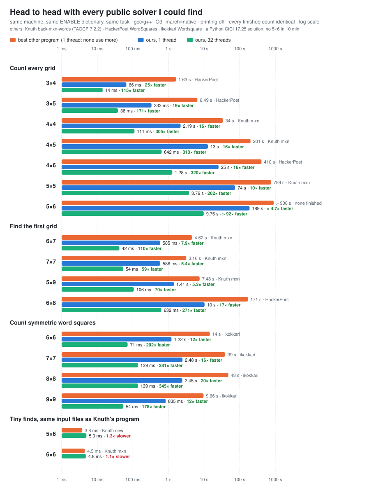

All programs ran on the same machine (hephaestus, a Ryzen 9 3950X), with the same ENABLE word list and the same task. I built the C and C++ programs with `-O3 -march=native` and turned off their solution printing (ours does not print either). Only their word list and size settings changed. Every count that finished matches ours exactly. For example, all of them count 114,846,713 grids of size 4×5.

| Program | What it is | Against ours on one thread |
|---|---|---|
| [Knuth `back-mxn-words-new` and `back-mxn-words-mxn`](https://cs.stanford.edu/~knuth/programs.html) | Knuth's CWEB programs for word rectangles (TAOCP 7.2.2, Algorithm B) | 5 to 25 times slower (4×5 count: 201 s against 13 s) |
| [HackerPoet `WordSquares`](https://github.com/HackerPoet/WordSquares) | A C++ trie solver from a YouTube video | 8 to 25 times slower (6×8 find: 171 s against 10 s) |
| [ikokkari `Wordsquare`](https://github.com/ikokkari/Wordsquare) | The C program that showed no 9×9 double word square exists | 6 to 20 times slower on symmetric squares (8×8: 48 s against 2.4 s) |
| [Noah Nelson's Python](https://gist.github.com/NoahNelson/eea646be1f5abc859cda1583f1f58a78) | A solution to *Cracking the Coding Interview* problem 17.25 | Found no 5×6 in 10 minutes (ours: 6 ms) |

The ranges cover every task that took longer than a tenth of a second. None of the other programs uses more than one core.

We lose one race. Knuth's program finds a 5×6 in 3.8 ms. Ours takes 5.0 ms when it reads the same input files, which contain only the word lengths it needs, and 6.1 ms when it reads the whole 1.9 MB dictionary. For 6×6 the times are 4.5 ms for Knuth's program and 4.8 ms or 6.5 ms for ours. Our search itself takes 0.1 ms. The rest is loading the words, about 24,000 small memory allocations plus two tries, where Knuth's C program reads into fixed arrays.

I found no other solver or published result that has settled every size for this dictionary. Raw numbers: [`results/competitors.csv`](results/competitors.csv).

## What the dictionary allows

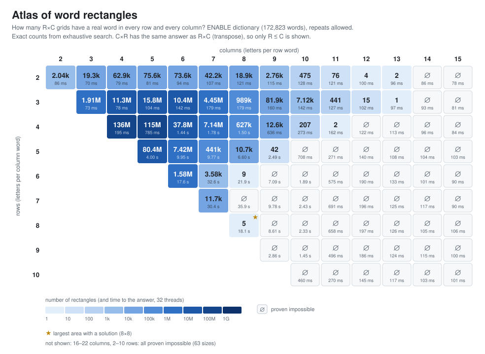

[`scripts/atlas.py`](scripts/atlas.py) produced this map of every size from 2×2 to 10×22. The five 8×8 grids are all symmetric word squares, where row i is the same word as column i. 7×8 has no solution even though 8×8 does, and nothing exists at 9×9 or beyond. 3×13 has exactly one solution:

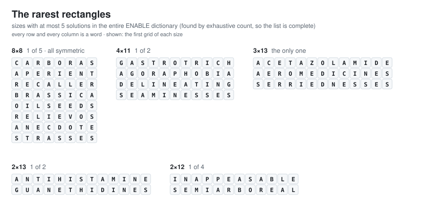

Among squares, symmetric ones become the rule as the size grows. They are 2% of the 4×4s, 58% of the 6×6s, 90% of the 7×7s and all five 8×8s (`wordrect squares --rows N` counts them):

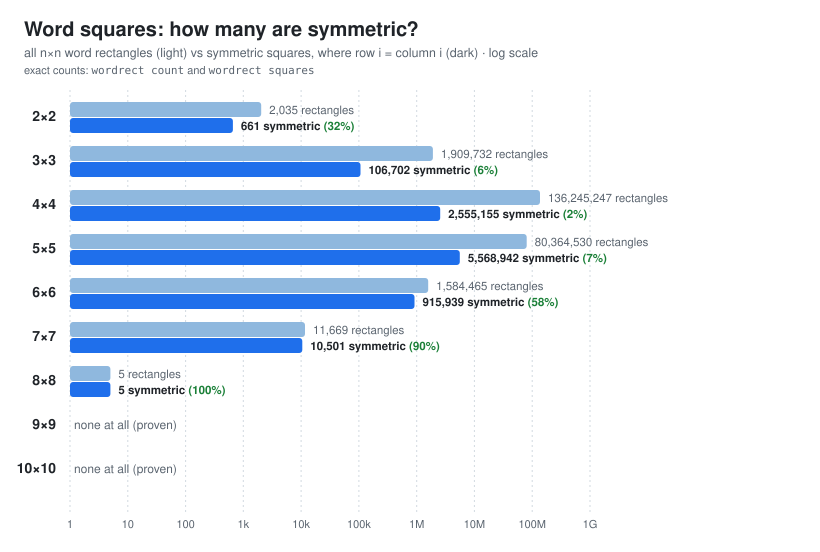

The word list matters more than anything else. With an everyday list (the system's American English dictionary, lowercase entries only, about a third the size of ENABLE), the largest grid is 7×7, and all 32 of them are symmetric squares. Most of ENABLE's large rectangles need rare words such as `serriednesses` and `strasses`.

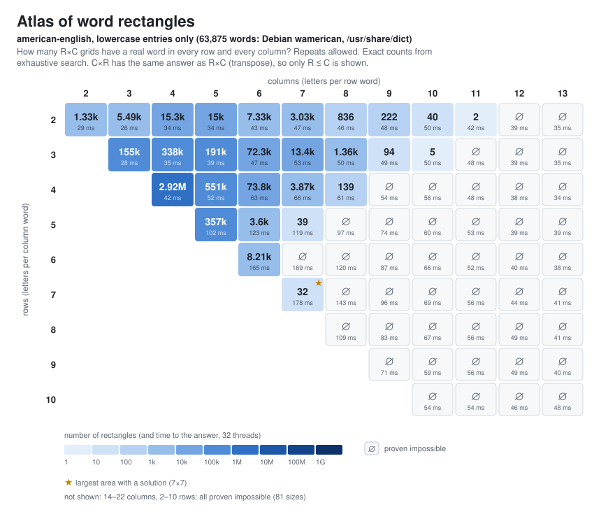

<sub>To regenerate: `grep -x '[a-z]*' /usr/share/dict/american-english > /tmp/american.txt`, then
`python3 scripts/atlas.py --max-rows 10 --max-cols 22 --dict /tmp/american.txt --name american`.</sub>

## Progress

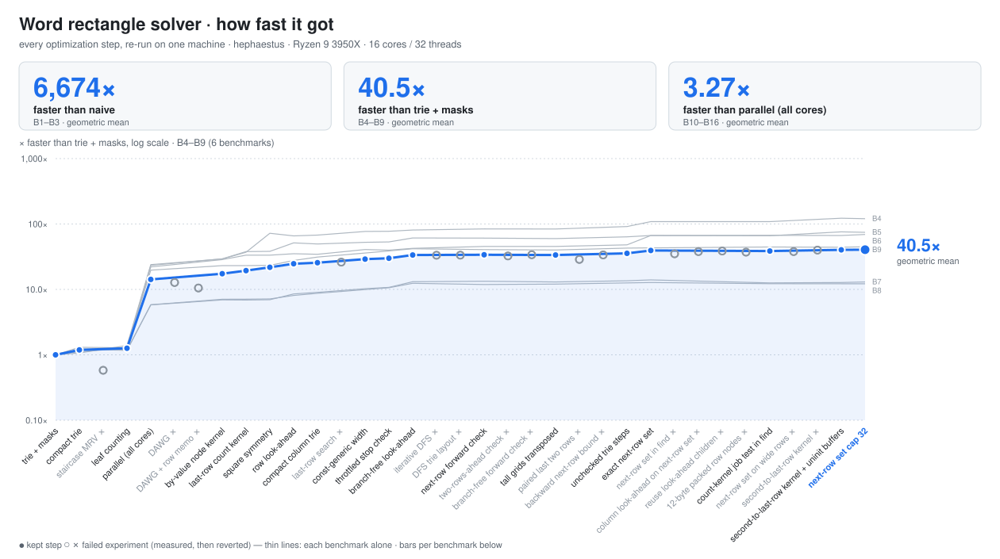

Each step either visits fewer nodes of the search tree or makes each node cheaper. This chart splits the 4×5 count's gains into those two parts:


Every idea I tried, kept or reverted, ranked by how much it changed the speed:


Nodes visited per grid cell with the current code:

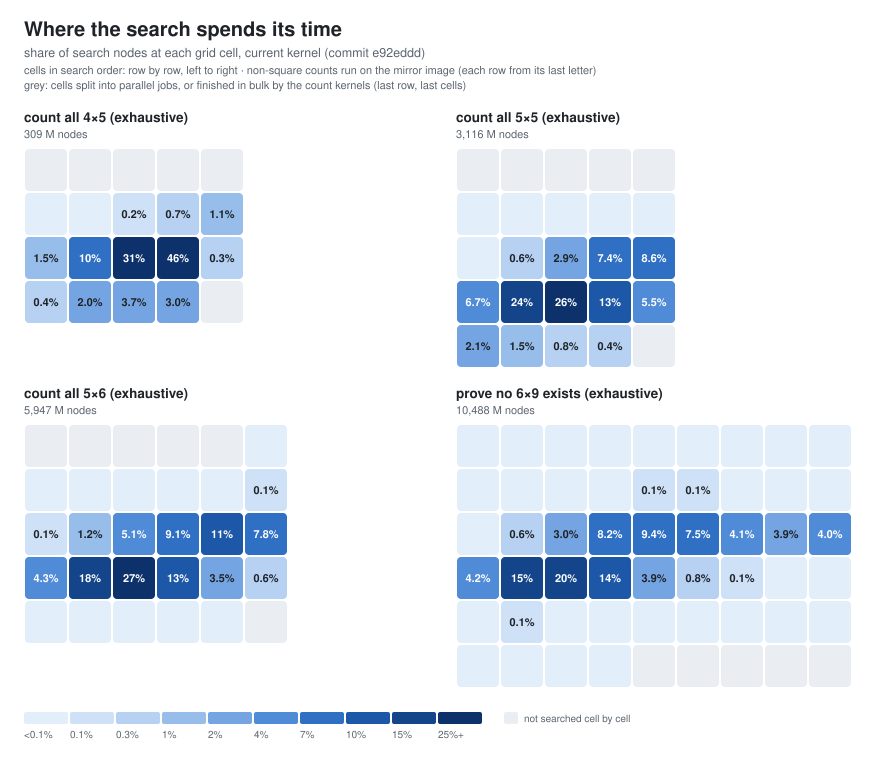

Speedup against the number of threads:


What 32 threads do during one `find`, with every job, test and abort on a timeline. Without splitting, one thread works through a huge early job while the others wait. With splitting, long jobs are cut into pieces as soon as a thread is idle, which is 2.5 times faster here:

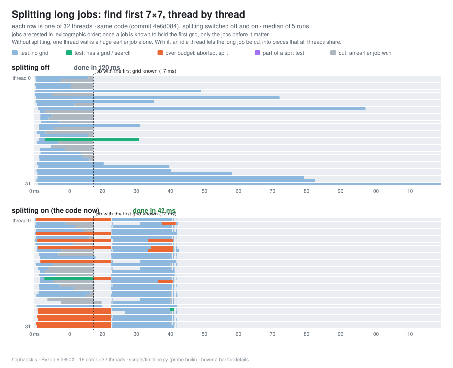

`python3 scripts/heatmap.py`, `scripts/scaling.py`, `scripts/timeline.py` and `scripts/atlas.py` regenerate these from the current code.

### Every benchmark, step by step

Each chart has one bar per step, oldest at the top. I rebuilt every step from its commit and ran it on hephaestus (Ryzen 9 3950X, 32 threads), so all bars are comparable. Blue bars are kept steps, and the bright blue one is the code in the tree now. Grey hatched bars are experiments that I measured and then reverted. Tables: [`results/BENCHMARKS.md`](results/BENCHMARKS.md).

Quick suite, compared with the naive solver, which can only finish these:


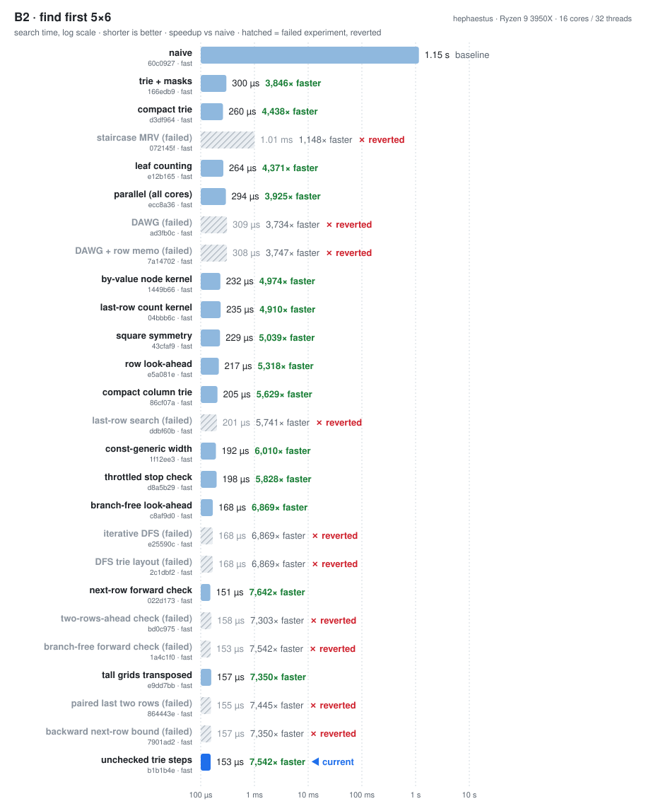
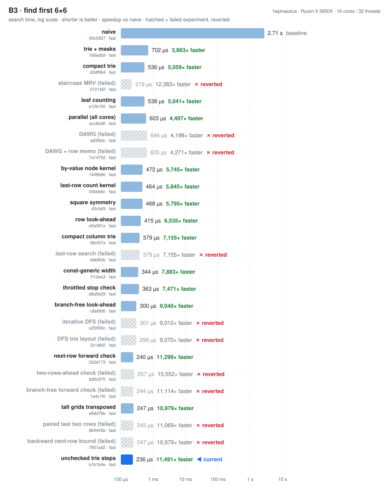

Heavy suite, compared with the first trie solver (naive cannot finish these):

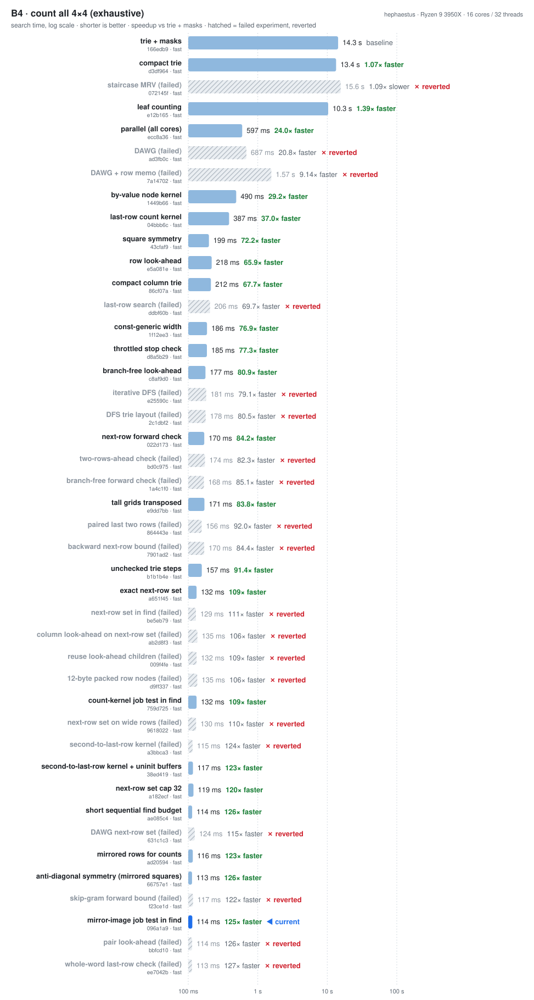

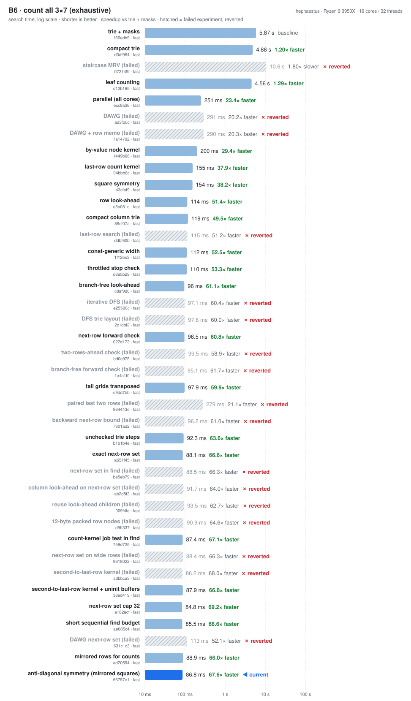
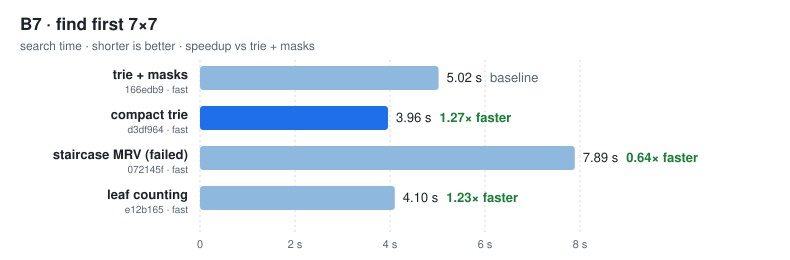
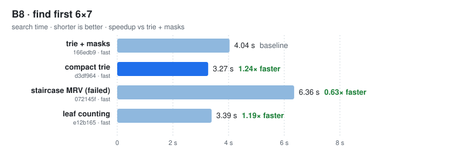
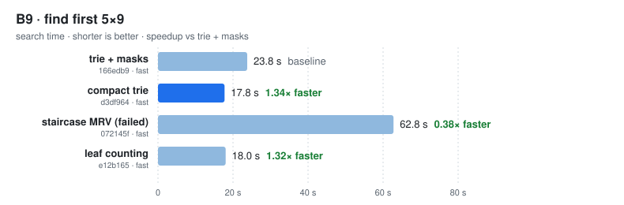

Huge suite, compared with the first parallel version (the single-threaded steps would take hours):


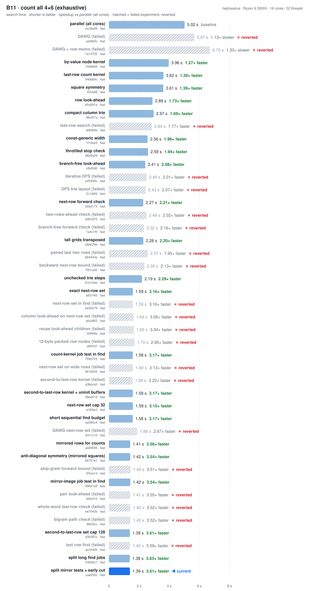

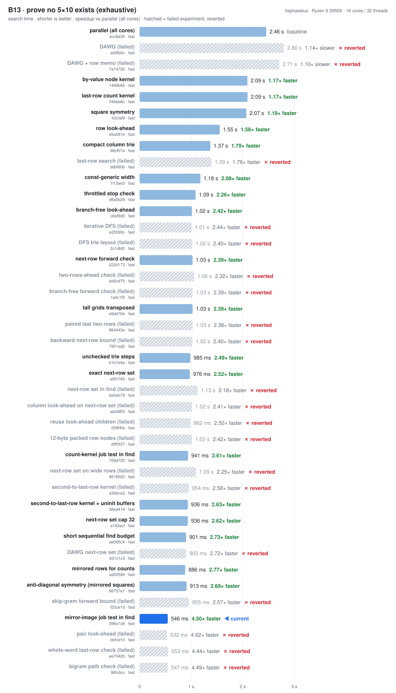
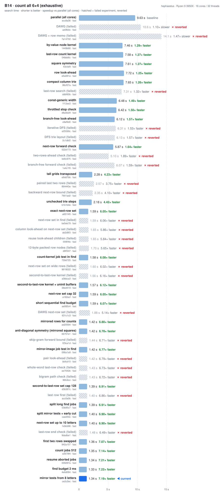


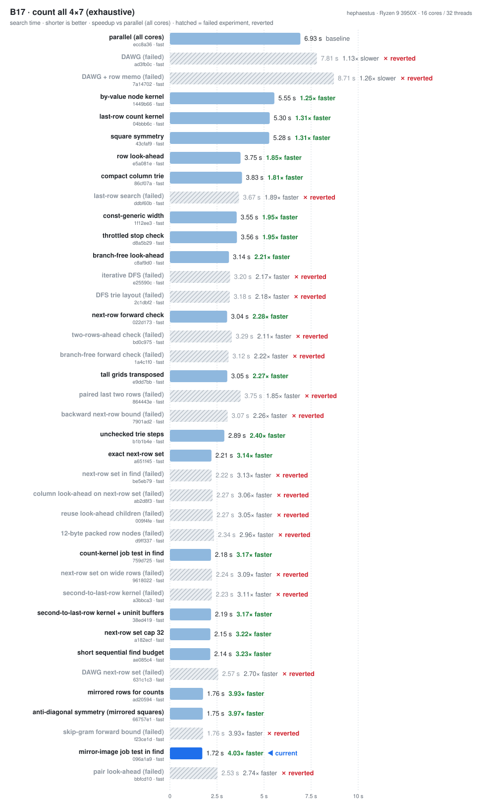
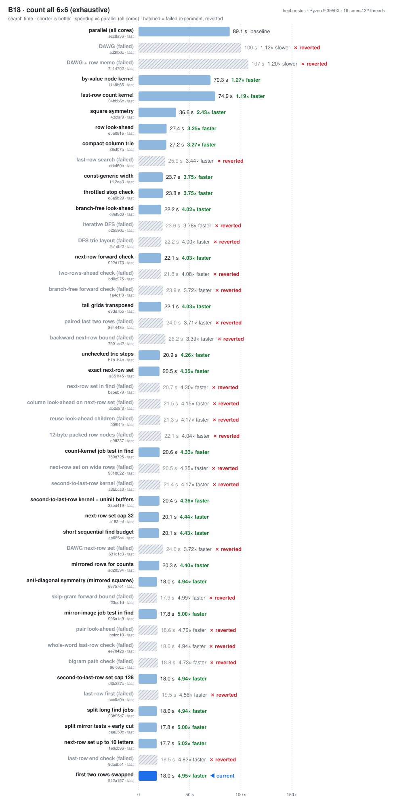

## Quick start

`./wr` builds the code when needed, so you never have to call cargo yourself:

```bash
./wr              # build, test and benchmark
./wr 6x6          # find one 6×6 (./wr 6 also works)
./wr count 3x3    # count all 3×3
./wr test         # run the tests
./wr bench        # full benchmark suite (about 1 min)
./wr bench quick  # B1-B3 only; ./wr bench heavy = B4-B9; ./wr bench huge = B10-B18; ./wr bench B2 = one
./wr bench --label "my step"   # record an optimization step and redraw the charts
./wr charts       # redraw the charts from results/bench-log.csv
./wr release      # benchmark with the full release build (official numbers)
./wr info         # words per length in the dictionary
./wr help
```

The binary itself:

```bash
cargo build --profile fast            # about 2 s
B=target/fast/wordrect

$B find  --rows 6 --cols 7            # first 6×7 rectangle, checked by the validator
$B count --rows 5 --cols 5 --stats    # exhaustive count, with nodes visited and time
$B squares --rows 7                   # count symmetric 7×7 word squares
$B find  --rows 4 --cols 4 --solver naive   # par (default), trie or naive
$B count --rows 3 --cols 3 --print    # list every solution
$B count --rows 5 --cols 5 --threads 8
$B info                               # words per length
```

Every run prints the dictionary fingerprint, the solver and the git commit, so results can be reproduced. `--dict PATH` picks another word list (default `dicts/enable.txt`).

Build profiles:

| Profile | Command | Build time | Use for |
|---|---|---|---|
| `dev` | `cargo build`, `cargo test` | fastest | tests and debugging (`opt-level=1`) |
| `fast` | `cargo build --profile fast` | about 2 s | everyday benchmarking |
| `release` | `cargo build --release` | slower (fat LTO, one codegen unit) | numbers in the journal and records |

Builds stay quick because there are no dependencies, the linker is lld (`.cargo/config.toml`) and the `fast` profile is incremental. `target-cpu=native` is set for every build.

## The problem

Given a dictionary, find an R×C grid of letters where each of the R rows, read left to right, is a C-letter word, and each of the C columns, read top to bottom, is an R-letter word. A bigger area is a better result.

A word square is the case R = C. In a symmetric (or perfect) square, row i equals column i. In a double word square, all rows and columns are different words. A 10×10 square of words from a standard dictionary has never been found; the known large squares use obscure words, place names or old dictionaries.

The rules used here: rectangles, words may repeat, ENABLE dictionary, lowercase `a` to `z` only. Results always state the dictionary file and its hash.

The search is hard because every letter belongs to one row and one column at once, and the number of partial grids grows very fast. A plain backtracking search spends almost all its time in branches that fail several rows later. Large grids have so few solutions that proving none exist, by exhausting the size, costs the most.

## Dictionary

`dicts/enable.txt` is ENABLE1 (172,823 words, from `github.com/dolph/dictionary`), SHA-256 `3f16130220645692ed49c7134e24a18504c2ca55b3c012f7290e3e77c63b1a89`. Hashes are kept in `dicts/HASHES.txt`. A changed dictionary gets a new file name.

Loading keeps lowercase words made of `a` to `z`, removes duplicates and splits them by length. A search only loads the two word lengths it needs. When the file is already sorted, as ENABLE is, it is read in parallel chunks without sorting.

## How it works

An R×C search needs only two word lists: C-letter words for the rows and R-letter words for the columns. Each goes into its own trie. Every word in a trie has the same length, so reaching depth L means a complete word, and no end-of-word flags are needed.

Each trie node stores a 26-bit mask of the letters that can follow. The search fills the grid one cell at a time in row order and keeps the trie node reached so far for every row and column. The letters allowed in the next cell are one AND:

```
allowed = row_trie.mask(row_state[r]) & col_trie.mask(col_state[c])
```

If `allowed` is zero, the branch is dead. Otherwise the search tries each set bit, lowest first (`trailing_zeros`, then `x & (x - 1)`).

This basic version is [`src/search.rs`](src/search.rs). The default solver, [`src/par.rs`](src/par.rs), adds the steps that paid off:

- Tries stored as flat arrays in breadth-first order, with only existing children and `u32` indices.
- One search function per row width (const generics), with trie nodes passed by value and no bounds checks in the inner loop.
- A look-ahead: a letter is skipped when the row node it leads to cannot fit the columns two and three cells further right.
- While a row is being filled, the exact set of trie nodes the next row can still be in. This prunes harder than letter pairs, and in the second-to-last row it counts the last row's completions directly.
- Counts run on the mirror image of the grid, with rows filled from their last letter, which is up to 1.7 times faster. Square counts search only half the grids and use transpose symmetry for the rest.
- Parallel search on `std::thread::scope`. The first cells are expanded into many jobs that threads take from an atomic counter. `find` returns the same grid as the sequential solver: the first job in order that holds a solution wins, and jobs after it are skipped or aborted. Long jobs are split while a thread is idle.

Ideas that measured slower and were reverted include choosing the most constrained cell first (2 times slower), an explicit stack instead of recursion, profile-guided optimization (20 to 27% slower) and remembering column states that failed before (they almost never repeat). About 60 steps have been benchmarked so far, 23 of them reverted. The journal has the numbers for each, and [`PLAN.md`](PLAN.md) lists what is still open.

## Benchmarks

The suite is in `scripts/bench.sh`. The table gives search times on hephaestus for the step where each benchmark was added and for the current code. A benchmark ID never changes meaning: when the code gets too fast for one, a bigger one is added.

| ID | Task | At its baseline | Now |
|---|---|---:|---:|
| `B1` | `count --rows 3 --cols 3` (1,909,732 solutions) | naive 5.87 s | 1.16 ms |
| `B2` | `find --rows 5 --cols 6` | naive 1.15 s | 0.13 ms |
| `B3` | `find --rows 6 --cols 6` | naive 2.71 s | 0.22 ms |
| `B4` | `count --rows 4 --cols 4` | trie 14.3 s | 0.107 s |
| `B5` | `count --rows 4 --cols 5` | trie 57.7 s | 0.658 s |
| `B6` | `count --rows 3 --cols 7` | trie 5.87 s | 0.074 s |
| `B7` | `find --rows 7 --cols 7` | trie 1.81 s | 0.045 s |
| `B8` | `find --rows 6 --cols 7` | trie 1.47 s | 0.035 s |
| `B9` | `find --rows 5 --cols 9` | trie 8.36 s | 0.094 s |
| `B10` | `count --rows 5 --cols 5` (80,364,530 solutions) | parallel 15.9 s | 3.84 s |
| `B11` | `count --rows 4 --cols 6` | parallel 5.02 s | 1.32 s |
| `B12` | `find --rows 6 --cols 8` | parallel 2.64 s | 0.622 s |
| `B13` | `find --rows 5 --cols 10` (none exist, exhaustive proof) | parallel 2.46 s | 0.424 s |
| `B14` | `count --rows 6 --cols 4` (tall shape) | parallel 9.63 s | 1.33 s |
| `B15` | `count --rows 5 --cols 6` (7,424,362 solutions) | parallel 30.0 s | 9.95 s |
| `B16` | `find --rows 6 --cols 9` (none exist, exhaustive proof) | parallel 26.0 s | 4.70 s |
| `B17` | `count --rows 4 --cols 7` (7,139,499 solutions) | parallel | 1.66 s |
| `B18` | `count --rows 6 --cols 6` (1,584,465 solutions) | parallel | 17.9 s |

"Now" is the "fast startup" step of 2026-11-23. The heavy and huge suites report the median of three runs.

Every run is appended to `results/bench-log.csv`. Its `search_s` column is the median search time without dictionary loading, and `label` names the step. `scripts/charts.py` turns the log into `results/charts/*.svg` and [`results/BENCHMARKS.md`](results/BENCHMARKS.md). `CLAUDE.md` describes the workflow for each step.

`bench.sh` only records on hephaestus, because numbers from different CPUs cannot be compared. Runs from the previous machine are in `results/legacy/` and are not charted. If the main machine changes, `python3 scripts/replay.py` rebuilds every step from its commit and re-runs the whole history, which takes about 50 minutes.

Besides time, `--stats` reports nodes visited. It does not depend on the hardware, so it shows whether a change pruned more or just ran each node faster.

## Correctness

- `src/validate.rs` checks every printed grid, row by row and column by column, against the dictionary. It shares no code with the solvers.
- `src/naive.rs` is the reference. It picks whole row words and checks column prefixes against a hash set. It is never optimized, so it stays both the check and the speed baseline.
- `tests/cross_check.rs` requires every solver to give exactly the same counts and first grids as naive on small sizes, and checks that R×C and C×R have the same count.
- `tests/small_dicts.rs` uses tiny hand-made dictionaries, such as `cat`, `ape`, `ten`, whose answers can be worked out by hand.
- `tests/dict_load.rs` checks that the fast loader matches the general one on unsorted lists, duplicates, uppercase words and Windows line endings.

## Project layout

```
word-rectangle-solver/
├── wr                   launcher (build, test, bench, charts)
├── build.rs             embeds the git commit in the binary
├── .cargo/config.toml   target-cpu=native, lld linker
├── PLAN.md              open ideas and current measurements
├── dicts/               enable.txt and HASHES.txt
├── scripts/
│   ├── bench.sh         benchmark suite, appends to results/bench-log.csv
│   ├── charts.py        bench-log.csv to charts/*.svg and BENCHMARKS.md
│   ├── replay.py        rebuilds and re-runs every step on a new machine
│   ├── atlas.py         settles every size, draws the atlas
│   └── heatmap.py, scaling.py, timeline.py
├── src/
│   ├── main.rs          CLI
│   ├── dict.rs          loading, cleaning, splitting by length
│   ├── naive.rs         reference solver (never optimized)
│   ├── trie.rs          per-length tries with letter masks
│   ├── search.rs        single-threaded trie solver
│   ├── par.rs           parallel solver (default)
│   ├── squares.rs       symmetric word squares
│   ├── probe.rs         optional node counters and find timeline (--features probe)
│   └── validate.rs      independent checker
├── tests/               cross_check.rs, small_dicts.rs, dict_load.rs
└── results/
    ├── bench-log.csv    every benchmark run on the main machine
    ├── journal.md       one entry per step, failures included
    ├── records.md       solutions found and sizes proven empty
    ├── competitors.csv  the race against other solvers
    ├── BENCHMARKS.md    generated tables
    ├── charts/          generated SVG charts
    └── legacy/          runs from the previous machine
```

## References

- *Cracking the Coding Interview*, problem 17.25 "Word Rectangle", the usual interview version of this problem.
- *Word Ways*, the journal of recreational linguistics, which has many articles on word squares and the known 9×9 squares.
- Donald Knuth, *The Art of Computer Programming*, Volume 4, section 7.2.2 on backtracking. His word-rectangle programs (`back-mxn-words-new.w`, `back-mxn-words-mxn.w`, `word-rect-dlx.w`) are at `cs.stanford.edu/~knuth/programs.html` and are in the race above.
- Dan Vanderkam's Boggle research (`danvk.org`, `hybrid-boggle` on GitHub), a careful write-up of trie tricks and bounds for a word-puzzle search.
- The Rust Performance Book (`nnethercote.github.io/perf-book`).
