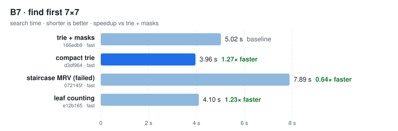
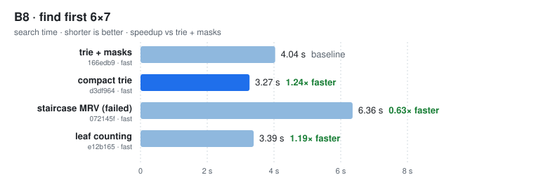

# Benchmark progress

Generated by `scripts/charts.py` from [`bench-log.csv`](bench-log.csv) — do not edit by hand.
Each bar is one optimization step (the latest run of its `--label`). Time = median search time
reported by the binary (dictionary load excluded). Details of each step: [`journal.md`](journal.md).

> ⚠️ *nodes* are not comparable across solvers: naive counts placed row words, trie counts cells.

## B1 · count all 3×3 (exhaustive)

| Step | Commit | Date | Profile | Time | vs baseline | vs previous | Nodes | Result |
|---|---|---|---|---:|---:|---:|---:|---|
| naive | `60c0927` | 2026-11-07 | fast | 11.9 s | — | — | 2,034,829 | solutions=1909732 |
| trie + masks | `60c0927` | 2026-11-07 | fast | 77.1 ms | 154× | 154× | 4,031,868 | solutions=1909732 |
| compact trie | `d3df964` | 2026-11-07 | fast | 73.9 ms | 160× | 1.04× | 4,031,868 | solutions=1909732 |
| staircase MRV (failed) | `072145f` | 2026-11-07 | fast | 90.7 ms | 131× | 0.81× | 4,063,089 | solutions=1909732 |
| leaf counting | `e12b165` | 2026-11-07 | fast | 31.5 ms | 376× | 2.88× | 2,122,136 | solutions=1909732 |
| parallel 22 threads | `ecc8a36` | 2026-11-07 | fast | 7.82 ms | 1,515× | 4.03× | 2,122,136 | solutions=1909732 |

## B2 · find first 5×6

| Step | Commit | Date | Profile | Time | vs baseline | vs previous | Nodes | Result |
|---|---|---|---|---:|---:|---:|---:|---|
| naive | `60c0927` | 2026-11-07 | fast | 2.34 s | — | — | 1,919 | found |
| trie + masks | `60c0927` | 2026-11-07 | fast | 900 µs | 2,600× | 2,600× | 22,841 | found |
| compact trie | `d3df964` | 2026-11-07 | fast | 691 µs | 3,386× | 1.30× | 22,841 | found |
| staircase MRV (failed) | `072145f` | 2026-11-07 | fast | 2.6 ms | 899× | 0.27× | 67,477 | found |
| leaf counting | `e12b165` | 2026-11-07 | fast | 718 µs | 3,259× | 3.63× | 22,841 | found |
| parallel 22 threads | `ecc8a36` | 2026-11-07 | fast | 732 µs | 3,197× | 0.98× | 22,841 | found |

## B3 · find first 6×6

| Step | Commit | Date | Profile | Time | vs baseline | vs previous | Nodes | Result |
|---|---|---|---|---:|---:|---:|---:|---|
| naive | `60c0927` | 2026-11-07 | fast | 5.65 s | — | — | 4,505 | found |
| trie + masks | `60c0927` | 2026-11-07 | fast | 1.91 ms | 2,958× | 2,958× | 49,782 | found |
| compact trie | `d3df964` | 2026-11-07 | fast | 1.41 ms | 4,012× | 1.36× | 49,782 | found |
| staircase MRV (failed) | `072145f` | 2026-11-07 | fast | 535 µs | 10,566× | 2.63× | 12,263 | found |
| leaf counting | `e12b165` | 2026-11-07 | fast | 1.44 ms | 3,917× | 0.37× | 49,782 | found |
| parallel 22 threads | `ecc8a36` | 2026-11-07 | fast | 1.51 ms | 3,736× | 0.95× | 49,782 | found |

## B4 · count all 4×4 (exhaustive)

| Step | Commit | Date | Profile | Time | vs baseline | vs previous | Nodes | Result |
|---|---|---|---|---:|---:|---:|---:|---|
| trie + masks | `166edb9` | 2026-11-07 | fast | 37.5 s | — | — | 1,435,800,420 | solutions=136245247 |
| compact trie | `d3df964` | 2026-11-07 | fast | 33.7 s | 1.11× | 1.11× | 1,435,800,420 | solutions=136245247 |
| staircase MRV (failed) | `072145f` | 2026-11-07 | fast | 37.8 s | 0.99× | 0.89× | 1,232,007,295 | solutions=136245247 |
| leaf counting | `e12b165` | 2026-11-07 | fast | 26.8 s | 1.40× | 1.41× | 1,299,555,173 | solutions=136245247 |
| parallel 22 threads | `ecc8a36` | 2026-11-07 | fast | 1.48 s | 25.3× | 18.0× | 1,299,555,173 | solutions=136245247 |

## B5 · count all 4×5 (exhaustive)

| Step | Commit | Date | Profile | Time | vs baseline | vs previous | Nodes | Result |
|---|---|---|---|---:|---:|---:|---:|---|
| trie + masks | `166edb9` | 2026-11-07 | fast | 153 s | — | — | 5,169,522,478 | solutions=114846713 |
| compact trie | `d3df964` | 2026-11-07 | fast | 130 s | 1.18× | 1.18× | 5,169,522,478 | solutions=114846713 |
| staircase MRV (failed) | `072145f` | 2026-11-07 | fast | 189 s | 0.81× | 0.69× | 5,745,769,138 | solutions=114846713 |
| leaf counting | `e12b165` | 2026-11-07 | fast | 120 s | 1.27× | 1.57× | 5,054,675,765 | solutions=114846713 |
| parallel 22 threads | `ecc8a36` | 2026-11-07 | fast | 6.43 s | 23.8× | 18.7× | 5,054,675,765 | solutions=114846713 |

## B6 · count all 3×7 (exhaustive)

| Step | Commit | Date | Profile | Time | vs baseline | vs previous | Nodes | Result |
|---|---|---|---|---:|---:|---:|---:|---|
| trie + masks | `166edb9` | 2026-11-07 | fast | 16.3 s | — | — | 489,739,310 | solutions=4453472 |
| compact trie | `d3df964` | 2026-11-07 | fast | 12.7 s | 1.29× | 1.29× | 489,739,310 | solutions=4453472 |
| staircase MRV (failed) | `072145f` | 2026-11-07 | fast | 25.8 s | 0.63× | 0.49× | 799,291,031 | solutions=4453472 |
| leaf counting | `e12b165` | 2026-11-07 | fast | 12.1 s | 1.34× | 2.13× | 485,285,838 | solutions=4453472 |
| parallel 22 threads | `ecc8a36` | 2026-11-07 | fast | 628 ms | 26.0× | 19.3× | 485,285,838 | solutions=4453472 |

## B7 · find first 7×7

| Step | Commit | Date | Profile | Time | vs baseline | vs previous | Nodes | Result |
|---|---|---|---|---:|---:|---:|---:|---|
| trie + masks | `166edb9` | 2026-11-07 | fast | 5.02 s | — | — | 141,510,783 | found |
| compact trie | `d3df964` | 2026-11-07 | fast | 3.96 s | 1.27× | 1.27× | 141,510,783 | found |
| staircase MRV (failed) | `072145f` | 2026-11-07 | fast | 7.89 s | 0.64× | 0.50× | 214,037,348 | found |
| leaf counting | `e12b165` | 2026-11-07 | fast | 4.10 s | 1.23× | 1.92× | 141,510,783 | found |
| parallel 22 threads | `ecc8a36` | 2026-11-07 | fast | 698 ms | 7.20× | 5.87× | 157,038,815 | found |

## B8 · find first 6×7

| Step | Commit | Date | Profile | Time | vs baseline | vs previous | Nodes | Result |
|---|---|---|---|---:|---:|---:|---:|---|
| trie + masks | `166edb9` | 2026-11-07 | fast | 4.04 s | — | — | 117,670,090 | found |
| compact trie | `d3df964` | 2026-11-07 | fast | 3.27 s | 1.24× | 1.24× | 117,670,090 | found |
| staircase MRV (failed) | `072145f` | 2026-11-07 | fast | 6.36 s | 0.63× | 0.51× | 173,754,350 | found |
| leaf counting | `e12b165` | 2026-11-07 | fast | 3.39 s | 1.19× | 1.87× | 117,670,090 | found |
| parallel 22 threads | `ecc8a36` | 2026-11-07 | fast | 626 ms | 6.45× | 5.42× | 120,820,550 | found |

## B9 · find first 5×9

| Step | Commit | Date | Profile | Time | vs baseline | vs previous | Nodes | Result |
|---|---|---|---|---:|---:|---:|---:|---|
| trie + masks | `166edb9` | 2026-11-07 | fast | 23.8 s | — | — | 604,041,773 | found |
| compact trie | `d3df964` | 2026-11-07 | fast | 17.8 s | 1.34× | 1.34× | 604,041,773 | found |
| staircase MRV (failed) | `072145f` | 2026-11-07 | fast | 62.8 s | 0.38× | 0.28× | 1,819,147,498 | found |
| leaf counting | `e12b165` | 2026-11-07 | fast | 18.0 s | 1.32× | 3.48× | 604,041,773 | found |
| parallel 22 threads | `ecc8a36` | 2026-11-07 | fast | 1.06 s | 22.4× | 17.0× | 610,338,537 | found |
