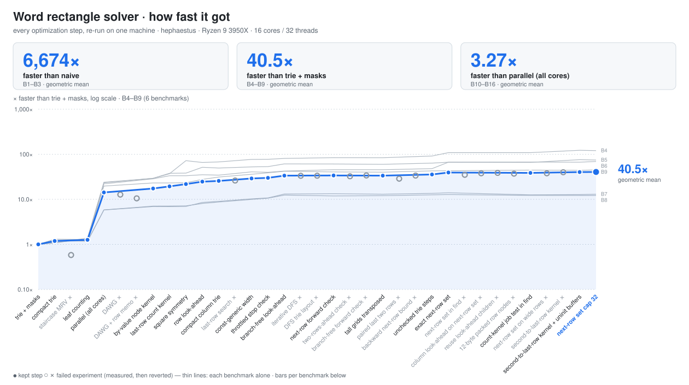

# Benchmark progress

All numbers from one machine: **hephaestus · Ryzen 9 3950X · 16 cores / 32 threads**. Every step of the history was rebuilt
from its commit and re-run there (`scripts/replay.py`); runs from the previous machine are
kept in [`legacy/bench-log.csv`](legacy/bench-log.csv) but not charted (not comparable).

Generated by `scripts/charts.py` from [`bench-log.csv`](bench-log.csv) — do not edit by hand.
Each bar is one optimization step (the latest run of its `--label`). Time = median search time
reported by the binary (dictionary load excluded). Details of each step: [`journal.md`](journal.md).

> ⚠️ *nodes* are not comparable across solvers: naive counts placed row words, trie counts cells.

Status: ✅ kept · ❌ failed experiment, reverted (it never stays in the code) · ⭐ the code in the tree now.
*vs previous* compares with the previous **kept** step, the code each experiment started from.

## B1 · count all 3×3 (exhaustive)

| | Step | Commit | Date | Profile | Time | vs baseline | vs previous | Nodes | Result |
|---|---|---|---|---|---:|---:|---:|---:|---|
| ✅ | naive | `60c0927` | 2026-11-07 | fast | 5.87 s | — | — | 2,034,829 | solutions=1909732 |
| ✅ | trie + masks | `166edb9` | 2026-11-07 | fast | 30.9 ms | 190× | 190× | 4,031,868 | solutions=1909732 |
| ✅ | compact trie | `d3df964` | 2026-11-07 | fast | 30.5 ms | 192× | 1.01× | 4,031,868 | solutions=1909732 |
| ❌ | ~~staircase MRV (failed)~~ | `072145f` | 2026-11-07 | fast | 37.3 ms | 157× | 0.82× | 4,063,089 | solutions=1909732 |
| ✅ | leaf counting | `e12b165` | 2026-11-07 | fast | 12.3 ms | 478× | 2.48× | 2,122,136 | solutions=1909732 |
| ✅ | parallel (all cores) | `ecc8a36` | 2026-11-07 | fast | 2.7 ms | 2,176× | 4.56× | 2,122,136 | solutions=1909732 |
| ❌ | ~~DAWG (failed)~~ | `ad3fb0c` | 2026-11-07 | fast | 3.46 ms | 1,696× | 0.78× | 2,122,136 | solutions=1909732 |
| ❌ | ~~DAWG + row memo (failed)~~ | `7a14702` | 2026-11-07 | fast | 3.17 ms | 1,853× | 0.85× | 2,122,136 | solutions=1909732 |
| ✅ | by-value node kernel | `1449b66` | 2026-11-07 | fast | 2.83 ms | 2,074× | 0.95× | 2,122,136 | solutions=1909732 |
| ✅ | last-row count kernel | `04bbb6c` | 2026-11-07 | fast | 2.42 ms | 2,427× | 1.17× | 2,122,136 | solutions=1909732 |
| ✅ | square symmetry | `43cfaf9` | 2026-11-07 | fast | 1.79 ms | 3,281× | 1.35× | 1,102,846 | solutions=1909732 |
| ✅ | row look-ahead | `e5a081e` | 2026-11-07 | fast | 2 ms | 2,929× | 0.89× | 1,049,457 | solutions=1909732 |
| ✅ | compact column trie | `86cf07a` | 2026-11-07 | fast | 1.82 ms | 3,218× | 1.10× | 1,049,457 | solutions=1909732 |
| ❌ | ~~last-row search (failed)~~ | `ddbf60b` | 2026-11-07 | fast | 2 ms | 2,936× | 0.91× | 1,049,457 | solutions=1909732 |
| ✅ | const-generic width | `1f12ee3` | 2026-11-07 | fast | 1.7 ms | 3,459× | 1.07× | 1,049,457 | solutions=1909732 |
| ✅ | throttled stop check | `d8a5b29` | 2026-11-07 | fast | 1.64 ms | 3,568× | 1.03× | 1,049,457 | solutions=1909732 |
| ✅ | branch-free look-ahead | `c8af9d0` | 2026-11-07 | fast | 1.94 ms | 3,027× | 0.85× | 1,001,786 | solutions=1909732 |
| ❌ | ~~iterative DFS (failed)~~ | `e25590c` | 2026-11-07 | fast | 1.86 ms | 3,154× | 1.04× | 1,001,786 | solutions=1909732 |
| ❌ | ~~DFS trie layout (failed)~~ | `2c1dbf2` | 2026-11-07 | fast | 1.66 ms | 3,534× | 1.17× | 1,001,786 | solutions=1909732 |
| ✅ | next-row forward check | `022d173` | 2026-11-07 | fast | 1.83 ms | 3,206× | 1.06× | 994,996 | solutions=1909732 |
| ❌ | ~~two-rows-ahead check (failed)~~ | `bd0c975` | 2026-11-07 | fast | 1.83 ms | 3,206× | 1.00× | 994,996 | solutions=1909732 |
| ❌ | ~~branch-free forward check (failed)~~ | `1a4c1f0` | 2026-11-07 | fast | 1.74 ms | 3,377× | 1.05× | 994,996 | solutions=1909732 |
| ✅ | tall grids transposed | `e9dd7bb` | 2026-11-07 | fast | 1.81 ms | 3,232× | 1.01× | 994,996 | solutions=1909732 |
| ❌ | ~~paired last two rows (failed)~~ | `864443e` | 2026-11-07 | fast | 1.74 ms | 3,373× | 1.04× | 994,996 | solutions=1909732 |
| ❌ | ~~backward next-row bound (failed)~~ | `7901ad2` | 2026-11-07 | fast | 1.96 ms | 2,993× | 0.93× | 994,995 | solutions=1909732 |
| ✅ | unchecked trie steps | `b1b1b4e` | 2026-11-07 | fast | 1.67 ms | 3,507× | 1.08× | 994,996 | solutions=1909732 |
| ✅ | exact next-row set | `a651f45` | 2026-11-21 | fast | 1.93 ms | 3,041× | 0.87× | 994,996 | solutions=1909732 |
| ❌ | ~~next-row set in find (failed)~~ | `be5eb79` | 2026-11-21 | fast | 1.83 ms | 3,197× | 1.05× | 994,996 | solutions=1909732 |
| ❌ | ~~column look-ahead on next-row set (failed)~~ | `ab2d8f3` | 2026-11-21 | fast | 1.87 ms | 3,130× | 1.03× | 994,996 | solutions=1909732 |
| ❌ | ~~reuse look-ahead children (failed)~~ | `009f4fe` | 2026-11-21 | fast | 1.81 ms | 3,241× | 1.07× | 994,996 | solutions=1909732 |
| ❌ | ~~12-byte packed row nodes (failed)~~ | `d9ff337` | 2026-11-21 | fast | 1.8 ms | 3,255× | 1.07× | 994,996 | solutions=1909732 |
| ✅ | count-kernel job test in find | `759d725` | 2026-11-21 | fast | 1.76 ms | 3,333× | 1.10× | 994,996 | solutions=1909732 |
| ❌ | ~~next-row set on wide rows (failed)~~ | `9618022` | 2026-11-22 | fast | 1.75 ms | 3,354× | 1.01× | 994,996 | solutions=1909732 |
| ❌ | ~~second-to-last-row kernel (failed)~~ | `a3bbca3` | 2026-11-22 | fast | 1.74 ms | 3,364× | 1.01× | 994,996 | solutions=1909732 |
| ✅ | second-to-last-row kernel + uninit buffers | `38ed419` | 2026-11-22 | fast | 1.61 ms | 3,651× | 1.10× | 994,996 | solutions=1909732 |
| ✅ | next-row set cap 32 | `a182ecf` | 2026-11-22 | fast | 1.78 ms | 3,298× | 0.90× | 994,996 | solutions=1909732 |
| ✅ | short sequential find budget | `ae085c4` | 2026-11-22 | fast | 1.72 ms | 3,405× | 1.03× | 994,996 | solutions=1909732 |
| ❌ | ~~DAWG next-row set (failed)~~ | `631c1c3` | 2026-11-22 | fast | 1.63 ms | 3,590× | 1.05× | 994,996 | solutions=1909732 |
| ✅ | mirrored rows for counts | `ad20594` | 2026-11-22 | fast | 1.69 ms | 3,473× | 1.02× | 994,996 | solutions=1909732 |
| ✅ | anti-diagonal symmetry (mirrored squares) | `66757e1` | 2026-11-22 | fast | 1.64 ms | 3,571× | 1.03× | 994,996 | solutions=1909732 |
| ❌ | ~~skip-gram forward bound (failed)~~ | `f23ce1d` | 2026-11-22 | fast | 1.91 ms | 3,070× | 0.86× | 994,996 | solutions=1909732 |
| ✅ | mirror-image job test in find | `096a1a9` | 2026-11-22 | fast | 1.76 ms | 3,337× | 0.93× | 994,996 | solutions=1909732 |
| ❌ | ~~pair look-ahead (failed)~~ | `bbfcd10` | 2026-11-22 | fast | 1.74 ms | 3,370× | 1.01× | 994,996 | solutions=1909732 |
| ❌ | ~~whole-word last-row check (failed)~~ | `ee7042b` | 2026-11-22 | fast | 1.66 ms | 3,543× | 1.06× | 994,996 | solutions=1909732 |
| ❌ | ~~bigram path check (failed)~~ | `96fc6cc` | 2026-11-22 | fast | 1.66 ms | 3,536× | 1.06× | 994,996 | solutions=1909732 |
| ✅ | second-to-last-row set cap 128 | `d3b387c` | 2026-11-22 | fast | 1.73 ms | 3,389× | 1.02× | 994,996 | solutions=1909732 |
| ❌ | ~~last row first (failed)~~ | `acc0a0b` | 2026-11-22 | fast | 1.8 ms | 3,252× | 0.96× | 994,996 | solutions=1909732 |
| ✅ | split long find jobs | `03b95c7` | 2026-11-22 | fast | 1.67 ms | 3,515× | 1.04× | 994,996 | solutions=1909732 |
| ✅ | split mirror tests + early cut | `cae250c` | 2026-11-22 | fast | 1.77 ms | 3,311× | 0.94× | 994,996 | solutions=1909732 |
| ✅ | next-row set up to 10 letters | `1e9cb96` | 2026-11-22 | fast | 1.71 ms | 3,439× | 1.04× | 994,996 | solutions=1909732 |
| ❌ | ~~last-row end check (failed)~~ | `9dadbe1` | 2026-11-22 | fast | 1.66 ms | 3,536× | 1.03× | 994,996 | solutions=1909732 |
| ✅ | first two rows swapped | `942a157` | 2026-11-22 | fast | 1.66 ms | 3,540× | 1.03× | 994,996 | solutions=1909732 |
| ✅ | count jobs 512 | `e2679f4` | 2026-11-22 | fast | 1.75 ms | 3,346× | 0.95× | 994,996 | solutions=1909732 |
| ✅ | resume aborted jobs | `009297a` | 2026-11-22 | fast | 1.79 ms | 3,285× | 0.98× | 994,996 | solutions=1909732 |
| ✅ | find budget 2 ms | `4e6d084` | 2026-11-22 | fast | 1.92 ms | 3,055× | 0.93× | 994,996 | solutions=1909732 |
| ⭐ | **mirror tests from 8 letters** | `ce2c2ec` | 2026-11-22 | fast | 1.93 ms | 3,043× | 1.00× | 994,996 | solutions=1909732 |

## B2 · find first 5×6

| | Step | Commit | Date | Profile | Time | vs baseline | vs previous | Nodes | Result |
|---|---|---|---|---|---:|---:|---:|---:|---|
| ✅ | naive | `60c0927` | 2026-11-07 | fast | 1.15 s | — | — | 1,919 | found |
| ✅ | trie + masks | `166edb9` | 2026-11-07 | fast | 300 µs | 3,846× | 3,846× | 22,841 | found |
| ✅ | compact trie | `d3df964` | 2026-11-07 | fast | 260 µs | 4,438× | 1.15× | 22,841 | found |
| ❌ | ~~staircase MRV (failed)~~ | `072145f` | 2026-11-07 | fast | 1.01 ms | 1,148× | 0.26× | 67,477 | found |
| ✅ | leaf counting | `e12b165` | 2026-11-07 | fast | 264 µs | 4,371× | 0.98× | 22,841 | found |
| ✅ | parallel (all cores) | `ecc8a36` | 2026-11-07 | fast | 294 µs | 3,925× | 0.90× | 22,841 | found |
| ❌ | ~~DAWG (failed)~~ | `ad3fb0c` | 2026-11-07 | fast | 309 µs | 3,734× | 0.95× | 22,841 | found |
| ❌ | ~~DAWG + row memo (failed)~~ | `7a14702` | 2026-11-07 | fast | 308 µs | 3,747× | 0.95× | 22,841 | found |
| ✅ | by-value node kernel | `1449b66` | 2026-11-07 | fast | 232 µs | 4,974× | 1.27× | 22,840 | found |
| ✅ | last-row count kernel | `04bbb6c` | 2026-11-07 | fast | 235 µs | 4,910× | 0.99× | 22,840 | found |
| ✅ | square symmetry | `43cfaf9` | 2026-11-07 | fast | 229 µs | 5,039× | 1.03× | 22,840 | found |
| ✅ | row look-ahead | `e5a081e` | 2026-11-07 | fast | 217 µs | 5,318× | 1.06× | 12,444 | found |
| ✅ | compact column trie | `86cf07a` | 2026-11-07 | fast | 205 µs | 5,629× | 1.06× | 12,444 | found |
| ❌ | ~~last-row search (failed)~~ | `ddbf60b` | 2026-11-07 | fast | 201 µs | 5,741× | 1.02× | 12,381 | found |
| ✅ | const-generic width | `1f12ee3` | 2026-11-07 | fast | 192 µs | 6,010× | 1.07× | 12,444 | found |
| ✅ | throttled stop check | `d8a5b29` | 2026-11-07 | fast | 198 µs | 5,828× | 0.97× | 12,444 | found |
| ✅ | branch-free look-ahead | `c8af9d0` | 2026-11-07 | fast | 168 µs | 6,869× | 1.18× | 9,611 | found |
| ❌ | ~~iterative DFS (failed)~~ | `e25590c` | 2026-11-07 | fast | 168 µs | 6,869× | 1.00× | 9,611 | found |
| ❌ | ~~DFS trie layout (failed)~~ | `2c1dbf2` | 2026-11-07 | fast | 168 µs | 6,869× | 1.00× | 9,611 | found |
| ✅ | next-row forward check | `022d173` | 2026-11-07 | fast | 151 µs | 7,642× | 1.11× | 7,220 | found |
| ❌ | ~~two-rows-ahead check (failed)~~ | `bd0c975` | 2026-11-07 | fast | 158 µs | 7,303× | 0.96× | 7,220 | found |
| ❌ | ~~branch-free forward check (failed)~~ | `1a4c1f0` | 2026-11-07 | fast | 153 µs | 7,542× | 0.99× | 7,220 | found |
| ✅ | tall grids transposed | `e9dd7bb` | 2026-11-07 | fast | 157 µs | 7,350× | 0.96× | 7,220 | found |
| ❌ | ~~paired last two rows (failed)~~ | `864443e` | 2026-11-07 | fast | 155 µs | 7,445× | 1.01× | 7,220 | found |
| ❌ | ~~backward next-row bound (failed)~~ | `7901ad2` | 2026-11-07 | fast | 157 µs | 7,350× | 1.00× | 7,220 | found |
| ✅ | unchecked trie steps | `b1b1b4e` | 2026-11-07 | fast | 153 µs | 7,542× | 1.03× | 7,220 | found |
| ✅ | exact next-row set | `a651f45` | 2026-11-21 | fast | 153 µs | 7,542× | 1.00× | 7,220 | found |
| ❌ | ~~next-row set in find (failed)~~ | `be5eb79` | 2026-11-21 | fast | 129 µs | 8,945× | 1.19× | 2,123 | found |
| ❌ | ~~column look-ahead on next-row set (failed)~~ | `ab2d8f3` | 2026-11-21 | fast | 155 µs | 7,445× | 0.99× | 7,220 | found |
| ❌ | ~~reuse look-ahead children (failed)~~ | `009f4fe` | 2026-11-21 | fast | 148 µs | 7,797× | 1.03× | 7,220 | found |
| ❌ | ~~12-byte packed row nodes (failed)~~ | `d9ff337` | 2026-11-21 | fast | 153 µs | 7,542× | 1.00× | 7,220 | found |
| ✅ | count-kernel job test in find | `759d725` | 2026-11-21 | fast | 149 µs | 7,745× | 1.03× | 7,220 | found |
| ❌ | ~~next-row set on wide rows (failed)~~ | `9618022` | 2026-11-22 | fast | 148 µs | 7,797× | 1.01× | 7,220 | found |
| ❌ | ~~second-to-last-row kernel (failed)~~ | `a3bbca3` | 2026-11-22 | fast | 146 µs | 7,904× | 1.02× | 7,220 | found |
| ✅ | second-to-last-row kernel + uninit buffers | `38ed419` | 2026-11-22 | fast | 147 µs | 7,850× | 1.01× | 7,220 | found |
| ✅ | next-row set cap 32 | `a182ecf` | 2026-11-22 | fast | 149 µs | 7,745× | 0.99× | 7,220 | found |
| ✅ | short sequential find budget | `ae085c4` | 2026-11-22 | fast | 149 µs | 7,745× | 1.00× | 7,220 | found |
| ❌ | ~~DAWG next-row set (failed)~~ | `631c1c3` | 2026-11-22 | fast | 151 µs | 7,642× | 0.99× | 7,220 | found |
| ✅ | mirrored rows for counts | `ad20594` | 2026-11-22 | fast | 149 µs | 7,745× | 1.00× | 7,220 | found |
| ✅ | anti-diagonal symmetry (mirrored squares) | `66757e1` | 2026-11-22 | fast | 146 µs | 7,904× | 1.02× | 7,220 | found |
| ❌ | ~~skip-gram forward bound (failed)~~ | `f23ce1d` | 2026-11-22 | fast | 152 µs | 7,592× | 0.96× | 7,220 | found |
| ✅ | mirror-image job test in find | `096a1a9` | 2026-11-22 | fast | 145 µs | 7,958× | 1.01× | 7,220 | found |
| ❌ | ~~pair look-ahead (failed)~~ | `bbfcd10` | 2026-11-22 | fast | 146 µs | 7,904× | 0.99× | 7,220 | found |
| ❌ | ~~whole-word last-row check (failed)~~ | `ee7042b` | 2026-11-22 | fast | 150 µs | 7,693× | 0.97× | 7,220 | found |
| ❌ | ~~bigram path check (failed)~~ | `96fc6cc` | 2026-11-22 | fast | 145 µs | 7,958× | 1.00× | 7,220 | found |
| ✅ | second-to-last-row set cap 128 | `d3b387c` | 2026-11-22 | fast | 149 µs | 7,745× | 0.97× | 7,220 | found |
| ❌ | ~~last row first (failed)~~ | `acc0a0b` | 2026-11-22 | fast | 150 µs | 7,693× | 0.99× | 7,220 | found |
| ✅ | split long find jobs | `03b95c7` | 2026-11-22 | fast | 147 µs | 7,850× | 1.01× | 7,220 | found |
| ✅ | split mirror tests + early cut | `cae250c` | 2026-11-22 | fast | 150 µs | 7,693× | 0.98× | 7,220 | found |
| ✅ | next-row set up to 10 letters | `1e9cb96` | 2026-11-22 | fast | 150 µs | 7,693× | 1.00× | 7,220 | found |
| ❌ | ~~last-row end check (failed)~~ | `9dadbe1` | 2026-11-22 | fast | 161 µs | 7,167× | 0.93× | 7,220 | found |
| ✅ | first two rows swapped | `942a157` | 2026-11-22 | fast | 147 µs | 7,850× | 1.02× | 7,220 | found |
| ✅ | count jobs 512 | `e2679f4` | 2026-11-22 | fast | 145 µs | 7,958× | 1.01× | 7,220 | found |
| ✅ | resume aborted jobs | `009297a` | 2026-11-22 | fast | 151 µs | 7,642× | 0.96× | 7,220 | found |
| ✅ | find budget 2 ms | `4e6d084` | 2026-11-22 | fast | 152 µs | 7,592× | 0.99× | 7,220 | found |
| ⭐ | **mirror tests from 8 letters** | `ce2c2ec` | 2026-11-22 | fast | 151 µs | 7,642× | 1.01× | 7,220 | found |

## B3 · find first 6×6

| | Step | Commit | Date | Profile | Time | vs baseline | vs previous | Nodes | Result |
|---|---|---|---|---|---:|---:|---:|---:|---|
| ✅ | naive | `60c0927` | 2026-11-07 | fast | 2.71 s | — | — | 4,505 | found |
| ✅ | trie + masks | `166edb9` | 2026-11-07 | fast | 702 µs | 3,863× | 3,863× | 49,782 | found |
| ✅ | compact trie | `d3df964` | 2026-11-07 | fast | 536 µs | 5,059× | 1.31× | 49,782 | found |
| ❌ | ~~staircase MRV (failed)~~ | `072145f` | 2026-11-07 | fast | 219 µs | 12,383× | 2.45× | 12,263 | found |
| ✅ | leaf counting | `e12b165` | 2026-11-07 | fast | 538 µs | 5,041× | 1.00× | 49,782 | found |
| ✅ | parallel (all cores) | `ecc8a36` | 2026-11-07 | fast | 603 µs | 4,497× | 0.89× | 49,782 | found |
| ❌ | ~~DAWG (failed)~~ | `ad3fb0c` | 2026-11-07 | fast | 646 µs | 4,198× | 0.93× | 49,782 | found |
| ❌ | ~~DAWG + row memo (failed)~~ | `7a14702` | 2026-11-07 | fast | 635 µs | 4,271× | 0.95× | 49,782 | found |
| ✅ | by-value node kernel | `1449b66` | 2026-11-07 | fast | 472 µs | 5,745× | 1.28× | 49,781 | found |
| ✅ | last-row count kernel | `04bbb6c` | 2026-11-07 | fast | 464 µs | 5,845× | 1.02× | 49,781 | found |
| ✅ | square symmetry | `43cfaf9` | 2026-11-07 | fast | 468 µs | 5,795× | 0.99× | 49,781 | found |
| ✅ | row look-ahead | `e5a081e` | 2026-11-07 | fast | 415 µs | 6,535× | 1.13× | 26,012 | found |
| ✅ | compact column trie | `86cf07a` | 2026-11-07 | fast | 379 µs | 7,155× | 1.09× | 26,012 | found |
| ❌ | ~~last-row search (failed)~~ | `ddbf60b` | 2026-11-07 | fast | 379 µs | 7,155× | 1.00× | 26,011 | found |
| ✅ | const-generic width | `1f12ee3` | 2026-11-07 | fast | 344 µs | 7,883× | 1.10× | 26,012 | found |
| ✅ | throttled stop check | `d8a5b29` | 2026-11-07 | fast | 363 µs | 7,471× | 0.95× | 26,012 | found |
| ✅ | branch-free look-ahead | `c8af9d0` | 2026-11-07 | fast | 300 µs | 9,040× | 1.21× | 19,902 | found |
| ❌ | ~~iterative DFS (failed)~~ | `e25590c` | 2026-11-07 | fast | 301 µs | 9,010× | 1.00× | 19,902 | found |
| ❌ | ~~DFS trie layout (failed)~~ | `2c1dbf2` | 2026-11-07 | fast | 299 µs | 9,070× | 1.00× | 19,902 | found |
| ✅ | next-row forward check | `022d173` | 2026-11-07 | fast | 240 µs | 11,299× | 1.25× | 12,839 | found |
| ❌ | ~~two-rows-ahead check (failed)~~ | `bd0c975` | 2026-11-07 | fast | 257 µs | 10,552× | 0.93× | 12,839 | found |
| ❌ | ~~branch-free forward check (failed)~~ | `1a4c1f0` | 2026-11-07 | fast | 244 µs | 11,114× | 0.98× | 12,839 | found |
| ✅ | tall grids transposed | `e9dd7bb` | 2026-11-07 | fast | 247 µs | 10,979× | 0.97× | 12,839 | found |
| ❌ | ~~paired last two rows (failed)~~ | `864443e` | 2026-11-07 | fast | 245 µs | 11,069× | 1.01× | 12,839 | found |
| ❌ | ~~backward next-row bound (failed)~~ | `7901ad2` | 2026-11-07 | fast | 247 µs | 10,979× | 1.00× | 12,839 | found |
| ✅ | unchecked trie steps | `b1b1b4e` | 2026-11-07 | fast | 236 µs | 11,491× | 1.05× | 12,839 | found |
| ✅ | exact next-row set | `a651f45` | 2026-11-21 | fast | 233 µs | 11,639× | 1.01× | 12,839 | found |
| ❌ | ~~next-row set in find (failed)~~ | `be5eb79` | 2026-11-21 | fast | 218 µs | 12,440× | 1.07× | 4,063 | found |
| ❌ | ~~column look-ahead on next-row set (failed)~~ | `ab2d8f3` | 2026-11-21 | fast | 239 µs | 11,347× | 0.97× | 12,839 | found |
| ❌ | ~~reuse look-ahead children (failed)~~ | `009f4fe` | 2026-11-21 | fast | 235 µs | 11,540× | 0.99× | 12,839 | found |
| ❌ | ~~12-byte packed row nodes (failed)~~ | `d9ff337` | 2026-11-21 | fast | 242 µs | 11,206× | 0.96× | 12,839 | found |
| ✅ | count-kernel job test in find | `759d725` | 2026-11-21 | fast | 228 µs | 11,894× | 1.02× | 12,839 | found |
| ❌ | ~~next-row set on wide rows (failed)~~ | `9618022` | 2026-11-22 | fast | 226 µs | 11,999× | 1.01× | 12,839 | found |
| ❌ | ~~second-to-last-row kernel (failed)~~ | `a3bbca3` | 2026-11-22 | fast | 232 µs | 11,689× | 0.98× | 12,839 | found |
| ✅ | second-to-last-row kernel + uninit buffers | `38ed419` | 2026-11-22 | fast | 233 µs | 11,639× | 0.98× | 12,839 | found |
| ✅ | next-row set cap 32 | `a182ecf` | 2026-11-22 | fast | 233 µs | 11,639× | 1.00× | 12,839 | found |
| ✅ | short sequential find budget | `ae085c4` | 2026-11-22 | fast | 229 µs | 11,842× | 1.02× | 12,839 | found |
| ❌ | ~~DAWG next-row set (failed)~~ | `631c1c3` | 2026-11-22 | fast | 235 µs | 11,540× | 0.97× | 12,839 | found |
| ✅ | mirrored rows for counts | `ad20594` | 2026-11-22 | fast | 225 µs | 12,053× | 1.02× | 12,839 | found |
| ✅ | anti-diagonal symmetry (mirrored squares) | `66757e1` | 2026-11-22 | fast | 235 µs | 11,540× | 0.96× | 12,839 | found |
| ❌ | ~~skip-gram forward bound (failed)~~ | `f23ce1d` | 2026-11-22 | fast | 230 µs | 11,791× | 1.02× | 12,839 | found |
| ✅ | mirror-image job test in find | `096a1a9` | 2026-11-22 | fast | 229 µs | 11,842× | 1.03× | 12,839 | found |
| ❌ | ~~pair look-ahead (failed)~~ | `bbfcd10` | 2026-11-22 | fast | 224 µs | 12,107× | 1.02× | 12,839 | found |
| ❌ | ~~whole-word last-row check (failed)~~ | `ee7042b` | 2026-11-22 | fast | 231 µs | 11,740× | 0.99× | 12,839 | found |
| ❌ | ~~bigram path check (failed)~~ | `96fc6cc` | 2026-11-22 | fast | 230 µs | 11,791× | 1.00× | 12,839 | found |
| ✅ | second-to-last-row set cap 128 | `d3b387c` | 2026-11-22 | fast | 232 µs | 11,689× | 0.99× | 12,839 | found |
| ❌ | ~~last row first (failed)~~ | `acc0a0b` | 2026-11-22 | fast | 228 µs | 11,894× | 1.02× | 12,839 | found |
| ✅ | split long find jobs | `03b95c7` | 2026-11-22 | fast | 227 µs | 11,947× | 1.02× | 12,839 | found |
| ✅ | split mirror tests + early cut | `cae250c` | 2026-11-22 | fast | 234 µs | 11,589× | 0.97× | 12,839 | found |
| ✅ | next-row set up to 10 letters | `1e9cb96` | 2026-11-22 | fast | 227 µs | 11,947× | 1.03× | 12,839 | found |
| ❌ | ~~last-row end check (failed)~~ | `9dadbe1` | 2026-11-22 | fast | 233 µs | 11,639× | 0.97× | 12,839 | found |
| ✅ | first two rows swapped | `942a157` | 2026-11-22 | fast | 230 µs | 11,791× | 0.99× | 12,839 | found |
| ✅ | count jobs 512 | `e2679f4` | 2026-11-22 | fast | 225 µs | 12,053× | 1.02× | 12,839 | found |
| ✅ | resume aborted jobs | `009297a` | 2026-11-22 | fast | 230 µs | 11,791× | 0.98× | 12,839 | found |
| ✅ | find budget 2 ms | `4e6d084` | 2026-11-22 | fast | 230 µs | 11,791× | 1.00× | 12,839 | found |
| ⭐ | **mirror tests from 8 letters** | `ce2c2ec` | 2026-11-22 | fast | 232 µs | 11,689× | 0.99× | 12,839 | found |

## B4 · count all 4×4 (exhaustive)

| | Step | Commit | Date | Profile | Time | vs baseline | vs previous | Nodes | Result |
|---|---|---|---|---|---:|---:|---:|---:|---|
| ✅ | trie + masks | `166edb9` | 2026-11-07 | fast | 14.3 s | — | — | 1,435,800,420 | solutions=136245247 |
| ✅ | compact trie | `d3df964` | 2026-11-07 | fast | 13.4 s | 1.07× | 1.07× | 1,435,800,420 | solutions=136245247 |
| ❌ | ~~staircase MRV (failed)~~ | `072145f` | 2026-11-07 | fast | 15.6 s | 0.92× | 0.86× | 1,232,007,295 | solutions=136245247 |
| ✅ | leaf counting | `e12b165` | 2026-11-07 | fast | 10.3 s | 1.39× | 1.30× | 1,299,555,173 | solutions=136245247 |
| ✅ | parallel (all cores) | `ecc8a36` | 2026-11-07 | fast | 597 ms | 24.0× | 17.2× | 1,299,555,173 | solutions=136245247 |
| ❌ | ~~DAWG (failed)~~ | `ad3fb0c` | 2026-11-07 | fast | 687 ms | 20.8× | 0.87× | 1,299,555,173 | solutions=136245247 |
| ❌ | ~~DAWG + row memo (failed)~~ | `7a14702` | 2026-11-07 | fast | 1.57 s | 9.14× | 0.38× | 1,172,622,953 | solutions=136245247 |
| ✅ | by-value node kernel | `1449b66` | 2026-11-07 | fast | 490 ms | 29.2× | 1.22× | 1,299,555,173 | solutions=136245247 |
| ✅ | last-row count kernel | `04bbb6c` | 2026-11-07 | fast | 387 ms | 37.0× | 1.27× | 1,299,555,173 | solutions=136245247 |
| ✅ | square symmetry | `43cfaf9` | 2026-11-07 | fast | 199 ms | 72.2× | 1.95× | 660,528,401 | solutions=136245247 |
| ✅ | row look-ahead | `e5a081e` | 2026-11-07 | fast | 218 ms | 65.9× | 0.91× | 559,509,989 | solutions=136245247 |
| ✅ | compact column trie | `86cf07a` | 2026-11-07 | fast | 212 ms | 67.7× | 1.03× | 559,509,989 | solutions=136245247 |
| ❌ | ~~last-row search (failed)~~ | `ddbf60b` | 2026-11-07 | fast | 206 ms | 69.7× | 1.03× | 559,509,989 | solutions=136245247 |
| ✅ | const-generic width | `1f12ee3` | 2026-11-07 | fast | 186 ms | 76.9× | 1.14× | 559,509,989 | solutions=136245247 |
| ✅ | throttled stop check | `d8a5b29` | 2026-11-07 | fast | 185 ms | 77.3× | 1.00× | 559,509,989 | solutions=136245247 |
| ✅ | branch-free look-ahead | `c8af9d0` | 2026-11-07 | fast | 177 ms | 80.9× | 1.05× | 434,317,924 | solutions=136245247 |
| ❌ | ~~iterative DFS (failed)~~ | `e25590c` | 2026-11-07 | fast | 181 ms | 79.1× | 0.98× | 434,317,924 | solutions=136245247 |
| ❌ | ~~DFS trie layout (failed)~~ | `2c1dbf2` | 2026-11-07 | fast | 178 ms | 80.5× | 0.99× | 434,317,924 | solutions=136245247 |
| ✅ | next-row forward check | `022d173` | 2026-11-07 | fast | 170 ms | 84.2× | 1.04× | 397,315,658 | solutions=136245247 |
| ❌ | ~~two-rows-ahead check (failed)~~ | `bd0c975` | 2026-11-07 | fast | 174 ms | 82.3× | 0.98× | 397,275,206 | solutions=136245247 |
| ❌ | ~~branch-free forward check (failed)~~ | `1a4c1f0` | 2026-11-07 | fast | 168 ms | 85.1× | 1.01× | 397,315,658 | solutions=136245247 |
| ✅ | tall grids transposed | `e9dd7bb` | 2026-11-07 | fast | 171 ms | 83.8× | 1.00× | 397,315,658 | solutions=136245247 |
| ❌ | ~~paired last two rows (failed)~~ | `864443e` | 2026-11-07 | fast | 156 ms | 92.0× | 1.10× | 221,286,896 | solutions=136245247 |
| ❌ | ~~backward next-row bound (failed)~~ | `7901ad2` | 2026-11-07 | fast | 170 ms | 84.4× | 1.01× | 396,848,007 | solutions=136245247 |
| ✅ | unchecked trie steps | `b1b1b4e` | 2026-11-07 | fast | 157 ms | 91.4× | 1.09× | 397,315,658 | solutions=136245247 |
| ✅ | exact next-row set | `a651f45` | 2026-11-21 | fast | 132 ms | 109× | 1.19× | 192,987,066 | solutions=136245247 |
| ❌ | ~~next-row set in find (failed)~~ | `be5eb79` | 2026-11-21 | fast | 129 ms | 111× | 1.02× | 192,987,066 | solutions=136245247 |
| ❌ | ~~column look-ahead on next-row set (failed)~~ | `ab2d8f3` | 2026-11-21 | fast | 135 ms | 106× | 0.97× | 186,976,700 | solutions=136245247 |
| ❌ | ~~reuse look-ahead children (failed)~~ | `009f4fe` | 2026-11-21 | fast | 132 ms | 109× | 1.00× | 192,987,066 | solutions=136245247 |
| ❌ | ~~12-byte packed row nodes (failed)~~ | `d9ff337` | 2026-11-21 | fast | 135 ms | 106× | 0.98× | 192,987,066 | solutions=136245247 |
| ✅ | count-kernel job test in find | `759d725` | 2026-11-21 | fast | 132 ms | 109× | 1.00× | 192,987,066 | solutions=136245247 |
| ❌ | ~~next-row set on wide rows (failed)~~ | `9618022` | 2026-11-22 | fast | 130 ms | 110× | 1.02× | 192,987,066 | solutions=136245247 |
| ❌ | ~~second-to-last-row kernel (failed)~~ | `a3bbca3` | 2026-11-22 | fast | 115 ms | 124× | 1.14× | 170,637,018 | solutions=136245247 |
| ✅ | second-to-last-row kernel + uninit buffers | `38ed419` | 2026-11-22 | fast | 117 ms | 123× | 1.13× | 170,637,018 | solutions=136245247 |
| ✅ | next-row set cap 32 | `a182ecf` | 2026-11-22 | fast | 119 ms | 120× | 0.98× | 170,637,018 | solutions=136245247 |
| ✅ | short sequential find budget | `ae085c4` | 2026-11-22 | fast | 114 ms | 126× | 1.04× | 170,637,018 | solutions=136245247 |
| ❌ | ~~DAWG next-row set (failed)~~ | `631c1c3` | 2026-11-22 | fast | 124 ms | 115× | 0.92× | 170,637,018 | solutions=136245247 |
| ✅ | mirrored rows for counts | `ad20594` | 2026-11-22 | fast | 116 ms | 123× | 0.98× | 170,637,018 | solutions=136245247 |
| ✅ | anti-diagonal symmetry (mirrored squares) | `66757e1` | 2026-11-22 | fast | 113 ms | 126× | 1.02× | 170,637,018 | solutions=136245247 |
| ❌ | ~~skip-gram forward bound (failed)~~ | `f23ce1d` | 2026-11-22 | fast | 117 ms | 122× | 0.97× | 170,189,420 | solutions=136245247 |
| ✅ | mirror-image job test in find | `096a1a9` | 2026-11-22 | fast | 114 ms | 125× | 0.99× | 170,637,018 | solutions=136245247 |
| ❌ | ~~pair look-ahead (failed)~~ | `bbfcd10` | 2026-11-22 | fast | 114 ms | 126× | 1.00× | 170,637,018 | solutions=136245247 |
| ❌ | ~~whole-word last-row check (failed)~~ | `ee7042b` | 2026-11-22 | fast | 113 ms | 127× | 1.01× | 170,637,018 | solutions=136245247 |
| ❌ | ~~bigram path check (failed)~~ | `96fc6cc` | 2026-11-22 | fast | 116 ms | 124× | 0.99× | 170,637,018 | solutions=136245247 |
| ✅ | second-to-last-row set cap 128 | `d3b387c` | 2026-11-22 | fast | 113 ms | 127× | 1.01× | 170,485,926 | solutions=136245247 |
| ❌ | ~~last row first (failed)~~ | `acc0a0b` | 2026-11-22 | fast | 116 ms | 123× | 0.97× | 170,485,926 | solutions=136245247 |
| ✅ | split long find jobs | `03b95c7` | 2026-11-22 | fast | 115 ms | 124× | 0.98× | 170,485,926 | solutions=136245247 |
| ✅ | split mirror tests + early cut | `cae250c` | 2026-11-22 | fast | 112 ms | 128× | 1.03× | 170,485,926 | solutions=136245247 |
| ✅ | next-row set up to 10 letters | `1e9cb96` | 2026-11-22 | fast | 112 ms | 127× | 0.99× | 170,485,926 | solutions=136245247 |
| ❌ | ~~last-row end check (failed)~~ | `9dadbe1` | 2026-11-22 | fast | 117 ms | 123× | 0.96× | 169,914,985 | solutions=136245247 |
| ✅ | first two rows swapped | `942a157` | 2026-11-22 | fast | 113 ms | 126× | 0.99× | 170,485,926 | solutions=136245247 |
| ✅ | count jobs 512 | `e2679f4` | 2026-11-22 | fast | 113 ms | 127× | 1.01× | 170,485,926 | solutions=136245247 |
| ✅ | resume aborted jobs | `009297a` | 2026-11-22 | fast | 114 ms | 126× | 0.99× | 170,485,926 | solutions=136245247 |
| ✅ | find budget 2 ms | `4e6d084` | 2026-11-22 | fast | 113 ms | 126× | 1.00× | 170,485,926 | solutions=136245247 |
| ⭐ | **mirror tests from 8 letters** | `ce2c2ec` | 2026-11-22 | fast | 113 ms | 126× | 1.00× | 170,485,926 | solutions=136245247 |

## B5 · count all 4×5 (exhaustive)

| | Step | Commit | Date | Profile | Time | vs baseline | vs previous | Nodes | Result |
|---|---|---|---|---|---:|---:|---:|---:|---|
| ✅ | trie + masks | `166edb9` | 2026-11-07 | fast | 57.7 s | — | — | 5,169,522,478 | solutions=114846713 |
| ✅ | compact trie | `d3df964` | 2026-11-07 | fast | 51.7 s | 1.12× | 1.12× | 5,169,522,478 | solutions=114846713 |
| ❌ | ~~staircase MRV (failed)~~ | `072145f` | 2026-11-07 | fast | 78.3 s | 0.74× | 0.66× | 5,745,769,138 | solutions=114846713 |
| ✅ | leaf counting | `e12b165` | 2026-11-07 | fast | 45.8 s | 1.26× | 1.13× | 5,054,675,765 | solutions=114846713 |
| ✅ | parallel (all cores) | `ecc8a36` | 2026-11-07 | fast | 2.61 s | 22.1× | 17.5× | 5,054,675,765 | solutions=114846713 |
| ❌ | ~~DAWG (failed)~~ | `ad3fb0c` | 2026-11-07 | fast | 2.87 s | 20.1× | 0.91× | 5,054,675,765 | solutions=114846713 |
| ❌ | ~~DAWG + row memo (failed)~~ | `7a14702` | 2026-11-07 | fast | 3.92 s | 14.7× | 0.67× | 4,993,539,305 | solutions=114846713 |
| ✅ | by-value node kernel | `1449b66` | 2026-11-07 | fast | 2.02 s | 28.6× | 1.29× | 5,054,675,765 | solutions=114846713 |
| ✅ | last-row count kernel | `04bbb6c` | 2026-11-07 | fast | 1.73 s | 33.4× | 1.17× | 5,054,675,765 | solutions=114846713 |
| ✅ | square symmetry | `43cfaf9` | 2026-11-07 | fast | 1.73 s | 33.4× | 1.00× | 5,054,675,765 | solutions=114846713 |
| ✅ | row look-ahead | `e5a081e` | 2026-11-07 | fast | 1.65 s | 35.1× | 1.05× | 3,364,600,156 | solutions=114846713 |
| ✅ | compact column trie | `86cf07a` | 2026-11-07 | fast | 1.67 s | 34.5× | 0.98× | 3,364,600,156 | solutions=114846713 |
| ❌ | ~~last-row search (failed)~~ | `ddbf60b` | 2026-11-07 | fast | 1.63 s | 35.4× | 1.03× | 3,364,600,156 | solutions=114846713 |
| ✅ | const-generic width | `1f12ee3` | 2026-11-07 | fast | 1.42 s | 40.7× | 1.18× | 3,364,600,156 | solutions=114846713 |
| ✅ | throttled stop check | `d8a5b29` | 2026-11-07 | fast | 1.45 s | 39.8× | 0.98× | 3,364,600,156 | solutions=114846713 |
| ✅ | branch-free look-ahead | `c8af9d0` | 2026-11-07 | fast | 1.36 s | 42.4× | 1.06× | 2,436,976,174 | solutions=114846713 |
| ❌ | ~~iterative DFS (failed)~~ | `e25590c` | 2026-11-07 | fast | 1.39 s | 41.7× | 0.98× | 2,436,976,174 | solutions=114846713 |
| ❌ | ~~DFS trie layout (failed)~~ | `2c1dbf2` | 2026-11-07 | fast | 1.37 s | 42.2× | 0.99× | 2,436,976,174 | solutions=114846713 |
| ✅ | next-row forward check | `022d173` | 2026-11-07 | fast | 1.27 s | 45.4× | 1.07× | 2,142,627,416 | solutions=114846713 |
| ❌ | ~~two-rows-ahead check (failed)~~ | `bd0c975` | 2026-11-07 | fast | 1.33 s | 43.3× | 0.95× | 2,142,095,698 | solutions=114846713 |
| ❌ | ~~branch-free forward check (failed)~~ | `1a4c1f0` | 2026-11-07 | fast | 1.28 s | 45.2× | 1.00× | 2,142,627,416 | solutions=114846713 |
| ✅ | tall grids transposed | `e9dd7bb` | 2026-11-07 | fast | 1.27 s | 45.4× | 1.00× | 2,142,627,416 | solutions=114846713 |
| ❌ | ~~paired last two rows (failed)~~ | `864443e` | 2026-11-07 | fast | 1.31 s | 44.0× | 0.97× | 946,918,563 | solutions=114846713 |
| ❌ | ~~backward next-row bound (failed)~~ | `7901ad2` | 2026-11-07 | fast | 1.29 s | 44.7× | 0.99× | 2,139,564,798 | solutions=114846713 |
| ✅ | unchecked trie steps | `b1b1b4e` | 2026-11-07 | fast | 1.20 s | 47.9× | 1.06× | 2,142,627,416 | solutions=114846713 |
| ✅ | exact next-row set | `a651f45` | 2026-11-21 | fast | 864 ms | 66.8× | 1.39× | 614,200,383 | solutions=114846713 |
| ❌ | ~~next-row set in find (failed)~~ | `be5eb79` | 2026-11-21 | fast | 875 ms | 66.0× | 0.99× | 614,200,383 | solutions=114846713 |
| ❌ | ~~column look-ahead on next-row set (failed)~~ | `ab2d8f3` | 2026-11-21 | fast | 894 ms | 64.5× | 0.97× | 520,773,017 | solutions=114846713 |
| ❌ | ~~reuse look-ahead children (failed)~~ | `009f4fe` | 2026-11-21 | fast | 872 ms | 66.2× | 0.99× | 614,200,383 | solutions=114846713 |
| ❌ | ~~12-byte packed row nodes (failed)~~ | `d9ff337` | 2026-11-21 | fast | 913 ms | 63.2× | 0.95× | 614,200,383 | solutions=114846713 |
| ✅ | count-kernel job test in find | `759d725` | 2026-11-21 | fast | 872 ms | 66.2× | 0.99× | 614,200,383 | solutions=114846713 |
| ❌ | ~~next-row set on wide rows (failed)~~ | `9618022` | 2026-11-22 | fast | 857 ms | 67.3× | 1.02× | 614,200,383 | solutions=114846713 |
| ❌ | ~~second-to-last-row kernel (failed)~~ | `a3bbca3` | 2026-11-22 | fast | 778 ms | 74.2× | 1.12× | 450,671,969 | solutions=114846713 |
| ✅ | second-to-last-row kernel + uninit buffers | `38ed419` | 2026-11-22 | fast | 761 ms | 75.8× | 1.15× | 450,671,969 | solutions=114846713 |
| ✅ | next-row set cap 32 | `a182ecf` | 2026-11-22 | fast | 773 ms | 74.7× | 0.98× | 450,034,077 | solutions=114846713 |
| ✅ | short sequential find budget | `ae085c4` | 2026-11-22 | fast | 771 ms | 74.9× | 1.00× | 450,034,077 | solutions=114846713 |
| ❌ | ~~DAWG next-row set (failed)~~ | `631c1c3` | 2026-11-22 | fast | 938 ms | 61.5× | 0.82× | 448,100,724 | solutions=114846713 |
| ✅ | mirrored rows for counts | `ad20594` | 2026-11-22 | fast | 728 ms | 79.3× | 1.06× | 414,768,985 | solutions=114846713 |
| ✅ | anti-diagonal symmetry (mirrored squares) | `66757e1` | 2026-11-22 | fast | 742 ms | 77.8× | 0.98× | 414,768,985 | solutions=114846713 |
| ❌ | ~~skip-gram forward bound (failed)~~ | `f23ce1d` | 2026-11-22 | fast | 737 ms | 78.3× | 1.01× | 414,752,936 | solutions=114846713 |
| ✅ | mirror-image job test in find | `096a1a9` | 2026-11-22 | fast | 728 ms | 79.3× | 1.02× | 414,768,985 | solutions=114846713 |
| ❌ | ~~pair look-ahead (failed)~~ | `bbfcd10` | 2026-11-22 | fast | 732 ms | 78.9× | 1.00× | 414,768,985 | solutions=114846713 |
| ❌ | ~~whole-word last-row check (failed)~~ | `ee7042b` | 2026-11-22 | fast | 741 ms | 77.9× | 0.98× | 414,768,985 | solutions=114846713 |
| ❌ | ~~bigram path check (failed)~~ | `96fc6cc` | 2026-11-22 | fast | 732 ms | 78.9× | 1.00× | 414,768,985 | solutions=114846713 |
| ✅ | second-to-last-row set cap 128 | `d3b387c` | 2026-11-22 | fast | 718 ms | 80.4× | 1.01× | 375,002,641 | solutions=114846713 |
| ❌ | ~~last row first (failed)~~ | `acc0a0b` | 2026-11-22 | fast | 724 ms | 79.8× | 0.99× | 375,002,641 | solutions=114846713 |
| ✅ | split long find jobs | `03b95c7` | 2026-11-22 | fast | 711 ms | 81.2× | 1.01× | 375,002,641 | solutions=114846713 |
| ✅ | split mirror tests + early cut | `cae250c` | 2026-11-22 | fast | 717 ms | 80.5× | 0.99× | 375,002,641 | solutions=114846713 |
| ✅ | next-row set up to 10 letters | `1e9cb96` | 2026-11-22 | fast | 716 ms | 80.6× | 1.00× | 375,002,641 | solutions=114846713 |
| ❌ | ~~last-row end check (failed)~~ | `9dadbe1` | 2026-11-22 | fast | 763 ms | 75.6× | 0.94× | 362,862,049 | solutions=114846713 |
| ✅ | first two rows swapped | `942a157` | 2026-11-22 | fast | 697 ms | 82.9× | 1.03× | 374,627,846 | solutions=114846713 |
| ✅ | count jobs 512 | `e2679f4` | 2026-11-22 | fast | 683 ms | 84.5× | 1.02× | 376,530,299 | solutions=114846713 |
| ✅ | resume aborted jobs | `009297a` | 2026-11-22 | fast | 684 ms | 84.4× | 1.00× | 376,530,299 | solutions=114846713 |
| ✅ | find budget 2 ms | `4e6d084` | 2026-11-22 | fast | 685 ms | 84.3× | 1.00× | 376,530,299 | solutions=114846713 |
| ⭐ | **mirror tests from 8 letters** | `ce2c2ec` | 2026-11-22 | fast | 675 ms | 85.5× | 1.01× | 376,530,299 | solutions=114846713 |

## B6 · count all 3×7 (exhaustive)

| | Step | Commit | Date | Profile | Time | vs baseline | vs previous | Nodes | Result |
|---|---|---|---|---|---:|---:|---:|---:|---|
| ✅ | trie + masks | `166edb9` | 2026-11-07 | fast | 5.87 s | — | — | 489,739,310 | solutions=4453472 |
| ✅ | compact trie | `d3df964` | 2026-11-07 | fast | 4.88 s | 1.20× | 1.20× | 489,739,310 | solutions=4453472 |
| ❌ | ~~staircase MRV (failed)~~ | `072145f` | 2026-11-07 | fast | 10.6 s | 0.55× | 0.46× | 799,291,031 | solutions=4453472 |
| ✅ | leaf counting | `e12b165` | 2026-11-07 | fast | 4.56 s | 1.29× | 1.07× | 485,285,838 | solutions=4453472 |
| ✅ | parallel (all cores) | `ecc8a36` | 2026-11-07 | fast | 251 ms | 23.4× | 18.2× | 485,285,838 | solutions=4453472 |
| ❌ | ~~DAWG (failed)~~ | `ad3fb0c` | 2026-11-07 | fast | 291 ms | 20.2× | 0.86× | 485,285,838 | solutions=4453472 |
| ❌ | ~~DAWG + row memo (failed)~~ | `7a14702` | 2026-11-07 | fast | 290 ms | 20.3× | 0.87× | 485,285,838 | solutions=4453472 |
| ✅ | by-value node kernel | `1449b66` | 2026-11-07 | fast | 200 ms | 29.4× | 1.26× | 485,285,838 | solutions=4453472 |
| ✅ | last-row count kernel | `04bbb6c` | 2026-11-07 | fast | 155 ms | 37.9× | 1.29× | 485,285,838 | solutions=4453472 |
| ✅ | square symmetry | `43cfaf9` | 2026-11-07 | fast | 154 ms | 38.2× | 1.01× | 485,285,838 | solutions=4453472 |
| ✅ | row look-ahead | `e5a081e` | 2026-11-07 | fast | 114 ms | 51.4× | 1.35× | 182,615,542 | solutions=4453472 |
| ✅ | compact column trie | `86cf07a` | 2026-11-07 | fast | 119 ms | 49.5× | 0.96× | 182,615,542 | solutions=4453472 |
| ❌ | ~~last-row search (failed)~~ | `ddbf60b` | 2026-11-07 | fast | 115 ms | 51.2× | 1.03× | 182,615,542 | solutions=4453472 |
| ✅ | const-generic width | `1f12ee3` | 2026-11-07 | fast | 112 ms | 52.5× | 1.06× | 182,615,542 | solutions=4453472 |
| ✅ | throttled stop check | `d8a5b29` | 2026-11-07 | fast | 110 ms | 53.3× | 1.02× | 182,615,542 | solutions=4453472 |
| ✅ | branch-free look-ahead | `c8af9d0` | 2026-11-07 | fast | 96 ms | 61.1× | 1.15× | 136,298,665 | solutions=4453472 |
| ❌ | ~~iterative DFS (failed)~~ | `e25590c` | 2026-11-07 | fast | 97.1 ms | 60.4× | 0.99× | 136,298,665 | solutions=4453472 |
| ❌ | ~~DFS trie layout (failed)~~ | `2c1dbf2` | 2026-11-07 | fast | 97.8 ms | 60.0× | 0.98× | 136,298,665 | solutions=4453472 |
| ✅ | next-row forward check | `022d173` | 2026-11-07 | fast | 96.5 ms | 60.8× | 0.99× | 132,592,160 | solutions=4453472 |
| ❌ | ~~two-rows-ahead check (failed)~~ | `bd0c975` | 2026-11-07 | fast | 99.5 ms | 58.9× | 0.97× | 132,592,160 | solutions=4453472 |
| ❌ | ~~branch-free forward check (failed)~~ | `1a4c1f0` | 2026-11-07 | fast | 95.1 ms | 61.7× | 1.02× | 132,592,160 | solutions=4453472 |
| ✅ | tall grids transposed | `e9dd7bb` | 2026-11-07 | fast | 97.9 ms | 59.9× | 0.99× | 132,592,160 | solutions=4453472 |
| ❌ | ~~paired last two rows (failed)~~ | `864443e` | 2026-11-07 | fast | 279 ms | 21.1× | 0.35× | 238,449,733 | solutions=4453472 |
| ❌ | ~~backward next-row bound (failed)~~ | `7901ad2` | 2026-11-07 | fast | 96.2 ms | 61.0× | 1.02× | 132,590,961 | solutions=4453472 |
| ✅ | unchecked trie steps | `b1b1b4e` | 2026-11-07 | fast | 92.3 ms | 63.6× | 1.06× | 132,592,160 | solutions=4453472 |
| ✅ | exact next-row set | `a651f45` | 2026-11-21 | fast | 88.1 ms | 66.6× | 1.05× | 107,976,321 | solutions=4453472 |
| ❌ | ~~next-row set in find (failed)~~ | `be5eb79` | 2026-11-21 | fast | 88.5 ms | 66.3× | 0.99× | 107,976,321 | solutions=4453472 |
| ❌ | ~~column look-ahead on next-row set (failed)~~ | `ab2d8f3` | 2026-11-21 | fast | 91.7 ms | 64.0× | 0.96× | 103,574,244 | solutions=4453472 |
| ❌ | ~~reuse look-ahead children (failed)~~ | `009f4fe` | 2026-11-21 | fast | 93.5 ms | 62.7× | 0.94× | 107,976,321 | solutions=4453472 |
| ❌ | ~~12-byte packed row nodes (failed)~~ | `d9ff337` | 2026-11-21 | fast | 90.9 ms | 64.6× | 0.97× | 107,976,321 | solutions=4453472 |
| ✅ | count-kernel job test in find | `759d725` | 2026-11-21 | fast | 87.4 ms | 67.1× | 1.01× | 107,976,321 | solutions=4453472 |
| ❌ | ~~next-row set on wide rows (failed)~~ | `9618022` | 2026-11-22 | fast | 88.4 ms | 66.3× | 0.99× | 107,976,321 | solutions=4453472 |
| ❌ | ~~second-to-last-row kernel (failed)~~ | `a3bbca3` | 2026-11-22 | fast | 86.2 ms | 68.0× | 1.01× | 90,978,847 | solutions=4453472 |
| ✅ | second-to-last-row kernel + uninit buffers | `38ed419` | 2026-11-22 | fast | 87.9 ms | 66.8× | 0.99× | 107,976,321 | solutions=4453472 |
| ✅ | next-row set cap 32 | `a182ecf` | 2026-11-22 | fast | 84.8 ms | 69.2× | 1.04× | 90,270,853 | solutions=4453472 |
| ✅ | short sequential find budget | `ae085c4` | 2026-11-22 | fast | 85.5 ms | 68.6× | 0.99× | 90,270,853 | solutions=4453472 |
| ❌ | ~~DAWG next-row set (failed)~~ | `631c1c3` | 2026-11-22 | fast | 113 ms | 52.1× | 0.76× | 89,635,286 | solutions=4453472 |
| ✅ | mirrored rows for counts | `ad20594` | 2026-11-22 | fast | 88.9 ms | 66.0× | 0.96× | 73,695,021 | solutions=4453472 |
| ✅ | anti-diagonal symmetry (mirrored squares) | `66757e1` | 2026-11-22 | fast | 86.8 ms | 67.6× | 1.02× | 73,695,021 | solutions=4453472 |
| ❌ | ~~skip-gram forward bound (failed)~~ | `f23ce1d` | 2026-11-22 | fast | 96.3 ms | 61.0× | 0.90× | 73,521,957 | solutions=4453472 |
| ✅ | mirror-image job test in find | `096a1a9` | 2026-11-22 | fast | 88 ms | 66.7× | 0.99× | 73,695,021 | solutions=4453472 |
| ❌ | ~~pair look-ahead (failed)~~ | `bbfcd10` | 2026-11-22 | fast | 101 ms | 58.0× | 0.87× | 72,681,529 | solutions=4453472 |
| ❌ | ~~whole-word last-row check (failed)~~ | `ee7042b` | 2026-11-22 | fast | 88.6 ms | 66.2× | 0.99× | 73,694,947 | solutions=4453472 |
| ❌ | ~~bigram path check (failed)~~ | `96fc6cc` | 2026-11-22 | fast | 94.1 ms | 62.4× | 0.94× | 73,694,913 | solutions=4453472 |
| ✅ | second-to-last-row set cap 128 | `d3b387c` | 2026-11-22 | fast | 89.4 ms | 65.6× | 0.98× | 73,695,021 | solutions=4453472 |
| ❌ | ~~last row first (failed)~~ | `acc0a0b` | 2026-11-22 | fast | 220 ms | 26.7× | 0.41× | 92,856,296 | solutions=4453472 |
| ✅ | split long find jobs | `03b95c7` | 2026-11-22 | fast | 89.7 ms | 65.4× | 1.00× | 73,695,021 | solutions=4453472 |
| ✅ | split mirror tests + early cut | `cae250c` | 2026-11-22 | fast | 88.4 ms | 66.4× | 1.02× | 73,695,021 | solutions=4453472 |
| ✅ | next-row set up to 10 letters | `1e9cb96` | 2026-11-22 | fast | 89.3 ms | 65.7× | 0.99× | 73,695,021 | solutions=4453472 |
| ❌ | ~~last-row end check (failed)~~ | `9dadbe1` | 2026-11-22 | fast | 92.7 ms | 63.3× | 0.96× | 66,545,310 | solutions=4453472 |
| ✅ | first two rows swapped | `942a157` | 2026-11-22 | fast | 86.2 ms | 68.0× | 1.04× | 72,352,003 | solutions=4453472 |
| ✅ | count jobs 512 | `e2679f4` | 2026-11-22 | fast | 86.2 ms | 68.1× | 1.00× | 72,352,263 | solutions=4453472 |
| ✅ | resume aborted jobs | `009297a` | 2026-11-22 | fast | 84.3 ms | 69.6× | 1.02× | 72,352,263 | solutions=4453472 |
| ✅ | find budget 2 ms | `4e6d084` | 2026-11-22 | fast | 84.7 ms | 69.2× | 0.99× | 72,352,263 | solutions=4453472 |
| ⭐ | **mirror tests from 8 letters** | `ce2c2ec` | 2026-11-22 | fast | 86.5 ms | 67.8× | 0.98× | 72,352,263 | solutions=4453472 |

## B7 · find first 7×7

| | Step | Commit | Date | Profile | Time | vs baseline | vs previous | Nodes | Result |
|---|---|---|---|---|---:|---:|---:|---:|---|
| ✅ | trie + masks | `166edb9` | 2026-11-07 | fast | 1.81 s | — | — | 141,510,783 | found |
| ✅ | compact trie | `d3df964` | 2026-11-07 | fast | 1.47 s | 1.23× | 1.23× | 141,510,783 | found |
| ❌ | ~~staircase MRV (failed)~~ | `072145f` | 2026-11-07 | fast | 3.31 s | 0.55× | 0.44× | 214,037,348 | found |
| ✅ | leaf counting | `e12b165` | 2026-11-07 | fast | 1.53 s | 1.18× | 0.96× | 141,510,783 | found |
| ✅ | parallel (all cores) | `ecc8a36` | 2026-11-07 | fast | 312 ms | 5.80× | 4.91× | 168,746,632 | found |
| ❌ | ~~DAWG (failed)~~ | `ad3fb0c` | 2026-11-07 | fast | 341 ms | 5.31× | 0.92× | 168,482,166 | found |
| ❌ | ~~DAWG + row memo (failed)~~ | `7a14702` | 2026-11-07 | fast | 340 ms | 5.33× | 0.92× | 167,808,788 | found |
| ✅ | by-value node kernel | `1449b66` | 2026-11-07 | fast | 262 ms | 6.91× | 1.19× | 168,886,816 | found |
| ✅ | last-row count kernel | `04bbb6c` | 2026-11-07 | fast | 263 ms | 6.88× | 1.00× | 169,670,777 | found |
| ✅ | square symmetry | `43cfaf9` | 2026-11-07 | fast | 260 ms | 6.96× | 1.01× | 168,732,977 | found |
| ✅ | row look-ahead | `e5a081e` | 2026-11-07 | fast | 212 ms | 8.54× | 1.23× | 59,437,813 | found |
| ✅ | compact column trie | `86cf07a` | 2026-11-07 | fast | 201 ms | 9.02× | 1.06× | 59,319,895 | found |
| ❌ | ~~last-row search (failed)~~ | `ddbf60b` | 2026-11-07 | fast | 200 ms | 9.06× | 1.01× | 59,301,673 | found |
| ✅ | const-generic width | `1f12ee3` | 2026-11-07 | fast | 176 ms | 10.3× | 1.14× | 59,711,210 | found |
| ✅ | throttled stop check | `d8a5b29` | 2026-11-07 | fast | 168 ms | 10.7× | 1.05× | 59,340,487 | found |
| ✅ | branch-free look-ahead | `c8af9d0` | 2026-11-07 | fast | 138 ms | 13.1× | 1.22× | 47,169,781 | found |
| ❌ | ~~iterative DFS (failed)~~ | `e25590c` | 2026-11-07 | fast | 138 ms | 13.1× | 1.00× | 46,802,651 | found |
| ❌ | ~~DFS trie layout (failed)~~ | `2c1dbf2` | 2026-11-07 | fast | 138 ms | 13.1× | 1.00× | 46,811,705 | found |
| ✅ | next-row forward check | `022d173` | 2026-11-07 | fast | 136 ms | 13.3× | 1.02× | 38,975,877 | found |
| ❌ | ~~two-rows-ahead check (failed)~~ | `bd0c975` | 2026-11-07 | fast | 142 ms | 12.7× | 0.96× | 38,878,989 | found |
| ❌ | ~~branch-free forward check (failed)~~ | `1a4c1f0` | 2026-11-07 | fast | 137 ms | 13.2× | 0.99× | 38,989,475 | found |
| ✅ | tall grids transposed | `e9dd7bb` | 2026-11-07 | fast | 139 ms | 13.0× | 0.98× | 39,053,049 | found |
| ❌ | ~~paired last two rows (failed)~~ | `864443e` | 2026-11-07 | fast | 137 ms | 13.2× | 1.02× | 39,117,785 | found |
| ❌ | ~~backward next-row bound (failed)~~ | `7901ad2` | 2026-11-07 | fast | 137 ms | 13.2× | 1.02× | 39,056,627 | found |
| ✅ | unchecked trie steps | `b1b1b4e` | 2026-11-07 | fast | 134 ms | 13.5× | 1.04× | 38,756,145 | found |
| ✅ | exact next-row set | `a651f45` | 2026-11-21 | fast | 129 ms | 14.0× | 1.03× | 38,535,200 | found |
| ❌ | ~~next-row set in find (failed)~~ | `be5eb79` | 2026-11-21 | fast | 166 ms | 10.9× | 0.78× | 27,595,197 | found |
| ❌ | ~~column look-ahead on next-row set (failed)~~ | `ab2d8f3` | 2026-11-21 | fast | 139 ms | 13.0× | 0.93× | 38,958,171 | found |
| ❌ | ~~reuse look-ahead children (failed)~~ | `009f4fe` | 2026-11-21 | fast | 135 ms | 13.4× | 0.96× | 49,388,577 | found |
| ❌ | ~~12-byte packed row nodes (failed)~~ | `d9ff337` | 2026-11-21 | fast | 138 ms | 13.1× | 0.94× | 39,003,324 | found |
| ✅ | count-kernel job test in find | `759d725` | 2026-11-21 | fast | 144 ms | 12.6× | 0.90× | 35,197,216 | found |
| ❌ | ~~next-row set on wide rows (failed)~~ | `9618022` | 2026-11-22 | fast | 142 ms | 12.7× | 1.01× | 34,381,484 | found |
| ❌ | ~~second-to-last-row kernel (failed)~~ | `a3bbca3` | 2026-11-22 | fast | 144 ms | 12.6× | 1.00× | 34,425,540 | found |
| ✅ | second-to-last-row kernel + uninit buffers | `38ed419` | 2026-11-22 | fast | 142 ms | 12.8× | 1.02× | 34,650,439 | found |
| ✅ | next-row set cap 32 | `a182ecf` | 2026-11-22 | fast | 139 ms | 13.0× | 1.02× | 29,602,651 | found |
| ✅ | short sequential find budget | `ae085c4` | 2026-11-22 | fast | 104 ms | 17.4× | 1.34× | 27,407,764 | found |
| ❌ | ~~DAWG next-row set (failed)~~ | `631c1c3` | 2026-11-22 | fast | 136 ms | 13.3× | 0.77× | 26,804,994 | found |
| ✅ | mirrored rows for counts | `ad20594` | 2026-11-22 | fast | 105 ms | 17.2× | 0.99× | 28,045,408 | found |
| ✅ | anti-diagonal symmetry (mirrored squares) | `66757e1` | 2026-11-22 | fast | 112 ms | 16.1× | 0.93× | 27,640,929 | found |
| ❌ | ~~skip-gram forward bound (failed)~~ | `f23ce1d` | 2026-11-22 | fast | 105 ms | 17.2× | 1.07× | 28,230,703 | found |
| ✅ | mirror-image job test in find | `096a1a9` | 2026-11-22 | fast | 103 ms | 17.5× | 1.09× | 27,624,575 | found |
| ❌ | ~~pair look-ahead (failed)~~ | `bbfcd10` | 2026-11-22 | fast | 107 ms | 16.8× | 0.96× | 27,596,191 | found |
| ❌ | ~~whole-word last-row check (failed)~~ | `ee7042b` | 2026-11-22 | fast | 110 ms | 16.5× | 0.94× | 27,664,437 | found |
| ❌ | ~~bigram path check (failed)~~ | `96fc6cc` | 2026-11-22 | fast | 109 ms | 16.6× | 0.95× | 27,508,675 | found |
| ✅ | second-to-last-row set cap 128 | `d3b387c` | 2026-11-22 | fast | 103 ms | 17.5× | 1.00× | 28,869,782 | found |
| ❌ | ~~last row first (failed)~~ | `acc0a0b` | 2026-11-22 | fast | 105 ms | 17.3× | 0.99× | 28,159,077 | found |
| ✅ | split long find jobs | `03b95c7` | 2026-11-22 | fast | 64.4 ms | 28.1× | 1.60× | 35,373,336 | found |
| ✅ | split mirror tests + early cut | `cae250c` | 2026-11-22 | fast | 53 ms | 34.1× | 1.22× | 27,371,843 | found |
| ✅ | next-row set up to 10 letters | `1e9cb96` | 2026-11-22 | fast | 52.8 ms | 34.3× | 1.00× | 27,330,811 | found |
| ❌ | ~~last-row end check (failed)~~ | `9dadbe1` | 2026-11-22 | fast | 56.2 ms | 32.2× | 0.94× | 27,582,151 | found |
| ✅ | first two rows swapped | `942a157` | 2026-11-22 | fast | 54 ms | 33.5× | 0.98× | 28,448,663 | found |
| ✅ | count jobs 512 | `e2679f4` | 2026-11-22 | fast | 53.7 ms | 33.7× | 1.01× | 27,248,408 | found |
| ✅ | resume aborted jobs | `009297a` | 2026-11-22 | fast | 47.1 ms | 38.4× | 1.14× | 22,273,602 | found |
| ✅ | find budget 2 ms | `4e6d084` | 2026-11-22 | fast | 42.8 ms | 42.3× | 1.10× | 22,539,921 | found |
| ⭐ | **mirror tests from 8 letters** | `ce2c2ec` | 2026-11-22 | fast | 43.3 ms | 41.7× | 0.99× | 22,582,726 | found |

## B8 · find first 6×7

| | Step | Commit | Date | Profile | Time | vs baseline | vs previous | Nodes | Result |
|---|---|---|---|---|---:|---:|---:|---:|---|
| ✅ | trie + masks | `166edb9` | 2026-11-07 | fast | 1.47 s | — | — | 117,670,090 | found |
| ✅ | compact trie | `d3df964` | 2026-11-07 | fast | 1.20 s | 1.22× | 1.22× | 117,670,090 | found |
| ❌ | ~~staircase MRV (failed)~~ | `072145f` | 2026-11-07 | fast | 2.61 s | 0.56× | 0.46× | 173,754,350 | found |
| ✅ | leaf counting | `e12b165` | 2026-11-07 | fast | 1.25 s | 1.17× | 0.96× | 117,670,090 | found |
| ✅ | parallel (all cores) | `ecc8a36` | 2026-11-07 | fast | 252 ms | 5.83× | 4.97× | 124,776,289 | found |
| ❌ | ~~DAWG (failed)~~ | `ad3fb0c` | 2026-11-07 | fast | 272 ms | 5.40× | 0.93× | 124,941,443 | found |
| ❌ | ~~DAWG + row memo (failed)~~ | `7a14702` | 2026-11-07 | fast | 280 ms | 5.24× | 0.90× | 124,989,145 | found |
| ✅ | by-value node kernel | `1449b66` | 2026-11-07 | fast | 207 ms | 7.08× | 1.21× | 124,658,356 | found |
| ✅ | last-row count kernel | `04bbb6c` | 2026-11-07 | fast | 207 ms | 7.10× | 1.00× | 124,848,722 | found |
| ✅ | square symmetry | `43cfaf9` | 2026-11-07 | fast | 205 ms | 7.16× | 1.01× | 124,481,348 | found |
| ✅ | row look-ahead | `e5a081e` | 2026-11-07 | fast | 181 ms | 8.09× | 1.13× | 47,221,491 | found |
| ✅ | compact column trie | `86cf07a` | 2026-11-07 | fast | 168 ms | 8.73× | 1.08× | 47,196,822 | found |
| ❌ | ~~last-row search (failed)~~ | `ddbf60b` | 2026-11-07 | fast | 165 ms | 8.91× | 1.02× | 46,953,436 | found |
| ✅ | const-generic width | `1f12ee3` | 2026-11-07 | fast | 148 ms | 9.94× | 1.14× | 47,268,808 | found |
| ✅ | throttled stop check | `d8a5b29` | 2026-11-07 | fast | 138 ms | 10.6× | 1.07× | 46,971,195 | found |
| ✅ | branch-free look-ahead | `c8af9d0` | 2026-11-07 | fast | 118 ms | 12.4× | 1.17× | 37,598,217 | found |
| ❌ | ~~iterative DFS (failed)~~ | `e25590c` | 2026-11-07 | fast | 119 ms | 12.3× | 0.99× | 37,606,952 | found |
| ❌ | ~~DFS trie layout (failed)~~ | `2c1dbf2` | 2026-11-07 | fast | 117 ms | 12.5× | 1.01× | 37,425,322 | found |
| ✅ | next-row forward check | `022d173` | 2026-11-07 | fast | 123 ms | 11.9× | 0.96× | 32,245,679 | found |
| ❌ | ~~two-rows-ahead check (failed)~~ | `bd0c975` | 2026-11-07 | fast | 130 ms | 11.3× | 0.95× | 32,371,644 | found |
| ❌ | ~~branch-free forward check (failed)~~ | `1a4c1f0` | 2026-11-07 | fast | 123 ms | 11.9× | 1.00× | 32,273,115 | found |
| ✅ | tall grids transposed | `e9dd7bb` | 2026-11-07 | fast | 122 ms | 12.1× | 1.01× | 32,231,282 | found |
| ❌ | ~~paired last two rows (failed)~~ | `864443e` | 2026-11-07 | fast | 121 ms | 12.1× | 1.00× | 31,532,495 | found |
| ❌ | ~~backward next-row bound (failed)~~ | `7901ad2` | 2026-11-07 | fast | 123 ms | 11.9× | 0.99× | 32,175,764 | found |
| ✅ | unchecked trie steps | `b1b1b4e` | 2026-11-07 | fast | 117 ms | 12.6× | 1.04× | 32,157,298 | found |
| ✅ | exact next-row set | `a651f45` | 2026-11-21 | fast | 115 ms | 12.7× | 1.01× | 32,211,585 | found |
| ❌ | ~~next-row set in find (failed)~~ | `be5eb79` | 2026-11-21 | fast | 151 ms | 9.71× | 0.76× | 21,378,918 | found |
| ❌ | ~~column look-ahead on next-row set (failed)~~ | `ab2d8f3` | 2026-11-21 | fast | 118 ms | 12.4× | 0.97× | 32,254,682 | found |
| ❌ | ~~reuse look-ahead children (failed)~~ | `009f4fe` | 2026-11-21 | fast | 116 ms | 12.7× | 1.00× | 33,692,001 | found |
| ❌ | ~~12-byte packed row nodes (failed)~~ | `d9ff337` | 2026-11-21 | fast | 129 ms | 11.4× | 0.89× | 32,230,747 | found |
| ✅ | count-kernel job test in find | `759d725` | 2026-11-21 | fast | 120 ms | 12.2× | 0.96× | 22,695,216 | found |
| ❌ | ~~next-row set on wide rows (failed)~~ | `9618022` | 2026-11-22 | fast | 121 ms | 12.2× | 1.00× | 22,785,951 | found |
| ❌ | ~~second-to-last-row kernel (failed)~~ | `a3bbca3` | 2026-11-22 | fast | 128 ms | 11.5× | 0.94× | 22,854,961 | found |
| ✅ | second-to-last-row kernel + uninit buffers | `38ed419` | 2026-11-22 | fast | 121 ms | 12.2× | 1.00× | 22,893,258 | found |
| ✅ | next-row set cap 32 | `a182ecf` | 2026-11-22 | fast | 120 ms | 12.2× | 1.00× | 17,256,128 | found |
| ✅ | short sequential find budget | `ae085c4` | 2026-11-22 | fast | 82.8 ms | 17.7× | 1.45× | 15,410,365 | found |
| ❌ | ~~DAWG next-row set (failed)~~ | `631c1c3` | 2026-11-22 | fast | 108 ms | 13.6× | 0.77× | 14,983,421 | found |
| ✅ | mirrored rows for counts | `ad20594` | 2026-11-22 | fast | 86.5 ms | 17.0× | 0.96× | 15,384,791 | found |
| ✅ | anti-diagonal symmetry (mirrored squares) | `66757e1` | 2026-11-22 | fast | 79.7 ms | 18.4× | 1.08× | 15,456,330 | found |
| ❌ | ~~skip-gram forward bound (failed)~~ | `f23ce1d` | 2026-11-22 | fast | 80.1 ms | 18.3× | 1.00× | 15,360,358 | found |
| ✅ | mirror-image job test in find | `096a1a9` | 2026-11-22 | fast | 80.4 ms | 18.2× | 0.99× | 15,251,571 | found |
| ❌ | ~~pair look-ahead (failed)~~ | `bbfcd10` | 2026-11-22 | fast | 84.3 ms | 17.4× | 0.95× | 15,390,430 | found |
| ❌ | ~~whole-word last-row check (failed)~~ | `ee7042b` | 2026-11-22 | fast | 82.9 ms | 17.7× | 0.97× | 15,376,212 | found |
| ❌ | ~~bigram path check (failed)~~ | `96fc6cc` | 2026-11-22 | fast | 82.9 ms | 17.7× | 0.97× | 15,431,469 | found |
| ✅ | second-to-last-row set cap 128 | `d3b387c` | 2026-11-22 | fast | 82.4 ms | 17.8× | 0.98× | 15,474,634 | found |
| ❌ | ~~last row first (failed)~~ | `acc0a0b` | 2026-11-22 | fast | 81.1 ms | 18.1× | 1.02× | 15,440,618 | found |
| ✅ | split long find jobs | `03b95c7` | 2026-11-22 | fast | 43.8 ms | 33.5× | 1.88× | 20,077,653 | found |
| ✅ | split mirror tests + early cut | `cae250c` | 2026-11-22 | fast | 41.3 ms | 35.6× | 1.06× | 19,082,373 | found |
| ✅ | next-row set up to 10 letters | `1e9cb96` | 2026-11-22 | fast | 39.7 ms | 36.9× | 1.04× | 18,934,002 | found |
| ❌ | ~~last-row end check (failed)~~ | `9dadbe1` | 2026-11-22 | fast | 46.9 ms | 31.3× | 0.85× | 19,021,917 | found |
| ✅ | first two rows swapped | `942a157` | 2026-11-22 | fast | 40.6 ms | 36.2× | 0.98× | 19,262,649 | found |
| ✅ | count jobs 512 | `e2679f4` | 2026-11-22 | fast | 39.3 ms | 37.3× | 1.03× | 20,182,498 | found |
| ✅ | resume aborted jobs | `009297a` | 2026-11-22 | fast | 33.2 ms | 44.2× | 1.18× | 14,955,899 | found |
| ✅ | find budget 2 ms | `4e6d084` | 2026-11-22 | fast | 32.5 ms | 45.1× | 1.02× | 14,574,808 | found |
| ⭐ | **mirror tests from 8 letters** | `ce2c2ec` | 2026-11-22 | fast | 32.6 ms | 45.0× | 1.00× | 14,653,918 | found |

## B9 · find first 5×9

| | Step | Commit | Date | Profile | Time | vs baseline | vs previous | Nodes | Result |
|---|---|---|---|---|---:|---:|---:|---:|---|
| ✅ | trie + masks | `166edb9` | 2026-11-07 | fast | 8.36 s | — | — | 604,041,773 | found |
| ✅ | compact trie | `d3df964` | 2026-11-07 | fast | 6.42 s | 1.30× | 1.30× | 604,041,773 | found |
| ❌ | ~~staircase MRV (failed)~~ | `072145f` | 2026-11-07 | fast | 25.2 s | 0.33× | 0.25× | 1,819,147,498 | found |
| ✅ | leaf counting | `e12b165` | 2026-11-07 | fast | 6.53 s | 1.28× | 0.98× | 604,041,773 | found |
| ✅ | parallel (all cores) | `ecc8a36` | 2026-11-07 | fast | 425 ms | 19.7× | 15.4× | 609,626,195 | found |
| ❌ | ~~DAWG (failed)~~ | `ad3fb0c` | 2026-11-07 | fast | 473 ms | 17.7× | 0.90× | 610,891,175 | found |
| ❌ | ~~DAWG + row memo (failed)~~ | `7a14702` | 2026-11-07 | fast | 472 ms | 17.7× | 0.90× | 609,642,939 | found |
| ✅ | by-value node kernel | `1449b66` | 2026-11-07 | fast | 362 ms | 23.1× | 1.17× | 609,615,305 | found |
| ✅ | last-row count kernel | `04bbb6c` | 2026-11-07 | fast | 362 ms | 23.1× | 1.00× | 609,681,282 | found |
| ✅ | square symmetry | `43cfaf9` | 2026-11-07 | fast | 357 ms | 23.4× | 1.01× | 609,811,763 | found |
| ✅ | row look-ahead | `e5a081e` | 2026-11-07 | fast | 302 ms | 27.7× | 1.18× | 237,998,820 | found |
| ✅ | compact column trie | `86cf07a` | 2026-11-07 | fast | 268 ms | 31.2× | 1.13× | 237,738,873 | found |
| ❌ | ~~last-row search (failed)~~ | `ddbf60b` | 2026-11-07 | fast | 270 ms | 31.0× | 0.99× | 238,003,554 | found |
| ✅ | const-generic width | `1f12ee3` | 2026-11-07 | fast | 232 ms | 36.0× | 1.15× | 238,016,253 | found |
| ✅ | throttled stop check | `d8a5b29` | 2026-11-07 | fast | 216 ms | 38.7× | 1.07× | 238,066,429 | found |
| ✅ | branch-free look-ahead | `c8af9d0` | 2026-11-07 | fast | 200 ms | 41.9× | 1.08× | 187,445,357 | found |
| ❌ | ~~iterative DFS (failed)~~ | `e25590c` | 2026-11-07 | fast | 198 ms | 42.2× | 1.01× | 187,442,386 | found |
| ❌ | ~~DFS trie layout (failed)~~ | `2c1dbf2` | 2026-11-07 | fast | 201 ms | 41.5× | 0.99× | 187,427,311 | found |
| ✅ | next-row forward check | `022d173` | 2026-11-07 | fast | 206 ms | 40.6× | 0.97× | 157,898,638 | found |
| ❌ | ~~two-rows-ahead check (failed)~~ | `bd0c975` | 2026-11-07 | fast | 213 ms | 39.2× | 0.96× | 157,923,839 | found |
| ❌ | ~~branch-free forward check (failed)~~ | `1a4c1f0` | 2026-11-07 | fast | 207 ms | 40.3× | 0.99× | 157,902,695 | found |
| ✅ | tall grids transposed | `e9dd7bb` | 2026-11-07 | fast | 209 ms | 40.1× | 0.99× | 157,855,935 | found |
| ❌ | ~~paired last two rows (failed)~~ | `864443e` | 2026-11-07 | fast | 205 ms | 40.8× | 1.02× | 157,902,963 | found |
| ❌ | ~~backward next-row bound (failed)~~ | `7901ad2` | 2026-11-07 | fast | 209 ms | 40.0× | 1.00× | 157,879,747 | found |
| ✅ | unchecked trie steps | `b1b1b4e` | 2026-11-07 | fast | 195 ms | 42.8× | 1.07× | 157,768,319 | found |
| ✅ | exact next-row set | `a651f45` | 2026-11-21 | fast | 194 ms | 43.1× | 1.01× | 157,908,801 | found |
| ❌ | ~~next-row set in find (failed)~~ | `be5eb79` | 2026-11-21 | fast | 233 ms | 35.9× | 0.83× | 92,752,657 | found |
| ❌ | ~~column look-ahead on next-row set (failed)~~ | `ab2d8f3` | 2026-11-21 | fast | 201 ms | 41.6× | 0.96× | 157,911,332 | found |
| ❌ | ~~reuse look-ahead children (failed)~~ | `009f4fe` | 2026-11-21 | fast | 195 ms | 42.9× | 0.99× | 157,903,355 | found |
| ❌ | ~~12-byte packed row nodes (failed)~~ | `d9ff337` | 2026-11-21 | fast | 206 ms | 40.7× | 0.94× | 157,866,834 | found |
| ✅ | count-kernel job test in find | `759d725` | 2026-11-21 | fast | 188 ms | 44.5× | 1.03× | 159,376,757 | found |
| ❌ | ~~next-row set on wide rows (failed)~~ | `9618022` | 2026-11-22 | fast | 218 ms | 38.3× | 0.86× | 154,217,609 | found |
| ❌ | ~~second-to-last-row kernel (failed)~~ | `a3bbca3` | 2026-11-22 | fast | 188 ms | 44.5× | 1.00× | 159,215,937 | found |
| ✅ | second-to-last-row kernel + uninit buffers | `38ed419` | 2026-11-22 | fast | 189 ms | 44.1× | 0.99× | 159,424,334 | found |
| ✅ | next-row set cap 32 | `a182ecf` | 2026-11-22 | fast | 186 ms | 44.9× | 1.02× | 159,415,184 | found |
| ✅ | short sequential find budget | `ae085c4` | 2026-11-22 | fast | 152 ms | 55.0× | 1.22× | 157,462,177 | found |
| ❌ | ~~DAWG next-row set (failed)~~ | `631c1c3` | 2026-11-22 | fast | 152 ms | 55.0× | 1.00× | 157,444,263 | found |
| ✅ | mirrored rows for counts | `ad20594` | 2026-11-22 | fast | 154 ms | 54.2× | 0.99× | 157,297,922 | found |
| ✅ | anti-diagonal symmetry (mirrored squares) | `66757e1` | 2026-11-22 | fast | 152 ms | 54.9× | 1.01× | 157,342,384 | found |
| ❌ | ~~skip-gram forward bound (failed)~~ | `f23ce1d` | 2026-11-22 | fast | 161 ms | 52.0× | 0.95× | 155,786,745 | found |
| ✅ | mirror-image job test in find | `096a1a9` | 2026-11-22 | fast | 149 ms | 56.3× | 1.02× | 157,462,185 | found |
| ❌ | ~~pair look-ahead (failed)~~ | `bbfcd10` | 2026-11-22 | fast | 150 ms | 55.8× | 0.99× | 157,340,478 | found |
| ❌ | ~~whole-word last-row check (failed)~~ | `ee7042b` | 2026-11-22 | fast | 155 ms | 53.9× | 0.96× | 157,462,043 | found |
| ❌ | ~~bigram path check (failed)~~ | `96fc6cc` | 2026-11-22 | fast | 153 ms | 54.8× | 0.97× | 157,286,771 | found |
| ✅ | second-to-last-row set cap 128 | `d3b387c` | 2026-11-22 | fast | 151 ms | 55.5× | 0.99× | 157,429,780 | found |
| ❌ | ~~last row first (failed)~~ | `acc0a0b` | 2026-11-22 | fast | 152 ms | 55.1× | 0.99× | 157,331,935 | found |
| ✅ | split long find jobs | `03b95c7` | 2026-11-22 | fast | 153 ms | 54.5× | 0.98× | 157,611,939 | found |
| ✅ | split mirror tests + early cut | `cae250c` | 2026-11-22 | fast | 151 ms | 55.5× | 1.02× | 155,979,713 | found |
| ✅ | next-row set up to 10 letters | `1e9cb96` | 2026-11-22 | fast | 153 ms | 54.7× | 0.99× | 75,286,015 | found |
| ❌ | ~~last-row end check (failed)~~ | `9dadbe1` | 2026-11-22 | fast | 156 ms | 53.7× | 0.98× | 74,704,714 | found |
| ✅ | first two rows swapped | `942a157` | 2026-11-22 | fast | 157 ms | 53.4× | 0.97× | 75,142,877 | found |
| ✅ | count jobs 512 | `e2679f4` | 2026-11-22 | fast | 158 ms | 53.0× | 0.99× | 75,154,677 | found |
| ✅ | resume aborted jobs | `009297a` | 2026-11-22 | fast | 153 ms | 54.5× | 1.03× | 74,996,350 | found |
| ✅ | find budget 2 ms | `4e6d084` | 2026-11-22 | fast | 155 ms | 53.8× | 0.99× | 75,168,589 | found |
| ⭐ | **mirror tests from 8 letters** | `ce2c2ec` | 2026-11-22 | fast | 118 ms | 70.7× | 1.31× | 55,082,327 | found |

## B10 · count all 5×5 (exhaustive)

| | Step | Commit | Date | Profile | Time | vs baseline | vs previous | Nodes | Result |
|---|---|---|---|---|---:|---:|---:|---:|---|
| ✅ | parallel (all cores) | `ecc8a36` | 2026-11-07 | fast | 15.9 s | — | — | 30,730,973,507 | solutions=80364530 |
| ❌ | ~~DAWG (failed)~~ | `ad3fb0c` | 2026-11-07 | fast | 27.5 s | 0.58× | 0.58× | 30,730,973,507 | solutions=80364530 |
| ❌ | ~~DAWG + row memo (failed)~~ | `7a14702` | 2026-11-07 | fast | 21.4 s | 0.74× | 0.74× | 30,280,483,348 | solutions=80364530 |
| ✅ | by-value node kernel | `1449b66` | 2026-11-07 | fast | 12.6 s | 1.26× | 1.26× | 30,730,973,507 | solutions=80364530 |
| ✅ | last-row count kernel | `04bbb6c` | 2026-11-07 | fast | 12.7 s | 1.26× | 0.99× | 30,730,973,507 | solutions=80364530 |
| ✅ | square symmetry | `43cfaf9` | 2026-11-07 | fast | 6.45 s | 2.47× | 1.97× | 15,549,963,977 | solutions=80364530 |
| ✅ | row look-ahead | `e5a081e` | 2026-11-07 | fast | 5.71 s | 2.79× | 1.13× | 9,533,780,804 | solutions=80364530 |
| ✅ | compact column trie | `86cf07a` | 2026-11-07 | fast | 5.67 s | 2.81× | 1.01× | 9,533,780,804 | solutions=80364530 |
| ❌ | ~~last-row search (failed)~~ | `ddbf60b` | 2026-11-07 | fast | 5.43 s | 2.93× | 1.04× | 9,533,780,804 | solutions=80364530 |
| ✅ | const-generic width | `1f12ee3` | 2026-11-07 | fast | 4.78 s | 3.33× | 1.19× | 9,533,780,804 | solutions=80364530 |
| ✅ | throttled stop check | `d8a5b29` | 2026-11-07 | fast | 4.80 s | 3.32× | 1.00× | 9,533,780,804 | solutions=80364530 |
| ✅ | branch-free look-ahead | `c8af9d0` | 2026-11-07 | fast | 4.58 s | 3.48× | 1.05× | 6,875,817,435 | solutions=80364530 |
| ❌ | ~~iterative DFS (failed)~~ | `e25590c` | 2026-11-07 | fast | 4.82 s | 3.30× | 0.95× | 6,875,817,435 | solutions=80364530 |
| ❌ | ~~DFS trie layout (failed)~~ | `2c1dbf2` | 2026-11-07 | fast | 4.64 s | 3.44× | 0.99× | 6,875,817,435 | solutions=80364530 |
| ✅ | next-row forward check | `022d173` | 2026-11-07 | fast | 4.17 s | 3.82× | 1.10× | 5,393,001,298 | solutions=80364530 |
| ❌ | ~~two-rows-ahead check (failed)~~ | `bd0c975` | 2026-11-07 | fast | 4.40 s | 3.62× | 0.95× | 5,151,710,138 | solutions=80364530 |
| ❌ | ~~branch-free forward check (failed)~~ | `1a4c1f0` | 2026-11-07 | fast | 4.19 s | 3.80× | 1.00× | 5,393,001,298 | solutions=80364530 |
| ✅ | tall grids transposed | `e9dd7bb` | 2026-11-07 | fast | 4.17 s | 3.82× | 1.00× | 5,393,001,298 | solutions=80364530 |
| ❌ | ~~paired last two rows (failed)~~ | `864443e` | 2026-11-07 | fast | 4.87 s | 3.27× | 0.86× | 4,069,141,452 | solutions=80364530 |
| ❌ | ~~backward next-row bound (failed)~~ | `7901ad2` | 2026-11-07 | fast | 4.73 s | 3.37× | 0.88× | 5,039,898,387 | solutions=80364530 |
| ✅ | unchecked trie steps | `b1b1b4e` | 2026-11-07 | fast | 3.91 s | 4.07× | 1.07× | 5,393,001,298 | solutions=80364530 |
| ✅ | exact next-row set | `a651f45` | 2026-11-21 | fast | 3.95 s | 4.03× | 0.99× | 3,269,576,133 | solutions=80364530 |
| ❌ | ~~next-row set in find (failed)~~ | `be5eb79` | 2026-11-21 | fast | 3.99 s | 3.99× | 0.99× | 3,269,576,133 | solutions=80364530 |
| ❌ | ~~column look-ahead on next-row set (failed)~~ | `ab2d8f3` | 2026-11-21 | fast | 4.16 s | 3.83× | 0.95× | 3,132,362,493 | solutions=80364530 |
| ❌ | ~~reuse look-ahead children (failed)~~ | `009f4fe` | 2026-11-21 | fast | 4.02 s | 3.96× | 0.98× | 3,269,576,133 | solutions=80364530 |
| ❌ | ~~12-byte packed row nodes (failed)~~ | `d9ff337` | 2026-11-21 | fast | 4.24 s | 3.76× | 0.93× | 3,269,576,133 | solutions=80364530 |
| ✅ | count-kernel job test in find | `759d725` | 2026-11-21 | fast | 3.99 s | 3.99× | 0.99× | 3,269,576,133 | solutions=80364530 |
| ❌ | ~~next-row set on wide rows (failed)~~ | `9618022` | 2026-11-22 | fast | 3.90 s | 4.09× | 1.02× | 3,269,576,133 | solutions=80364530 |
| ❌ | ~~second-to-last-row kernel (failed)~~ | `a3bbca3` | 2026-11-22 | fast | 4.05 s | 3.93× | 0.99× | 3,266,964,258 | solutions=80364530 |
| ✅ | second-to-last-row kernel + uninit buffers | `38ed419` | 2026-11-22 | fast | 3.93 s | 4.06× | 1.02× | 3,269,576,133 | solutions=80364530 |
| ✅ | next-row set cap 32 | `a182ecf` | 2026-11-22 | fast | 3.93 s | 4.05× | 1.00× | 3,129,472,451 | solutions=80364530 |
| ✅ | short sequential find budget | `ae085c4` | 2026-11-22 | fast | 3.93 s | 4.05× | 1.00× | 3,129,472,451 | solutions=80364530 |
| ❌ | ~~DAWG next-row set (failed)~~ | `631c1c3` | 2026-11-22 | fast | 4.48 s | 3.56× | 0.88× | 3,123,782,617 | solutions=80364530 |
| ✅ | mirrored rows for counts | `ad20594` | 2026-11-22 | fast | 3.99 s | 3.99× | 0.99× | 3,129,472,451 | solutions=80364530 |
| ✅ | anti-diagonal symmetry (mirrored squares) | `66757e1` | 2026-11-22 | fast | 3.97 s | 4.02× | 1.01× | 3,129,472,451 | solutions=80364530 |
| ❌ | ~~skip-gram forward bound (failed)~~ | `f23ce1d` | 2026-11-22 | fast | 3.94 s | 4.04× | 1.01× | 3,120,029,647 | solutions=80364530 |
| ✅ | mirror-image job test in find | `096a1a9` | 2026-11-22 | fast | 3.91 s | 4.07× | 1.01× | 3,129,472,451 | solutions=80364530 |
| ❌ | ~~pair look-ahead (failed)~~ | `bbfcd10` | 2026-11-22 | fast | 4.92 s | 3.24× | 0.79× | 3,052,737,334 | solutions=80364530 |
| ❌ | ~~whole-word last-row check (failed)~~ | `ee7042b` | 2026-11-22 | fast | 4.09 s | 3.90× | 0.96× | 2,580,297,915 | solutions=80364530 |
| ❌ | ~~bigram path check (failed)~~ | `96fc6cc` | 2026-11-22 | fast | 4.46 s | 3.57× | 0.88× | 3,046,679,344 | solutions=80364530 |
| ✅ | second-to-last-row set cap 128 | `d3b387c` | 2026-11-22 | fast | 3.96 s | 4.02× | 0.99× | 3,129,472,451 | solutions=80364530 |
| ❌ | ~~last row first (failed)~~ | `acc0a0b` | 2026-11-22 | fast | 4.76 s | 3.35× | 0.83× | 3,167,969,514 | solutions=80364530 |
| ✅ | split long find jobs | `03b95c7` | 2026-11-22 | fast | 3.96 s | 4.02× | 1.00× | 3,129,472,451 | solutions=80364530 |
| ✅ | split mirror tests + early cut | `cae250c` | 2026-11-22 | fast | 3.96 s | 4.02× | 1.00× | 3,129,472,451 | solutions=80364530 |
| ✅ | next-row set up to 10 letters | `1e9cb96` | 2026-11-22 | fast | 3.94 s | 4.04× | 1.00× | 3,129,472,451 | solutions=80364530 |
| ❌ | ~~last-row end check (failed)~~ | `9dadbe1` | 2026-11-22 | fast | 4.36 s | 3.65× | 0.90× | 3,074,059,908 | solutions=80364530 |
| ✅ | first two rows swapped | `942a157` | 2026-11-22 | fast | 3.97 s | 4.01× | 0.99× | 3,129,472,451 | solutions=80364530 |
| ✅ | count jobs 512 | `e2679f4` | 2026-11-22 | fast | 3.95 s | 4.03× | 1.00× | 3,129,472,451 | solutions=80364530 |
| ✅ | resume aborted jobs | `009297a` | 2026-11-22 | fast | 3.93 s | 4.05× | 1.00× | 3,129,472,451 | solutions=80364530 |
| ✅ | find budget 2 ms | `4e6d084` | 2026-11-22 | fast | 3.95 s | 4.03× | 1.00× | 3,129,472,451 | solutions=80364530 |
| ⭐ | **mirror tests from 8 letters** | `ce2c2ec` | 2026-11-22 | fast | 3.92 s | 4.06× | 1.01× | 3,129,472,451 | solutions=80364530 |

## B11 · count all 4×6 (exhaustive)

| | Step | Commit | Date | Profile | Time | vs baseline | vs previous | Nodes | Result |
|---|---|---|---|---|---:|---:|---:|---:|---|
| ✅ | parallel (all cores) | `ecc8a36` | 2026-11-07 | fast | 5.02 s | — | — | 9,588,114,365 | solutions=37812638 |
| ❌ | ~~DAWG (failed)~~ | `ad3fb0c` | 2026-11-07 | fast | 5.67 s | 0.89× | 0.89× | 9,588,114,365 | solutions=37812638 |
| ❌ | ~~DAWG + row memo (failed)~~ | `7a14702` | 2026-11-07 | fast | 6.70 s | 0.75× | 0.75× | 9,562,857,684 | solutions=37812638 |
| ✅ | by-value node kernel | `1449b66` | 2026-11-07 | fast | 3.96 s | 1.27× | 1.27× | 9,588,114,365 | solutions=37812638 |
| ✅ | last-row count kernel | `04bbb6c` | 2026-11-07 | fast | 3.62 s | 1.39× | 1.10× | 9,588,114,365 | solutions=37812638 |
| ✅ | square symmetry | `43cfaf9` | 2026-11-07 | fast | 3.61 s | 1.39× | 1.00× | 9,588,114,365 | solutions=37812638 |
| ✅ | row look-ahead | `e5a081e` | 2026-11-07 | fast | 2.89 s | 1.73× | 1.25× | 4,952,123,756 | solutions=37812638 |
| ✅ | compact column trie | `86cf07a` | 2026-11-07 | fast | 2.97 s | 1.69× | 0.98× | 4,952,123,756 | solutions=37812638 |
| ❌ | ~~last-row search (failed)~~ | `ddbf60b` | 2026-11-07 | fast | 2.84 s | 1.77× | 1.04× | 4,952,123,756 | solutions=37812638 |
| ✅ | const-generic width | `1f12ee3` | 2026-11-07 | fast | 2.56 s | 1.96× | 1.16× | 4,952,123,756 | solutions=37812638 |
| ✅ | throttled stop check | `d8a5b29` | 2026-11-07 | fast | 2.59 s | 1.94× | 0.99× | 4,952,123,756 | solutions=37812638 |
| ✅ | branch-free look-ahead | `c8af9d0` | 2026-11-07 | fast | 2.41 s | 2.08× | 1.07× | 3,714,990,647 | solutions=37812638 |
| ❌ | ~~iterative DFS (failed)~~ | `e25590c` | 2026-11-07 | fast | 2.49 s | 2.01× | 0.97× | 3,714,990,647 | solutions=37812638 |
| ❌ | ~~DFS trie layout (failed)~~ | `2c1dbf2` | 2026-11-07 | fast | 2.43 s | 2.07× | 0.99× | 3,714,990,647 | solutions=37812638 |
| ✅ | next-row forward check | `022d173` | 2026-11-07 | fast | 2.27 s | 2.21× | 1.06× | 3,243,793,909 | solutions=37812638 |
| ❌ | ~~two-rows-ahead check (failed)~~ | `bd0c975` | 2026-11-07 | fast | 2.49 s | 2.02× | 0.91× | 3,242,807,579 | solutions=37812638 |
| ❌ | ~~branch-free forward check (failed)~~ | `1a4c1f0` | 2026-11-07 | fast | 2.32 s | 2.16× | 0.98× | 3,243,793,909 | solutions=37812638 |
| ✅ | tall grids transposed | `e9dd7bb` | 2026-11-07 | fast | 2.28 s | 2.20× | 1.00× | 3,243,793,909 | solutions=37812638 |
| ❌ | ~~paired last two rows (failed)~~ | `864443e` | 2026-11-07 | fast | 2.57 s | 1.95× | 0.89× | 1,629,669,482 | solutions=37812638 |
| ❌ | ~~backward next-row bound (failed)~~ | `7901ad2` | 2026-11-07 | fast | 2.35 s | 2.13× | 0.97× | 3,239,551,826 | solutions=37812638 |
| ✅ | unchecked trie steps | `b1b1b4e` | 2026-11-07 | fast | 2.19 s | 2.29× | 1.04× | 3,243,793,909 | solutions=37812638 |
| ✅ | exact next-row set | `a651f45` | 2026-11-21 | fast | 1.59 s | 3.16× | 1.38× | 1,046,986,844 | solutions=37812638 |
| ❌ | ~~next-row set in find (failed)~~ | `be5eb79` | 2026-11-21 | fast | 1.59 s | 3.16× | 1.00× | 1,046,986,844 | solutions=37812638 |
| ❌ | ~~column look-ahead on next-row set (failed)~~ | `ab2d8f3` | 2026-11-21 | fast | 1.64 s | 3.06× | 0.97× | 879,701,744 | solutions=37812638 |
| ❌ | ~~reuse look-ahead children (failed)~~ | `009f4fe` | 2026-11-21 | fast | 1.65 s | 3.04× | 0.96× | 1,046,986,844 | solutions=37812638 |
| ❌ | ~~12-byte packed row nodes (failed)~~ | `d9ff337` | 2026-11-21 | fast | 1.70 s | 2.95× | 0.93× | 1,046,986,844 | solutions=37812638 |
| ✅ | count-kernel job test in find | `759d725` | 2026-11-21 | fast | 1.58 s | 3.17× | 1.00× | 1,046,986,844 | solutions=37812638 |
| ❌ | ~~next-row set on wide rows (failed)~~ | `9618022` | 2026-11-22 | fast | 1.60 s | 3.13× | 0.99× | 1,046,986,844 | solutions=37812638 |
| ❌ | ~~second-to-last-row kernel (failed)~~ | `a3bbca3` | 2026-11-22 | fast | 1.56 s | 3.22× | 1.02× | 865,977,876 | solutions=37812638 |
| ✅ | second-to-last-row kernel + uninit buffers | `38ed419` | 2026-11-22 | fast | 1.58 s | 3.17× | 1.00× | 865,977,876 | solutions=37812638 |
| ✅ | next-row set cap 32 | `a182ecf` | 2026-11-22 | fast | 1.59 s | 3.15× | 0.99× | 862,998,712 | solutions=37812638 |
| ✅ | short sequential find budget | `ae085c4` | 2026-11-22 | fast | 1.58 s | 3.17× | 1.01× | 862,998,712 | solutions=37812638 |
| ❌ | ~~DAWG next-row set (failed)~~ | `631c1c3` | 2026-11-22 | fast | 1.88 s | 2.67× | 0.84× | 858,502,757 | solutions=37812638 |
| ✅ | mirrored rows for counts | `ad20594` | 2026-11-22 | fast | 1.41 s | 3.56× | 1.12× | 774,415,735 | solutions=37812638 |
| ✅ | anti-diagonal symmetry (mirrored squares) | `66757e1` | 2026-11-22 | fast | 1.42 s | 3.54× | 0.99× | 774,415,735 | solutions=37812638 |
| ❌ | ~~skip-gram forward bound (failed)~~ | `f23ce1d` | 2026-11-22 | fast | 1.43 s | 3.51× | 0.99× | 774,281,531 | solutions=37812638 |
| ✅ | mirror-image job test in find | `096a1a9` | 2026-11-22 | fast | 1.42 s | 3.54× | 1.00× | 774,415,735 | solutions=37812638 |
| ❌ | ~~pair look-ahead (failed)~~ | `bbfcd10` | 2026-11-22 | fast | 1.41 s | 3.55× | 1.00× | 774,415,735 | solutions=37812638 |
| ❌ | ~~whole-word last-row check (failed)~~ | `ee7042b` | 2026-11-22 | fast | 1.42 s | 3.52× | 1.00× | 774,415,735 | solutions=37812638 |
| ❌ | ~~bigram path check (failed)~~ | `96fc6cc` | 2026-11-22 | fast | 1.42 s | 3.52× | 1.00× | 774,415,735 | solutions=37812638 |
| ✅ | second-to-last-row set cap 128 | `d3b387c` | 2026-11-22 | fast | 1.39 s | 3.61× | 1.02× | 716,449,909 | solutions=37812638 |
| ❌ | ~~last row first (failed)~~ | `acc0a0b` | 2026-11-22 | fast | 1.40 s | 3.59× | 0.99× | 716,449,909 | solutions=37812638 |
| ✅ | split long find jobs | `03b95c7` | 2026-11-22 | fast | 1.38 s | 3.63× | 1.00× | 716,449,909 | solutions=37812638 |
| ✅ | split mirror tests + early cut | `cae250c` | 2026-11-22 | fast | 1.39 s | 3.61× | 0.99× | 716,449,909 | solutions=37812638 |
| ✅ | next-row set up to 10 letters | `1e9cb96` | 2026-11-22 | fast | 1.39 s | 3.60× | 1.00× | 716,449,909 | solutions=37812638 |
| ❌ | ~~last-row end check (failed)~~ | `9dadbe1` | 2026-11-22 | fast | 1.48 s | 3.38× | 0.94× | 677,323,263 | solutions=37812638 |
| ✅ | first two rows swapped | `942a157` | 2026-11-22 | fast | 1.35 s | 3.70× | 1.03× | 715,238,433 | solutions=37812638 |
| ✅ | count jobs 512 | `e2679f4` | 2026-11-22 | fast | 1.34 s | 3.74× | 1.01× | 722,346,874 | solutions=37812638 |
| ✅ | resume aborted jobs | `009297a` | 2026-11-22 | fast | 1.33 s | 3.78× | 1.01× | 722,346,874 | solutions=37812638 |
| ✅ | find budget 2 ms | `4e6d084` | 2026-11-22 | fast | 1.33 s | 3.77× | 1.00× | 722,346,874 | solutions=37812638 |
| ⭐ | **mirror tests from 8 letters** | `ce2c2ec` | 2026-11-22 | fast | 1.34 s | 3.75× | 1.00× | 722,346,874 | solutions=37812638 |

## B12 · find first 6×8

| | Step | Commit | Date | Profile | Time | vs baseline | vs previous | Nodes | Result |
|---|---|---|---|---|---:|---:|---:|---:|---|
| ✅ | parallel (all cores) | `ecc8a36` | 2026-11-07 | fast | 2.64 s | — | — | 4,132,965,494 | found |
| ❌ | ~~DAWG (failed)~~ | `ad3fb0c` | 2026-11-07 | fast | 2.91 s | 0.91× | 0.91× | 4,132,671,682 | found |
| ❌ | ~~DAWG + row memo (failed)~~ | `7a14702` | 2026-11-07 | fast | 2.91 s | 0.91× | 0.91× | 4,132,779,534 | found |
| ✅ | by-value node kernel | `1449b66` | 2026-11-07 | fast | 2.25 s | 1.17× | 1.17× | 4,136,898,888 | found |
| ✅ | last-row count kernel | `04bbb6c` | 2026-11-07 | fast | 2.25 s | 1.18× | 1.00× | 4,132,727,551 | found |
| ✅ | square symmetry | `43cfaf9` | 2026-11-07 | fast | 2.23 s | 1.18× | 1.01× | 4,133,203,027 | found |
| ✅ | row look-ahead | `e5a081e` | 2026-11-07 | fast | 1.69 s | 1.57× | 1.32× | 1,514,427,184 | found |
| ✅ | compact column trie | `86cf07a` | 2026-11-07 | fast | 1.50 s | 1.76× | 1.12× | 1,514,272,166 | found |
| ❌ | ~~last-row search (failed)~~ | `ddbf60b` | 2026-11-07 | fast | 1.52 s | 1.74× | 0.99× | 1,514,253,150 | found |
| ✅ | const-generic width | `1f12ee3` | 2026-11-07 | fast | 1.25 s | 2.12× | 1.21× | 1,514,268,956 | found |
| ✅ | throttled stop check | `d8a5b29` | 2026-11-07 | fast | 1.17 s | 2.26× | 1.06× | 1,514,262,717 | found |
| ✅ | branch-free look-ahead | `c8af9d0` | 2026-11-07 | fast | 1.02 s | 2.59× | 1.15× | 1,160,795,365 | found |
| ❌ | ~~iterative DFS (failed)~~ | `e25590c` | 2026-11-07 | fast | 1.02 s | 2.59× | 1.00× | 1,160,823,577 | found |
| ❌ | ~~DFS trie layout (failed)~~ | `2c1dbf2` | 2026-11-07 | fast | 1.03 s | 2.56× | 0.99× | 1,161,229,967 | found |
| ✅ | next-row forward check | `022d173` | 2026-11-07 | fast | 1.06 s | 2.48× | 0.96× | 1,009,792,922 | found |
| ❌ | ~~two-rows-ahead check (failed)~~ | `bd0c975` | 2026-11-07 | fast | 1.08 s | 2.44× | 0.98× | 1,009,793,947 | found |
| ❌ | ~~branch-free forward check (failed)~~ | `1a4c1f0` | 2026-11-07 | fast | 1.06 s | 2.48× | 1.00× | 1,009,690,447 | found |
| ✅ | tall grids transposed | `e9dd7bb` | 2026-11-07 | fast | 1.06 s | 2.49× | 1.00× | 1,009,781,520 | found |
| ❌ | ~~paired last two rows (failed)~~ | `864443e` | 2026-11-07 | fast | 1.06 s | 2.50× | 1.00× | 1,009,799,824 | found |
| ❌ | ~~backward next-row bound (failed)~~ | `7901ad2` | 2026-11-07 | fast | 1.06 s | 2.50× | 1.00× | 1,009,844,166 | found |
| ✅ | unchecked trie steps | `b1b1b4e` | 2026-11-07 | fast | 1.01 s | 2.61× | 1.05× | 1,009,792,440 | found |
| ✅ | exact next-row set | `a651f45` | 2026-11-21 | fast | 1.03 s | 2.58× | 0.99× | 1,009,835,868 | found |
| ❌ | ~~next-row set in find (failed)~~ | `be5eb79` | 2026-11-21 | fast | 1.09 s | 2.42× | 0.94× | 689,508,612 | found |
| ❌ | ~~column look-ahead on next-row set (failed)~~ | `ab2d8f3` | 2026-11-21 | fast | 1.05 s | 2.51× | 0.98× | 1,009,795,823 | found |
| ❌ | ~~reuse look-ahead children (failed)~~ | `009f4fe` | 2026-11-21 | fast | 1.00 s | 2.64× | 1.02× | 1,009,753,304 | found |
| ❌ | ~~12-byte packed row nodes (failed)~~ | `d9ff337` | 2026-11-21 | fast | 1.05 s | 2.51× | 0.97× | 1,009,783,881 | found |
| ✅ | count-kernel job test in find | `759d725` | 2026-11-21 | fast | 1.03 s | 2.56× | 0.99× | 690,106,117 | found |
| ❌ | ~~next-row set on wide rows (failed)~~ | `9618022` | 2026-11-22 | fast | 1.04 s | 2.54× | 0.99× | 690,157,479 | found |
| ❌ | ~~second-to-last-row kernel (failed)~~ | `a3bbca3` | 2026-11-22 | fast | 1.03 s | 2.56× | 1.00× | 690,195,394 | found |
| ✅ | second-to-last-row kernel + uninit buffers | `38ed419` | 2026-11-22 | fast | 1.02 s | 2.59× | 1.01× | 690,437,719 | found |
| ✅ | next-row set cap 32 | `a182ecf` | 2026-11-22 | fast | 947 ms | 2.79× | 1.08× | 542,429,647 | found |
| ✅ | short sequential find budget | `ae085c4` | 2026-11-22 | fast | 912 ms | 2.90× | 1.04× | 540,300,434 | found |
| ❌ | ~~DAWG next-row set (failed)~~ | `631c1c3` | 2026-11-22 | fast | 1.14 s | 2.31× | 0.80× | 538,575,004 | found |
| ✅ | mirrored rows for counts | `ad20594` | 2026-11-22 | fast | 907 ms | 2.91× | 1.01× | 540,151,032 | found |
| ✅ | anti-diagonal symmetry (mirrored squares) | `66757e1` | 2026-11-22 | fast | 916 ms | 2.89× | 0.99× | 540,252,048 | found |
| ❌ | ~~skip-gram forward bound (failed)~~ | `f23ce1d` | 2026-11-22 | fast | 905 ms | 2.92× | 1.01× | 538,103,046 | found |
| ✅ | mirror-image job test in find | `096a1a9` | 2026-11-22 | fast | 802 ms | 3.29× | 1.14× | 428,275,453 | found |
| ❌ | ~~pair look-ahead (failed)~~ | `bbfcd10` | 2026-11-22 | fast | 815 ms | 3.24× | 0.99× | 430,039,369 | found |
| ❌ | ~~whole-word last-row check (failed)~~ | `ee7042b` | 2026-11-22 | fast | 824 ms | 3.20× | 0.97× | 435,882,985 | found |
| ❌ | ~~bigram path check (failed)~~ | `96fc6cc` | 2026-11-22 | fast | 856 ms | 3.09× | 0.94× | 435,512,663 | found |
| ✅ | second-to-last-row set cap 128 | `d3b387c` | 2026-11-22 | fast | 803 ms | 3.29× | 1.00× | 433,144,128 | found |
| ❌ | ~~last row first (failed)~~ | `acc0a0b` | 2026-11-22 | fast | 793 ms | 3.33× | 1.01× | 432,097,480 | found |
| ✅ | split long find jobs | `03b95c7` | 2026-11-22 | fast | 807 ms | 3.27× | 0.99× | 446,537,398 | found |
| ✅ | split mirror tests + early cut | `cae250c` | 2026-11-22 | fast | 726 ms | 3.64× | 1.11× | 448,705,718 | found |
| ✅ | next-row set up to 10 letters | `1e9cb96` | 2026-11-22 | fast | 726 ms | 3.64× | 1.00× | 424,509,137 | found |
| ❌ | ~~last-row end check (failed)~~ | `9dadbe1` | 2026-11-22 | fast | 760 ms | 3.48× | 0.96× | 432,356,911 | found |
| ✅ | first two rows swapped | `942a157` | 2026-11-22 | fast | 721 ms | 3.67× | 1.01× | 425,330,412 | found |
| ✅ | count jobs 512 | `e2679f4` | 2026-11-22 | fast | 737 ms | 3.59× | 0.98× | 434,112,527 | found |
| ✅ | resume aborted jobs | `009297a` | 2026-11-22 | fast | 647 ms | 4.08× | 1.14× | 374,647,483 | found |
| ✅ | find budget 2 ms | `4e6d084` | 2026-11-22 | fast | 641 ms | 4.12× | 1.01× | 373,015,962 | found |
| ⭐ | **mirror tests from 8 letters** | `ce2c2ec` | 2026-11-22 | fast | 629 ms | 4.20× | 1.02× | 370,877,102 | found |

## B13 · prove no 5×10 exists (exhaustive)

| | Step | Commit | Date | Profile | Time | vs baseline | vs previous | Nodes | Result |
|---|---|---|---|---|---:|---:|---:|---:|---|
| ✅ | parallel (all cores) | `ecc8a36` | 2026-11-07 | fast | 2.46 s | — | — | 3,802,792,308 | no solution: 5x10 exhausted |
| ❌ | ~~DAWG (failed)~~ | `ad3fb0c` | 2026-11-07 | fast | 2.80 s | 0.88× | 0.88× | 3,802,792,308 | no solution: 5x10 exhausted |
| ❌ | ~~DAWG + row memo (failed)~~ | `7a14702` | 2026-11-07 | fast | 2.71 s | 0.91× | 0.91× | 3,802,792,308 | no solution: 5x10 exhausted |
| ✅ | by-value node kernel | `1449b66` | 2026-11-07 | fast | 2.09 s | 1.17× | 1.17× | 3,802,792,308 | no solution: 5x10 exhausted |
| ✅ | last-row count kernel | `04bbb6c` | 2026-11-07 | fast | 2.09 s | 1.17× | 1.00× | 3,802,792,308 | no solution: 5x10 exhausted |
| ✅ | square symmetry | `43cfaf9` | 2026-11-07 | fast | 2.07 s | 1.19× | 1.01× | 3,802,792,308 | no solution: 5x10 exhausted |
| ✅ | row look-ahead | `e5a081e` | 2026-11-07 | fast | 1.55 s | 1.58× | 1.33× | 1,432,485,110 | no solution: 5x10 exhausted |
| ✅ | compact column trie | `86cf07a` | 2026-11-07 | fast | 1.37 s | 1.79× | 1.13× | 1,432,485,110 | no solution: 5x10 exhausted |
| ❌ | ~~last-row search (failed)~~ | `ddbf60b` | 2026-11-07 | fast | 1.39 s | 1.76× | 0.98× | 1,432,466,342 | no solution: 5x10 exhausted |
| ✅ | const-generic width | `1f12ee3` | 2026-11-07 | fast | 1.18 s | 2.08× | 1.16× | 1,432,485,110 | no solution: 5x10 exhausted |
| ✅ | throttled stop check | `d8a5b29` | 2026-11-07 | fast | 1.09 s | 2.26× | 1.08× | 1,432,485,237 | no solution: 5x10 exhausted |
| ✅ | branch-free look-ahead | `c8af9d0` | 2026-11-07 | fast | 1.02 s | 2.42× | 1.07× | 1,139,376,699 | no solution: 5x10 exhausted |
| ❌ | ~~iterative DFS (failed)~~ | `e25590c` | 2026-11-07 | fast | 1.01 s | 2.44× | 1.01× | 1,139,376,699 | no solution: 5x10 exhausted |
| ❌ | ~~DFS trie layout (failed)~~ | `2c1dbf2` | 2026-11-07 | fast | 1.02 s | 2.40× | 0.99× | 1,139,376,699 | no solution: 5x10 exhausted |
| ✅ | next-row forward check | `022d173` | 2026-11-07 | fast | 1.03 s | 2.39× | 0.99× | 976,239,922 | no solution: 5x10 exhausted |
| ❌ | ~~two-rows-ahead check (failed)~~ | `bd0c975` | 2026-11-07 | fast | 1.06 s | 2.32× | 0.97× | 976,239,922 | no solution: 5x10 exhausted |
| ❌ | ~~branch-free forward check (failed)~~ | `1a4c1f0` | 2026-11-07 | fast | 1.03 s | 2.39× | 1.00× | 976,239,922 | no solution: 5x10 exhausted |
| ✅ | tall grids transposed | `e9dd7bb` | 2026-11-07 | fast | 1.03 s | 2.39× | 1.00× | 976,239,922 | no solution: 5x10 exhausted |
| ❌ | ~~paired last two rows (failed)~~ | `864443e` | 2026-11-07 | fast | 1.03 s | 2.38× | 1.00× | 976,239,922 | no solution: 5x10 exhausted |
| ❌ | ~~backward next-row bound (failed)~~ | `7901ad2` | 2026-11-07 | fast | 1.02 s | 2.40× | 1.00× | 976,239,922 | no solution: 5x10 exhausted |
| ✅ | unchecked trie steps | `b1b1b4e` | 2026-11-07 | fast | 985 ms | 2.49× | 1.04× | 976,239,922 | no solution: 5x10 exhausted |
| ✅ | exact next-row set | `a651f45` | 2026-11-21 | fast | 976 ms | 2.52× | 1.01× | 976,239,922 | no solution: 5x10 exhausted |
| ❌ | ~~next-row set in find (failed)~~ | `be5eb79` | 2026-11-21 | fast | 1.13 s | 2.18× | 0.87× | 604,160,888 | no solution: 5x10 exhausted |
| ❌ | ~~column look-ahead on next-row set (failed)~~ | `ab2d8f3` | 2026-11-21 | fast | 1.02 s | 2.41× | 0.96× | 976,239,922 | no solution: 5x10 exhausted |
| ❌ | ~~reuse look-ahead children (failed)~~ | `009f4fe` | 2026-11-21 | fast | 982 ms | 2.50× | 0.99× | 976,239,922 | no solution: 5x10 exhausted |
| ❌ | ~~12-byte packed row nodes (failed)~~ | `d9ff337` | 2026-11-21 | fast | 1.02 s | 2.42× | 0.96× | 976,239,922 | no solution: 5x10 exhausted |
| ✅ | count-kernel job test in find | `759d725` | 2026-11-21 | fast | 941 ms | 2.61× | 1.04× | 976,239,922 | no solution: 5x10 exhausted |
| ❌ | ~~next-row set on wide rows (failed)~~ | `9618022` | 2026-11-22 | fast | 1.09 s | 2.25× | 0.86× | 962,271,526 | no solution: 5x10 exhausted |
| ❌ | ~~second-to-last-row kernel (failed)~~ | `a3bbca3` | 2026-11-22 | fast | 954 ms | 2.58× | 0.99× | 976,239,922 | no solution: 5x10 exhausted |
| ✅ | second-to-last-row kernel + uninit buffers | `38ed419` | 2026-11-22 | fast | 936 ms | 2.63× | 1.01× | 976,239,922 | no solution: 5x10 exhausted |
| ✅ | next-row set cap 32 | `a182ecf` | 2026-11-22 | fast | 936 ms | 2.62× | 1.00× | 976,239,922 | no solution: 5x10 exhausted |
| ✅ | short sequential find budget | `ae085c4` | 2026-11-22 | fast | 901 ms | 2.73× | 1.04× | 974,270,002 | no solution: 5x10 exhausted |
| ❌ | ~~DAWG next-row set (failed)~~ | `631c1c3` | 2026-11-22 | fast | 903 ms | 2.72× | 1.00× | 974,270,002 | no solution: 5x10 exhausted |
| ✅ | mirrored rows for counts | `ad20594` | 2026-11-22 | fast | 886 ms | 2.77× | 1.02× | 974,270,002 | no solution: 5x10 exhausted |
| ✅ | anti-diagonal symmetry (mirrored squares) | `66757e1` | 2026-11-22 | fast | 913 ms | 2.69× | 0.97× | 974,270,002 | no solution: 5x10 exhausted |
| ❌ | ~~skip-gram forward bound (failed)~~ | `f23ce1d` | 2026-11-22 | fast | 955 ms | 2.57× | 0.96× | 963,815,861 | no solution: 5x10 exhausted |
| ✅ | mirror-image job test in find | `096a1a9` | 2026-11-22 | fast | 546 ms | 4.50× | 1.67× | 620,920,008 | no solution: 5x10 exhausted |
| ❌ | ~~pair look-ahead (failed)~~ | `bbfcd10` | 2026-11-22 | fast | 532 ms | 4.62× | 1.03× | 605,920,560 | no solution: 5x10 exhausted |
| ❌ | ~~whole-word last-row check (failed)~~ | `ee7042b` | 2026-11-22 | fast | 553 ms | 4.44× | 0.99× | 605,269,014 | no solution: 5x10 exhausted |
| ❌ | ~~bigram path check (failed)~~ | `96fc6cc` | 2026-11-22 | fast | 547 ms | 4.49× | 1.00× | 605,188,529 | no solution: 5x10 exhausted |
| ✅ | second-to-last-row set cap 128 | `d3b387c` | 2026-11-22 | fast | 538 ms | 4.57× | 1.02× | 606,400,112 | no solution: 5x10 exhausted |
| ❌ | ~~last row first (failed)~~ | `acc0a0b` | 2026-11-22 | fast | 534 ms | 4.61× | 1.01× | 608,109,201 | no solution: 5x10 exhausted |
| ✅ | split long find jobs | `03b95c7` | 2026-11-22 | fast | 545 ms | 4.51× | 0.99× | 606,829,356 | no solution: 5x10 exhausted |
| ✅ | split mirror tests + early cut | `cae250c` | 2026-11-22 | fast | 545 ms | 4.51× | 1.00× | 604,069,013 | no solution: 5x10 exhausted |
| ✅ | next-row set up to 10 letters | `1e9cb96` | 2026-11-22 | fast | 454 ms | 5.41× | 1.20× | 244,536,080 | no solution: 5x10 exhausted |
| ❌ | ~~last-row end check (failed)~~ | `9dadbe1` | 2026-11-22 | fast | 442 ms | 5.56× | 1.03× | 233,184,959 | no solution: 5x10 exhausted |
| ✅ | first two rows swapped | `942a157` | 2026-11-22 | fast | 441 ms | 5.57× | 1.03× | 233,598,206 | no solution: 5x10 exhausted |
| ✅ | count jobs 512 | `e2679f4` | 2026-11-22 | fast | 440 ms | 5.58× | 1.00× | 233,203,377 | no solution: 5x10 exhausted |
| ✅ | resume aborted jobs | `009297a` | 2026-11-22 | fast | 445 ms | 5.52× | 0.99× | 241,564,043 | no solution: 5x10 exhausted |
| ✅ | find budget 2 ms | `4e6d084` | 2026-11-22 | fast | 453 ms | 5.43× | 0.98× | 245,557,917 | no solution: 5x10 exhausted |
| ⭐ | **mirror tests from 8 letters** | `ce2c2ec` | 2026-11-22 | fast | 439 ms | 5.59× | 1.03× | 235,123,959 | no solution: 5x10 exhausted |

## B14 · count all 6×4 (exhaustive)

| | Step | Commit | Date | Profile | Time | vs baseline | vs previous | Nodes | Result |
|---|---|---|---|---|---:|---:|---:|---:|---|
| ✅ | parallel (all cores) | `ecc8a36` | 2026-11-07 | fast | 9.63 s | — | — | 18,493,024,542 | solutions=37812638 |
| ❌ | ~~DAWG (failed)~~ | `ad3fb0c` | 2026-11-07 | fast | 10.6 s | 0.91× | 0.91× | 18,493,024,542 | solutions=37812638 |
| ❌ | ~~DAWG + row memo (failed)~~ | `7a14702` | 2026-11-07 | fast | 14.1 s | 0.68× | 0.68× | 17,908,604,838 | solutions=37812638 |
| ✅ | by-value node kernel | `1449b66` | 2026-11-07 | fast | 7.46 s | 1.29× | 1.29× | 18,493,024,542 | solutions=37812638 |
| ✅ | last-row count kernel | `04bbb6c` | 2026-11-07 | fast | 7.58 s | 1.27× | 0.98× | 18,493,024,542 | solutions=37812638 |
| ✅ | square symmetry | `43cfaf9` | 2026-11-07 | fast | 7.61 s | 1.27× | 1.00× | 18,493,024,542 | solutions=37812638 |
| ✅ | row look-ahead | `e5a081e` | 2026-11-07 | fast | 7.72 s | 1.25× | 0.99× | 14,174,773,918 | solutions=37812638 |
| ✅ | compact column trie | `86cf07a` | 2026-11-07 | fast | 7.65 s | 1.26× | 1.01× | 14,174,773,918 | solutions=37812638 |
| ❌ | ~~last-row search (failed)~~ | `ddbf60b` | 2026-11-07 | fast | 7.31 s | 1.32× | 1.05× | 14,174,773,918 | solutions=37812638 |
| ✅ | const-generic width | `1f12ee3` | 2026-11-07 | fast | 6.48 s | 1.49× | 1.18× | 14,174,773,918 | solutions=37812638 |
| ✅ | throttled stop check | `d8a5b29` | 2026-11-07 | fast | 6.42 s | 1.50× | 1.01× | 14,174,773,918 | solutions=37812638 |
| ✅ | branch-free look-ahead | `c8af9d0` | 2026-11-07 | fast | 6.12 s | 1.57× | 1.05× | 9,721,495,834 | solutions=37812638 |
| ❌ | ~~iterative DFS (failed)~~ | `e25590c` | 2026-11-07 | fast | 6.31 s | 1.53× | 0.97× | 9,721,495,834 | solutions=37812638 |
| ❌ | ~~DFS trie layout (failed)~~ | `2c1dbf2` | 2026-11-07 | fast | 6.13 s | 1.57× | 1.00× | 9,721,495,834 | solutions=37812638 |
| ✅ | next-row forward check | `022d173` | 2026-11-07 | fast | 5.87 s | 1.64× | 1.04× | 7,691,811,606 | solutions=37812638 |
| ❌ | ~~two-rows-ahead check (failed)~~ | `bd0c975` | 2026-11-07 | fast | 5.10 s | 1.89× | 1.15× | 5,601,315,995 | solutions=37812638 |
| ❌ | ~~branch-free forward check (failed)~~ | `1a4c1f0` | 2026-11-07 | fast | 6.07 s | 1.59× | 0.97× | 7,691,811,606 | solutions=37812638 |
| ✅ | tall grids transposed | `e9dd7bb` | 2026-11-07 | fast | 2.28 s | 4.23× | 2.58× | 3,243,793,909 | solutions=37812638 |
| ❌ | ~~paired last two rows (failed)~~ | `864443e` | 2026-11-07 | fast | 2.57 s | 3.75× | 0.89× | 1,629,669,482 | solutions=37812638 |
| ❌ | ~~backward next-row bound (failed)~~ | `7901ad2` | 2026-11-07 | fast | 2.35 s | 4.10× | 0.97× | 3,239,551,826 | solutions=37812638 |
| ✅ | unchecked trie steps | `b1b1b4e` | 2026-11-07 | fast | 2.18 s | 4.42× | 1.04× | 3,243,793,909 | solutions=37812638 |
| ✅ | exact next-row set | `a651f45` | 2026-11-21 | fast | 1.59 s | 6.05× | 1.37× | 1,046,986,844 | solutions=37812638 |
| ❌ | ~~next-row set in find (failed)~~ | `be5eb79` | 2026-11-21 | fast | 1.59 s | 6.06× | 1.00× | 1,046,986,844 | solutions=37812638 |
| ❌ | ~~column look-ahead on next-row set (failed)~~ | `ab2d8f3` | 2026-11-21 | fast | 1.65 s | 5.86× | 0.97× | 879,701,744 | solutions=37812638 |
| ❌ | ~~reuse look-ahead children (failed)~~ | `009f4fe` | 2026-11-21 | fast | 1.65 s | 5.84× | 0.97× | 1,046,986,844 | solutions=37812638 |
| ❌ | ~~12-byte packed row nodes (failed)~~ | `d9ff337` | 2026-11-21 | fast | 1.70 s | 5.65× | 0.93× | 1,046,986,844 | solutions=37812638 |
| ✅ | count-kernel job test in find | `759d725` | 2026-11-21 | fast | 1.58 s | 6.08× | 1.01× | 1,046,986,844 | solutions=37812638 |
| ❌ | ~~next-row set on wide rows (failed)~~ | `9618022` | 2026-11-22 | fast | 1.60 s | 6.02× | 0.99× | 1,046,986,844 | solutions=37812638 |
| ❌ | ~~second-to-last-row kernel (failed)~~ | `a3bbca3` | 2026-11-22 | fast | 1.56 s | 6.16× | 1.01× | 865,977,876 | solutions=37812638 |
| ✅ | second-to-last-row kernel + uninit buffers | `38ed419` | 2026-11-22 | fast | 1.57 s | 6.12× | 1.01× | 865,977,876 | solutions=37812638 |
| ✅ | next-row set cap 32 | `a182ecf` | 2026-11-22 | fast | 1.59 s | 6.05× | 0.99× | 862,998,712 | solutions=37812638 |
| ✅ | short sequential find budget | `ae085c4` | 2026-11-22 | fast | 1.59 s | 6.07× | 1.00× | 862,998,712 | solutions=37812638 |
| ❌ | ~~DAWG next-row set (failed)~~ | `631c1c3` | 2026-11-22 | fast | 1.88 s | 5.14× | 0.85× | 858,502,757 | solutions=37812638 |
| ✅ | mirrored rows for counts | `ad20594` | 2026-11-22 | fast | 1.42 s | 6.80× | 1.12× | 774,415,735 | solutions=37812638 |
| ✅ | anti-diagonal symmetry (mirrored squares) | `66757e1` | 2026-11-22 | fast | 1.42 s | 6.78× | 1.00× | 774,415,735 | solutions=37812638 |
| ❌ | ~~skip-gram forward bound (failed)~~ | `f23ce1d` | 2026-11-22 | fast | 1.44 s | 6.71× | 0.99× | 774,281,531 | solutions=37812638 |
| ✅ | mirror-image job test in find | `096a1a9` | 2026-11-22 | fast | 1.42 s | 6.77× | 1.00× | 774,415,735 | solutions=37812638 |
| ❌ | ~~pair look-ahead (failed)~~ | `bbfcd10` | 2026-11-22 | fast | 1.42 s | 6.79× | 1.00× | 774,415,735 | solutions=37812638 |
| ❌ | ~~whole-word last-row check (failed)~~ | `ee7042b` | 2026-11-22 | fast | 1.43 s | 6.73× | 0.99× | 774,415,735 | solutions=37812638 |
| ❌ | ~~bigram path check (failed)~~ | `96fc6cc` | 2026-11-22 | fast | 1.43 s | 6.72× | 0.99× | 774,415,735 | solutions=37812638 |
| ✅ | second-to-last-row set cap 128 | `d3b387c` | 2026-11-22 | fast | 1.39 s | 6.91× | 1.02× | 716,449,909 | solutions=37812638 |
| ❌ | ~~last row first (failed)~~ | `acc0a0b` | 2026-11-22 | fast | 1.40 s | 6.86× | 0.99× | 716,449,909 | solutions=37812638 |
| ✅ | split long find jobs | `03b95c7` | 2026-11-22 | fast | 1.39 s | 6.91× | 1.00× | 716,449,909 | solutions=37812638 |
| ✅ | split mirror tests + early cut | `cae250c` | 2026-11-22 | fast | 1.40 s | 6.90× | 1.00× | 716,449,909 | solutions=37812638 |
| ✅ | next-row set up to 10 letters | `1e9cb96` | 2026-11-22 | fast | 1.40 s | 6.90× | 1.00× | 716,449,909 | solutions=37812638 |
| ❌ | ~~last-row end check (failed)~~ | `9dadbe1` | 2026-11-22 | fast | 1.48 s | 6.49× | 0.94× | 677,323,263 | solutions=37812638 |
| ✅ | first two rows swapped | `942a157` | 2026-11-22 | fast | 1.36 s | 7.07× | 1.03× | 715,238,433 | solutions=37812638 |
| ✅ | count jobs 512 | `e2679f4` | 2026-11-22 | fast | 1.35 s | 7.14× | 1.01× | 722,346,874 | solutions=37812638 |
| ✅ | resume aborted jobs | `009297a` | 2026-11-22 | fast | 1.34 s | 7.21× | 1.01× | 722,346,874 | solutions=37812638 |
| ✅ | find budget 2 ms | `4e6d084` | 2026-11-22 | fast | 1.33 s | 7.22× | 1.00× | 722,346,874 | solutions=37812638 |
| ⭐ | **mirror tests from 8 letters** | `ce2c2ec` | 2026-11-22 | fast | 1.34 s | 7.19× | 1.00× | 722,346,874 | solutions=37812638 |

## B15 · count all 5×6 (exhaustive)

| | Step | Commit | Date | Profile | Time | vs baseline | vs previous | Nodes | Result |
|---|---|---|---|---|---:|---:|---:|---:|---|
| ✅ | parallel (all cores) | `ecc8a36` | 2026-11-07 | fast | 30.0 s | — | — | 56,941,660,936 | solutions=7424362 |
| ❌ | ~~DAWG (failed)~~ | `ad3fb0c` | 2026-11-07 | fast | 33.6 s | 0.89× | 0.89× | 56,941,660,936 | solutions=7424362 |
| ❌ | ~~DAWG + row memo (failed)~~ | `7a14702` | 2026-11-07 | fast | 36.5 s | 0.82× | 0.82× | 56,895,555,321 | solutions=7424362 |
| ✅ | by-value node kernel | `1449b66` | 2026-11-07 | fast | 23.7 s | 1.27× | 1.27× | 56,941,660,936 | solutions=7424362 |
| ✅ | last-row count kernel | `04bbb6c` | 2026-11-07 | fast | 24.9 s | 1.20× | 0.95× | 56,941,660,936 | solutions=7424362 |
| ✅ | square symmetry | `43cfaf9` | 2026-11-07 | fast | 24.9 s | 1.20× | 1.00× | 56,941,660,936 | solutions=7424362 |
| ✅ | row look-ahead | `e5a081e` | 2026-11-07 | fast | 18.4 s | 1.63× | 1.35× | 26,411,533,079 | solutions=7424362 |
| ✅ | compact column trie | `86cf07a` | 2026-11-07 | fast | 18.5 s | 1.62× | 0.99× | 26,411,533,079 | solutions=7424362 |
| ❌ | ~~last-row search (failed)~~ | `ddbf60b` | 2026-11-07 | fast | 17.6 s | 1.70× | 1.05× | 26,411,533,079 | solutions=7424362 |
| ✅ | const-generic width | `1f12ee3` | 2026-11-07 | fast | 15.6 s | 1.92× | 1.19× | 26,411,533,079 | solutions=7424362 |
| ✅ | throttled stop check | `d8a5b29` | 2026-11-07 | fast | 15.6 s | 1.92× | 1.00× | 26,411,533,079 | solutions=7424362 |
| ✅ | branch-free look-ahead | `c8af9d0` | 2026-11-07 | fast | 15.1 s | 1.98× | 1.04× | 20,249,552,522 | solutions=7424362 |
| ❌ | ~~iterative DFS (failed)~~ | `e25590c` | 2026-11-07 | fast | 15.7 s | 1.91× | 0.96× | 20,249,552,522 | solutions=7424362 |
| ❌ | ~~DFS trie layout (failed)~~ | `2c1dbf2` | 2026-11-07 | fast | 15.2 s | 1.97× | 0.99× | 20,249,552,522 | solutions=7424362 |
| ✅ | next-row forward check | `022d173` | 2026-11-07 | fast | 14.2 s | 2.12× | 1.07× | 16,304,002,974 | solutions=7424362 |
| ❌ | ~~two-rows-ahead check (failed)~~ | `bd0c975` | 2026-11-07 | fast | 15.4 s | 1.95× | 0.92× | 15,228,639,184 | solutions=7424362 |
| ❌ | ~~branch-free forward check (failed)~~ | `1a4c1f0` | 2026-11-07 | fast | 15.0 s | 1.99× | 0.94× | 16,304,002,974 | solutions=7424362 |
| ✅ | tall grids transposed | `e9dd7bb` | 2026-11-07 | fast | 14.2 s | 2.11× | 1.00× | 16,304,002,974 | solutions=7424362 |
| ❌ | ~~paired last two rows (failed)~~ | `864443e` | 2026-11-07 | fast | 18.3 s | 1.63× | 0.77× | 13,808,705,091 | solutions=7424362 |
| ❌ | ~~backward next-row bound (failed)~~ | `7901ad2` | 2026-11-07 | fast | 16.6 s | 1.81× | 0.86× | 15,090,382,636 | solutions=7424362 |
| ✅ | unchecked trie steps | `b1b1b4e` | 2026-11-07 | fast | 13.5 s | 2.22× | 1.05× | 16,304,002,974 | solutions=7424362 |
| ✅ | exact next-row set | `a651f45` | 2026-11-21 | fast | 12.4 s | 2.41× | 1.08× | 8,497,208,081 | solutions=7424362 |
| ❌ | ~~next-row set in find (failed)~~ | `be5eb79` | 2026-11-21 | fast | 12.5 s | 2.39× | 0.99× | 8,497,208,081 | solutions=7424362 |
| ❌ | ~~column look-ahead on next-row set (failed)~~ | `ab2d8f3` | 2026-11-21 | fast | 12.9 s | 2.31× | 0.96× | 7,498,274,099 | solutions=7424362 |
| ❌ | ~~reuse look-ahead children (failed)~~ | `009f4fe` | 2026-11-21 | fast | 12.9 s | 2.33× | 0.97× | 8,497,208,081 | solutions=7424362 |
| ❌ | ~~12-byte packed row nodes (failed)~~ | `d9ff337` | 2026-11-21 | fast | 13.4 s | 2.24× | 0.93× | 8,497,208,081 | solutions=7424362 |
| ✅ | count-kernel job test in find | `759d725` | 2026-11-21 | fast | 12.4 s | 2.41× | 1.00× | 8,497,208,081 | solutions=7424362 |
| ❌ | ~~next-row set on wide rows (failed)~~ | `9618022` | 2026-11-22 | fast | 12.5 s | 2.40× | 0.99× | 8,497,208,081 | solutions=7424362 |
| ❌ | ~~second-to-last-row kernel (failed)~~ | `a3bbca3` | 2026-11-22 | fast | 12.8 s | 2.34× | 0.97× | 8,494,075,096 | solutions=7424362 |
| ✅ | second-to-last-row kernel + uninit buffers | `38ed419` | 2026-11-22 | fast | 12.5 s | 2.40× | 1.00× | 8,497,208,081 | solutions=7424362 |
| ✅ | next-row set cap 32 | `a182ecf` | 2026-11-22 | fast | 12.0 s | 2.50× | 1.04× | 7,001,446,794 | solutions=7424362 |
| ✅ | short sequential find budget | `ae085c4` | 2026-11-22 | fast | 12.0 s | 2.50× | 1.00× | 7,001,446,794 | solutions=7424362 |
| ❌ | ~~DAWG next-row set (failed)~~ | `631c1c3` | 2026-11-22 | fast | 15.7 s | 1.91× | 0.76× | 6,960,472,956 | solutions=7424362 |
| ✅ | mirrored rows for counts | `ad20594` | 2026-11-22 | fast | 10.1 s | 2.95× | 1.18× | 5,947,012,110 | solutions=7424362 |
| ✅ | anti-diagonal symmetry (mirrored squares) | `66757e1` | 2026-11-22 | fast | 10.2 s | 2.94× | 1.00× | 5,947,012,110 | solutions=7424362 |
| ❌ | ~~skip-gram forward bound (failed)~~ | `f23ce1d` | 2026-11-22 | fast | 10.1 s | 2.96× | 1.01× | 5,945,622,442 | solutions=7424362 |
| ✅ | mirror-image job test in find | `096a1a9` | 2026-11-22 | fast | 9.99 s | 3.00× | 1.02× | 5,947,012,110 | solutions=7424362 |
| ❌ | ~~pair look-ahead (failed)~~ | `bbfcd10` | 2026-11-22 | fast | 12.3 s | 2.43× | 0.81× | 5,794,155,604 | solutions=7424362 |
| ❌ | ~~whole-word last-row check (failed)~~ | `ee7042b` | 2026-11-22 | fast | 10.5 s | 2.87× | 0.96× | 4,154,854,672 | solutions=7424362 |
| ❌ | ~~bigram path check (failed)~~ | `96fc6cc` | 2026-11-22 | fast | 11.3 s | 2.66× | 0.89× | 5,711,298,906 | solutions=7424362 |
| ✅ | second-to-last-row set cap 128 | `d3b387c` | 2026-11-22 | fast | 10.1 s | 2.96× | 0.99× | 5,947,012,110 | solutions=7424362 |
| ❌ | ~~last row first (failed)~~ | `acc0a0b` | 2026-11-22 | fast | 12.0 s | 2.50× | 0.85× | 5,921,750,409 | solutions=7424362 |
| ✅ | split long find jobs | `03b95c7` | 2026-11-22 | fast | 10.1 s | 2.97× | 1.00× | 5,947,012,110 | solutions=7424362 |
| ✅ | split mirror tests + early cut | `cae250c` | 2026-11-22 | fast | 10.0 s | 3.00× | 1.01× | 5,947,012,110 | solutions=7424362 |
| ✅ | next-row set up to 10 letters | `1e9cb96` | 2026-11-22 | fast | 10.0 s | 2.99× | 1.00× | 5,947,012,110 | solutions=7424362 |
| ❌ | ~~last-row end check (failed)~~ | `9dadbe1` | 2026-11-22 | fast | 10.7 s | 2.80× | 0.94× | 5,788,976,632 | solutions=7424362 |
| ✅ | first two rows swapped | `942a157` | 2026-11-22 | fast | 10.1 s | 2.97× | 0.99× | 5,945,519,611 | solutions=7424362 |
| ✅ | count jobs 512 | `e2679f4` | 2026-11-22 | fast | 9.99 s | 3.00× | 1.01× | 5,948,229,468 | solutions=7424362 |
| ✅ | resume aborted jobs | `009297a` | 2026-11-22 | fast | 9.86 s | 3.04× | 1.01× | 5,948,229,468 | solutions=7424362 |
| ✅ | find budget 2 ms | `4e6d084` | 2026-11-22 | fast | 9.91 s | 3.02× | 1.00× | 5,948,229,468 | solutions=7424362 |
| ⭐ | **mirror tests from 8 letters** | `ce2c2ec` | 2026-11-22 | fast | 9.94 s | 3.01× | 1.00× | 5,948,229,468 | solutions=7424362 |

## B16 · prove no 6×9 exists (exhaustive)

| | Step | Commit | Date | Profile | Time | vs baseline | vs previous | Nodes | Result |
|---|---|---|---|---|---:|---:|---:|---:|---|
| ✅ | parallel (all cores) | `ecc8a36` | 2026-11-07 | fast | 26.0 s | — | — | 41,120,155,999 | no solution: 6x9 exhausted |
| ❌ | ~~DAWG (failed)~~ | `ad3fb0c` | 2026-11-07 | fast | 28.4 s | 0.91× | 0.91× | 41,120,155,999 | no solution: 6x9 exhausted |
| ❌ | ~~DAWG + row memo (failed)~~ | `7a14702` | 2026-11-07 | fast | 28.4 s | 0.91× | 0.91× | 41,120,155,999 | no solution: 6x9 exhausted |
| ✅ | by-value node kernel | `1449b66` | 2026-11-07 | fast | 22.1 s | 1.18× | 1.18× | 41,120,155,999 | no solution: 6x9 exhausted |
| ✅ | last-row count kernel | `04bbb6c` | 2026-11-07 | fast | 22.1 s | 1.18× | 1.00× | 41,120,155,999 | no solution: 6x9 exhausted |
| ✅ | square symmetry | `43cfaf9` | 2026-11-07 | fast | 21.7 s | 1.19× | 1.01× | 41,120,155,999 | no solution: 6x9 exhausted |
| ✅ | row look-ahead | `e5a081e` | 2026-11-07 | fast | 16.6 s | 1.57× | 1.31× | 15,534,026,516 | no solution: 6x9 exhausted |
| ✅ | compact column trie | `86cf07a` | 2026-11-07 | fast | 14.5 s | 1.79× | 1.14× | 15,534,026,516 | no solution: 6x9 exhausted |
| ❌ | ~~last-row search (failed)~~ | `ddbf60b` | 2026-11-07 | fast | 14.8 s | 1.75× | 0.98× | 15,534,026,121 | no solution: 6x9 exhausted |
| ✅ | const-generic width | `1f12ee3` | 2026-11-07 | fast | 12.2 s | 2.12× | 1.19× | 15,534,026,516 | no solution: 6x9 exhausted |
| ✅ | throttled stop check | `d8a5b29` | 2026-11-07 | fast | 11.3 s | 2.29× | 1.08× | 15,534,026,643 | no solution: 6x9 exhausted |
| ✅ | branch-free look-ahead | `c8af9d0` | 2026-11-07 | fast | 10.2 s | 2.54× | 1.11× | 12,147,427,239 | no solution: 6x9 exhausted |
| ❌ | ~~iterative DFS (failed)~~ | `e25590c` | 2026-11-07 | fast | 10.2 s | 2.54× | 1.00× | 12,147,427,239 | no solution: 6x9 exhausted |
| ❌ | ~~DFS trie layout (failed)~~ | `2c1dbf2` | 2026-11-07 | fast | 10.3 s | 2.53× | 0.99× | 12,147,427,239 | no solution: 6x9 exhausted |
| ✅ | next-row forward check | `022d173` | 2026-11-07 | fast | 10.5 s | 2.47× | 0.97× | 10,489,967,076 | no solution: 6x9 exhausted |
| ❌ | ~~two-rows-ahead check (failed)~~ | `bd0c975` | 2026-11-07 | fast | 10.8 s | 2.41× | 0.97× | 10,489,967,076 | no solution: 6x9 exhausted |
| ❌ | ~~branch-free forward check (failed)~~ | `1a4c1f0` | 2026-11-07 | fast | 10.6 s | 2.45× | 0.99× | 10,489,967,076 | no solution: 6x9 exhausted |
| ✅ | tall grids transposed | `e9dd7bb` | 2026-11-07 | fast | 10.5 s | 2.47× | 1.00× | 10,489,967,076 | no solution: 6x9 exhausted |
| ❌ | ~~paired last two rows (failed)~~ | `864443e` | 2026-11-07 | fast | 10.5 s | 2.48× | 1.01× | 10,489,967,076 | no solution: 6x9 exhausted |
| ❌ | ~~backward next-row bound (failed)~~ | `7901ad2` | 2026-11-07 | fast | 10.5 s | 2.47× | 1.00× | 10,489,967,076 | no solution: 6x9 exhausted |
| ✅ | unchecked trie steps | `b1b1b4e` | 2026-11-07 | fast | 9.93 s | 2.62× | 1.06× | 10,489,967,076 | no solution: 6x9 exhausted |
| ✅ | exact next-row set | `a651f45` | 2026-11-21 | fast | 9.91 s | 2.62× | 1.00× | 10,489,967,076 | no solution: 6x9 exhausted |
| ❌ | ~~next-row set in find (failed)~~ | `be5eb79` | 2026-11-21 | fast | 10.8 s | 2.40× | 0.91× | 6,986,049,229 | no solution: 6x9 exhausted |
| ❌ | ~~column look-ahead on next-row set (failed)~~ | `ab2d8f3` | 2026-11-21 | fast | 10.3 s | 2.51× | 0.96× | 10,489,967,076 | no solution: 6x9 exhausted |
| ❌ | ~~reuse look-ahead children (failed)~~ | `009f4fe` | 2026-11-21 | fast | 9.99 s | 2.60× | 0.99× | 10,489,967,076 | no solution: 6x9 exhausted |
| ❌ | ~~12-byte packed row nodes (failed)~~ | `d9ff337` | 2026-11-21 | fast | 10.3 s | 2.53× | 0.97× | 10,489,967,076 | no solution: 6x9 exhausted |
| ✅ | count-kernel job test in find | `759d725` | 2026-11-21 | fast | 9.26 s | 2.81× | 1.07× | 10,489,967,076 | no solution: 6x9 exhausted |
| ❌ | ~~next-row set on wide rows (failed)~~ | `9618022` | 2026-11-22 | fast | 10.9 s | 2.39× | 0.85× | 10,489,584,264 | no solution: 6x9 exhausted |
| ❌ | ~~second-to-last-row kernel (failed)~~ | `a3bbca3` | 2026-11-22 | fast | 9.26 s | 2.81× | 1.00× | 10,489,967,076 | no solution: 6x9 exhausted |
| ✅ | second-to-last-row kernel + uninit buffers | `38ed419` | 2026-11-22 | fast | 9.26 s | 2.80× | 1.00× | 10,489,967,076 | no solution: 6x9 exhausted |
| ✅ | next-row set cap 32 | `a182ecf` | 2026-11-22 | fast | 9.26 s | 2.80× | 1.00× | 10,489,967,076 | no solution: 6x9 exhausted |
| ✅ | short sequential find budget | `ae085c4` | 2026-11-22 | fast | 9.23 s | 2.81× | 1.00× | 10,487,997,156 | no solution: 6x9 exhausted |
| ❌ | ~~DAWG next-row set (failed)~~ | `631c1c3` | 2026-11-22 | fast | 9.23 s | 2.81× | 1.00× | 10,487,997,156 | no solution: 6x9 exhausted |
| ✅ | mirrored rows for counts | `ad20594` | 2026-11-22 | fast | 9.39 s | 2.77× | 0.98× | 10,487,997,156 | no solution: 6x9 exhausted |
| ✅ | anti-diagonal symmetry (mirrored squares) | `66757e1` | 2026-11-22 | fast | 9.23 s | 2.81× | 1.02× | 10,487,997,156 | no solution: 6x9 exhausted |
| ❌ | ~~skip-gram forward bound (failed)~~ | `f23ce1d` | 2026-11-22 | fast | 9.95 s | 2.61× | 0.93× | 10,394,973,114 | no solution: 6x9 exhausted |
| ✅ | mirror-image job test in find | `096a1a9` | 2026-11-22 | fast | 6.01 s | 4.32× | 1.54× | 7,253,401,853 | no solution: 6x9 exhausted |
| ❌ | ~~pair look-ahead (failed)~~ | `bbfcd10` | 2026-11-22 | fast | 6.02 s | 4.32× | 1.00× | 7,234,642,959 | no solution: 6x9 exhausted |
| ❌ | ~~whole-word last-row check (failed)~~ | `ee7042b` | 2026-11-22 | fast | 6.15 s | 4.22× | 0.98× | 7,234,755,664 | no solution: 6x9 exhausted |
| ❌ | ~~bigram path check (failed)~~ | `96fc6cc` | 2026-11-22 | fast | 6.17 s | 4.21× | 0.97× | 7,234,712,692 | no solution: 6x9 exhausted |
| ✅ | second-to-last-row set cap 128 | `d3b387c` | 2026-11-22 | fast | 6.04 s | 4.30× | 0.99× | 7,235,095,156 | no solution: 6x9 exhausted |
| ❌ | ~~last row first (failed)~~ | `acc0a0b` | 2026-11-22 | fast | 6.02 s | 4.31× | 1.00× | 7,234,712,692 | no solution: 6x9 exhausted |
| ✅ | split long find jobs | `03b95c7` | 2026-11-22 | fast | 6.07 s | 4.28× | 1.00× | 7,234,489,546 | no solution: 6x9 exhausted |
| ✅ | split mirror tests + early cut | `cae250c` | 2026-11-22 | fast | 6.05 s | 4.29× | 1.00× | 7,237,682,685 | no solution: 6x9 exhausted |
| ✅ | next-row set up to 10 letters | `1e9cb96` | 2026-11-22 | fast | 4.61 s | 5.63× | 1.31× | 2,510,754,061 | no solution: 6x9 exhausted |
| ❌ | ~~last-row end check (failed)~~ | `9dadbe1` | 2026-11-22 | fast | 4.68 s | 5.54× | 0.98× | 2,510,250,831 | no solution: 6x9 exhausted |
| ✅ | first two rows swapped | `942a157` | 2026-11-22 | fast | 4.70 s | 5.52× | 0.98× | 2,510,072,108 | no solution: 6x9 exhausted |
| ✅ | count jobs 512 | `e2679f4` | 2026-11-22 | fast | 4.70 s | 5.52× | 1.00× | 2,509,817,046 | no solution: 6x9 exhausted |
| ✅ | resume aborted jobs | `009297a` | 2026-11-22 | fast | 4.64 s | 5.60× | 1.01× | 2,508,124,867 | no solution: 6x9 exhausted |
| ✅ | find budget 2 ms | `4e6d084` | 2026-11-22 | fast | 4.65 s | 5.59× | 1.00× | 2,508,127,024 | no solution: 6x9 exhausted |
| ⭐ | **mirror tests from 8 letters** | `ce2c2ec` | 2026-11-22 | fast | 4.72 s | 5.50× | 0.98× | 2,502,277,255 | no solution: 6x9 exhausted |

## B17 · count all 4×7 (exhaustive)

| | Step | Commit | Date | Profile | Time | vs baseline | vs previous | Nodes | Result |
|---|---|---|---|---|---:|---:|---:|---:|---|
| ✅ | parallel (all cores) | `ecc8a36` | 2026-11-07 | fast | 6.93 s | — | — | 12,971,670,477 | solutions=7139499 |
| ❌ | ~~DAWG (failed)~~ | `ad3fb0c` | 2026-11-07 | fast | 7.81 s | 0.89× | 0.89× | 12,971,670,477 | solutions=7139499 |
| ❌ | ~~DAWG + row memo (failed)~~ | `7a14702` | 2026-11-07 | fast | 8.71 s | 0.80× | 0.80× | 12,957,618,313 | solutions=7139499 |
| ✅ | by-value node kernel | `1449b66` | 2026-11-07 | fast | 5.55 s | 1.25× | 1.25× | 12,971,670,477 | solutions=7139499 |
| ✅ | last-row count kernel | `04bbb6c` | 2026-11-07 | fast | 5.30 s | 1.31× | 1.05× | 12,971,670,477 | solutions=7139499 |
| ✅ | square symmetry | `43cfaf9` | 2026-11-07 | fast | 5.28 s | 1.31× | 1.00× | 12,971,670,477 | solutions=7139499 |
| ✅ | row look-ahead | `e5a081e` | 2026-11-07 | fast | 3.75 s | 1.85× | 1.41× | 5,682,604,241 | solutions=7139499 |
| ✅ | compact column trie | `86cf07a` | 2026-11-07 | fast | 3.83 s | 1.81× | 0.98× | 5,682,604,241 | solutions=7139499 |
| ❌ | ~~last-row search (failed)~~ | `ddbf60b` | 2026-11-07 | fast | 3.67 s | 1.89× | 1.04× | 5,682,604,241 | solutions=7139499 |
| ✅ | const-generic width | `1f12ee3` | 2026-11-07 | fast | 3.55 s | 1.95× | 1.08× | 5,682,604,241 | solutions=7139499 |
| ✅ | throttled stop check | `d8a5b29` | 2026-11-07 | fast | 3.56 s | 1.95× | 1.00× | 5,682,604,241 | solutions=7139499 |
| ✅ | branch-free look-ahead | `c8af9d0` | 2026-11-07 | fast | 3.14 s | 2.21× | 1.13× | 4,383,025,090 | solutions=7139499 |
| ❌ | ~~iterative DFS (failed)~~ | `e25590c` | 2026-11-07 | fast | 3.20 s | 2.17× | 0.98× | 4,383,025,090 | solutions=7139499 |
| ❌ | ~~DFS trie layout (failed)~~ | `2c1dbf2` | 2026-11-07 | fast | 3.18 s | 2.18× | 0.99× | 4,383,025,090 | solutions=7139499 |
| ✅ | next-row forward check | `022d173` | 2026-11-07 | fast | 3.04 s | 2.28× | 1.03× | 3,779,802,456 | solutions=7139499 |
| ❌ | ~~two-rows-ahead check (failed)~~ | `bd0c975` | 2026-11-07 | fast | 3.29 s | 2.11× | 0.93× | 3,777,184,228 | solutions=7139499 |
| ❌ | ~~branch-free forward check (failed)~~ | `1a4c1f0` | 2026-11-07 | fast | 3.12 s | 2.22× | 0.98× | 3,779,802,456 | solutions=7139499 |
| ✅ | tall grids transposed | `e9dd7bb` | 2026-11-07 | fast | 3.05 s | 2.27× | 1.00× | 3,779,802,456 | solutions=7139499 |
| ❌ | ~~paired last two rows (failed)~~ | `864443e` | 2026-11-07 | fast | 3.75 s | 1.85× | 0.81× | 2,258,626,641 | solutions=7139499 |
| ❌ | ~~backward next-row bound (failed)~~ | `7901ad2` | 2026-11-07 | fast | 3.07 s | 2.26× | 0.99× | 3,772,693,851 | solutions=7139499 |
| ✅ | unchecked trie steps | `b1b1b4e` | 2026-11-07 | fast | 2.89 s | 2.40× | 1.05× | 3,779,802,456 | solutions=7139499 |
| ✅ | exact next-row set | `a651f45` | 2026-11-21 | fast | 2.21 s | 3.14× | 1.31× | 1,436,122,644 | solutions=7139499 |
| ❌ | ~~next-row set in find (failed)~~ | `be5eb79` | 2026-11-21 | fast | 2.22 s | 3.13× | 1.00× | 1,436,122,644 | solutions=7139499 |
| ❌ | ~~column look-ahead on next-row set (failed)~~ | `ab2d8f3` | 2026-11-21 | fast | 2.27 s | 3.06× | 0.97× | 1,230,876,227 | solutions=7139499 |
| ❌ | ~~reuse look-ahead children (failed)~~ | `009f4fe` | 2026-11-21 | fast | 2.27 s | 3.05× | 0.97× | 1,436,122,644 | solutions=7139499 |
| ❌ | ~~12-byte packed row nodes (failed)~~ | `d9ff337` | 2026-11-21 | fast | 2.34 s | 2.96× | 0.94× | 1,436,122,644 | solutions=7139499 |
| ✅ | count-kernel job test in find | `759d725` | 2026-11-21 | fast | 2.18 s | 3.17× | 1.01× | 1,436,122,644 | solutions=7139499 |
| ❌ | ~~next-row set on wide rows (failed)~~ | `9618022` | 2026-11-22 | fast | 2.24 s | 3.09× | 0.97× | 1,436,122,644 | solutions=7139499 |
| ❌ | ~~second-to-last-row kernel (failed)~~ | `a3bbca3` | 2026-11-22 | fast | 2.23 s | 3.11× | 0.98× | 1,259,028,983 | solutions=7139499 |
| ✅ | second-to-last-row kernel + uninit buffers | `38ed419` | 2026-11-22 | fast | 2.19 s | 3.17× | 1.00× | 1,436,122,644 | solutions=7139499 |
| ✅ | next-row set cap 32 | `a182ecf` | 2026-11-22 | fast | 2.15 s | 3.22× | 1.02× | 1,251,599,245 | solutions=7139499 |
| ✅ | short sequential find budget | `ae085c4` | 2026-11-22 | fast | 2.14 s | 3.23× | 1.00× | 1,251,599,245 | solutions=7139499 |
| ❌ | ~~DAWG next-row set (failed)~~ | `631c1c3` | 2026-11-22 | fast | 2.57 s | 2.70× | 0.83× | 1,249,419,802 | solutions=7139499 |
| ✅ | mirrored rows for counts | `ad20594` | 2026-11-22 | fast | 1.76 s | 3.93× | 1.22× | 996,185,895 | solutions=7139499 |
| ✅ | anti-diagonal symmetry (mirrored squares) | `66757e1` | 2026-11-22 | fast | 1.75 s | 3.97× | 1.01× | 996,185,895 | solutions=7139499 |
| ❌ | ~~skip-gram forward bound (failed)~~ | `f23ce1d` | 2026-11-22 | fast | 1.76 s | 3.93× | 0.99× | 996,039,979 | solutions=7139499 |
| ✅ | mirror-image job test in find | `096a1a9` | 2026-11-22 | fast | 1.72 s | 4.03× | 1.02× | 996,185,895 | solutions=7139499 |
| ❌ | ~~pair look-ahead (failed)~~ | `bbfcd10` | 2026-11-22 | fast | 2.53 s | 2.74× | 0.68× | 913,558,942 | solutions=7139499 |
| ❌ | ~~whole-word last-row check (failed)~~ | `ee7042b` | 2026-11-22 | fast | 1.92 s | 3.61× | 0.90× | 947,315,421 | solutions=7139499 |
| ❌ | ~~bigram path check (failed)~~ | `96fc6cc` | 2026-11-22 | fast | 2.06 s | 3.36× | 0.83× | 989,407,265 | solutions=7139499 |
| ✅ | second-to-last-row set cap 128 | `d3b387c` | 2026-11-22 | fast | 1.75 s | 3.96× | 0.98× | 996,185,895 | solutions=7139499 |
| ❌ | ~~last row first (failed)~~ | `acc0a0b` | 2026-11-22 | fast | 2.34 s | 2.96× | 0.75× | 1,012,479,414 | solutions=7139499 |
| ✅ | split long find jobs | `03b95c7` | 2026-11-22 | fast | 1.73 s | 4.00× | 1.01× | 996,185,895 | solutions=7139499 |
| ✅ | split mirror tests + early cut | `cae250c` | 2026-11-22 | fast | 1.73 s | 4.00× | 1.00× | 996,185,895 | solutions=7139499 |
| ✅ | next-row set up to 10 letters | `1e9cb96` | 2026-11-22 | fast | 1.73 s | 4.01× | 1.00× | 996,185,895 | solutions=7139499 |
| ❌ | ~~last-row end check (failed)~~ | `9dadbe1` | 2026-11-22 | fast | 1.86 s | 3.73× | 0.93× | 897,002,164 | solutions=7139499 |
| ✅ | first two rows swapped | `942a157` | 2026-11-22 | fast | 1.74 s | 3.99× | 0.99× | 993,187,402 | solutions=7139499 |
| ✅ | count jobs 512 | `e2679f4` | 2026-11-22 | fast | 1.69 s | 4.11× | 1.03× | 993,187,402 | solutions=7139499 |
| ✅ | resume aborted jobs | `009297a` | 2026-11-22 | fast | 1.69 s | 4.10× | 1.00× | 993,187,402 | solutions=7139499 |
| ✅ | find budget 2 ms | `4e6d084` | 2026-11-22 | fast | 1.69 s | 4.10× | 1.00× | 993,187,402 | solutions=7139499 |
| ⭐ | **mirror tests from 8 letters** | `ce2c2ec` | 2026-11-22 | fast | 1.67 s | 4.15× | 1.01× | 993,187,402 | solutions=7139499 |

## B18 · count all 6×6 (exhaustive)

| | Step | Commit | Date | Profile | Time | vs baseline | vs previous | Nodes | Result |
|---|---|---|---|---|---:|---:|---:|---:|---|
| ✅ | parallel (all cores) | `ecc8a36` | 2026-11-07 | fast | 89.1 s | — | — | 169,629,707,118 | solutions=1584465 |
| ❌ | ~~DAWG (failed)~~ | `ad3fb0c` | 2026-11-07 | fast | 100 s | 0.89× | 0.89× | 169,629,707,118 | solutions=1584465 |
| ❌ | ~~DAWG + row memo (failed)~~ | `7a14702` | 2026-11-07 | fast | 107 s | 0.83× | 0.83× | 169,625,278,296 | solutions=1584465 |
| ✅ | by-value node kernel | `1449b66` | 2026-11-07 | fast | 70.3 s | 1.27× | 1.27× | 169,629,707,118 | solutions=1584465 |
| ✅ | last-row count kernel | `04bbb6c` | 2026-11-07 | fast | 74.9 s | 1.19× | 0.94× | 169,629,707,118 | solutions=1584465 |
| ✅ | square symmetry | `43cfaf9` | 2026-11-07 | fast | 36.6 s | 2.43× | 2.05× | 84,747,253,520 | solutions=1584465 |
| ✅ | row look-ahead | `e5a081e` | 2026-11-07 | fast | 27.4 s | 3.25× | 1.33× | 38,142,518,622 | solutions=1584465 |
| ✅ | compact column trie | `86cf07a` | 2026-11-07 | fast | 27.2 s | 3.27× | 1.01× | 38,142,518,622 | solutions=1584465 |
| ❌ | ~~last-row search (failed)~~ | `ddbf60b` | 2026-11-07 | fast | 25.9 s | 3.44× | 1.05× | 38,142,518,622 | solutions=1584465 |
| ✅ | const-generic width | `1f12ee3` | 2026-11-07 | fast | 23.7 s | 3.75× | 1.15× | 38,142,518,622 | solutions=1584465 |
| ✅ | throttled stop check | `d8a5b29` | 2026-11-07 | fast | 23.8 s | 3.75× | 1.00× | 38,142,518,622 | solutions=1584465 |
| ✅ | branch-free look-ahead | `c8af9d0` | 2026-11-07 | fast | 22.2 s | 4.02× | 1.07× | 29,599,568,658 | solutions=1584465 |
| ❌ | ~~iterative DFS (failed)~~ | `e25590c` | 2026-11-07 | fast | 23.6 s | 3.78× | 0.94× | 29,599,568,658 | solutions=1584465 |
| ❌ | ~~DFS trie layout (failed)~~ | `2c1dbf2` | 2026-11-07 | fast | 22.2 s | 4.00× | 1.00× | 29,599,568,658 | solutions=1584465 |
| ✅ | next-row forward check | `022d173` | 2026-11-07 | fast | 22.1 s | 4.03× | 1.00× | 25,590,643,482 | solutions=1584465 |
| ❌ | ~~two-rows-ahead check (failed)~~ | `bd0c975` | 2026-11-07 | fast | 21.8 s | 4.08× | 1.01× | 20,922,561,867 | solutions=1584465 |
| ❌ | ~~branch-free forward check (failed)~~ | `1a4c1f0` | 2026-11-07 | fast | 23.9 s | 3.72× | 0.92× | 25,590,643,482 | solutions=1584465 |
| ✅ | tall grids transposed | `e9dd7bb` | 2026-11-07 | fast | 22.1 s | 4.03× | 1.00× | 25,590,643,482 | solutions=1584465 |
| ❌ | ~~paired last two rows (failed)~~ | `864443e` | 2026-11-07 | fast | 24.0 s | 3.71× | 0.92× | 24,893,943,309 | solutions=1584465 |
| ❌ | ~~backward next-row bound (failed)~~ | `7901ad2` | 2026-11-07 | fast | 26.2 s | 3.39× | 0.84× | 23,627,245,732 | solutions=1584465 |
| ✅ | unchecked trie steps | `b1b1b4e` | 2026-11-07 | fast | 20.9 s | 4.26× | 1.06× | 25,590,643,482 | solutions=1584465 |
| ✅ | exact next-row set | `a651f45` | 2026-11-21 | fast | 20.5 s | 4.35× | 1.02× | 16,678,696,765 | solutions=1584465 |
| ❌ | ~~next-row set in find (failed)~~ | `be5eb79` | 2026-11-21 | fast | 20.7 s | 4.30× | 0.99× | 16,678,696,765 | solutions=1584465 |
| ❌ | ~~column look-ahead on next-row set (failed)~~ | `ab2d8f3` | 2026-11-21 | fast | 21.5 s | 4.15× | 0.95× | 15,665,375,074 | solutions=1584465 |
| ❌ | ~~reuse look-ahead children (failed)~~ | `009f4fe` | 2026-11-21 | fast | 21.3 s | 4.17× | 0.96× | 16,678,696,765 | solutions=1584465 |
| ❌ | ~~12-byte packed row nodes (failed)~~ | `d9ff337` | 2026-11-21 | fast | 22.1 s | 4.04× | 0.93× | 16,678,696,765 | solutions=1584465 |
| ✅ | count-kernel job test in find | `759d725` | 2026-11-21 | fast | 20.6 s | 4.33× | 0.99× | 16,678,696,765 | solutions=1584465 |
| ❌ | ~~next-row set on wide rows (failed)~~ | `9618022` | 2026-11-22 | fast | 20.5 s | 4.35× | 1.01× | 16,678,696,765 | solutions=1584465 |
| ❌ | ~~second-to-last-row kernel (failed)~~ | `a3bbca3` | 2026-11-22 | fast | 21.4 s | 4.17× | 0.96× | 16,678,674,419 | solutions=1584465 |
| ✅ | second-to-last-row kernel + uninit buffers | `38ed419` | 2026-11-22 | fast | 20.4 s | 4.36× | 1.01× | 16,678,696,765 | solutions=1584465 |
| ✅ | next-row set cap 32 | `a182ecf` | 2026-11-22 | fast | 20.1 s | 4.44× | 1.02× | 15,293,452,988 | solutions=1584465 |
| ✅ | short sequential find budget | `ae085c4` | 2026-11-22 | fast | 20.1 s | 4.43× | 1.00× | 15,293,452,988 | solutions=1584465 |
| ❌ | ~~DAWG next-row set (failed)~~ | `631c1c3` | 2026-11-22 | fast | 24.0 s | 3.72× | 0.84× | 15,243,002,746 | solutions=1584465 |
| ✅ | mirrored rows for counts | `ad20594` | 2026-11-22 | fast | 20.3 s | 4.40× | 0.99× | 15,293,452,988 | solutions=1584465 |
| ✅ | anti-diagonal symmetry (mirrored squares) | `66757e1` | 2026-11-22 | fast | 18.0 s | 4.94× | 1.12× | 15,605,237,112 | solutions=1584465 |
| ❌ | ~~skip-gram forward bound (failed)~~ | `f23ce1d` | 2026-11-22 | fast | 17.9 s | 4.99× | 1.01× | 15,602,166,452 | solutions=1584465 |
| ✅ | mirror-image job test in find | `096a1a9` | 2026-11-22 | fast | 17.8 s | 5.00× | 1.01× | 15,605,237,112 | solutions=1584465 |
| ❌ | ~~pair look-ahead (failed)~~ | `bbfcd10` | 2026-11-22 | fast | 18.6 s | 4.79× | 0.96× | 15,599,545,843 | solutions=1584465 |
| ❌ | ~~whole-word last-row check (failed)~~ | `ee7042b` | 2026-11-22 | fast | 18.0 s | 4.94× | 0.99× | 15,343,179,249 | solutions=1584465 |
| ❌ | ~~bigram path check (failed)~~ | `96fc6cc` | 2026-11-22 | fast | 18.8 s | 4.73× | 0.95× | 15,518,026,106 | solutions=1584465 |
| ✅ | second-to-last-row set cap 128 | `d3b387c` | 2026-11-22 | fast | 18.0 s | 4.94× | 0.99× | 15,605,237,112 | solutions=1584465 |
| ❌ | ~~last row first (failed)~~ | `acc0a0b` | 2026-11-22 | fast | 19.5 s | 4.56× | 0.92× | 15,583,124,906 | solutions=1584465 |
| ✅ | split long find jobs | `03b95c7` | 2026-11-22 | fast | 18.0 s | 4.94× | 1.00× | 15,605,237,112 | solutions=1584465 |
| ✅ | split mirror tests + early cut | `cae250c` | 2026-11-22 | fast | 17.8 s | 5.00× | 1.01× | 15,605,237,112 | solutions=1584465 |
| ✅ | next-row set up to 10 letters | `1e9cb96` | 2026-11-22 | fast | 17.7 s | 5.02× | 1.00× | 15,605,237,112 | solutions=1584465 |
| ❌ | ~~last-row end check (failed)~~ | `9dadbe1` | 2026-11-22 | fast | 18.5 s | 4.82× | 0.96× | 15,597,632,294 | solutions=1584465 |
| ✅ | first two rows swapped | `942a157` | 2026-11-22 | fast | 18.0 s | 4.95× | 0.99× | 15,605,237,112 | solutions=1584465 |
| ✅ | count jobs 512 | `e2679f4` | 2026-11-22 | fast | 18.0 s | 4.94× | 1.00× | 15,605,237,112 | solutions=1584465 |
| ✅ | resume aborted jobs | `009297a` | 2026-11-22 | fast | 17.8 s | 5.00× | 1.01× | 15,605,237,112 | solutions=1584465 |
| ✅ | find budget 2 ms | `4e6d084` | 2026-11-22 | fast | 17.8 s | 5.00× | 1.00× | 15,605,237,112 | solutions=1584465 |
| ⭐ | **mirror tests from 8 letters** | `ce2c2ec` | 2026-11-22 | fast | 17.9 s | 4.99× | 1.00× | 15,605,237,112 | solutions=1584465 |
