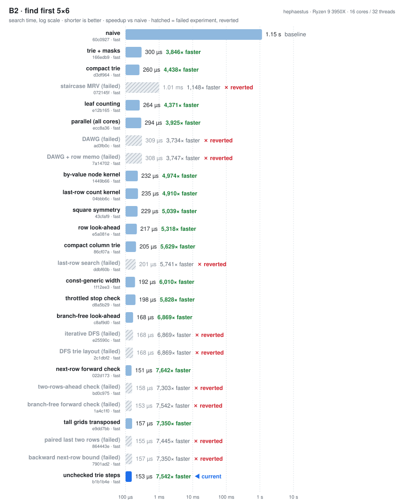
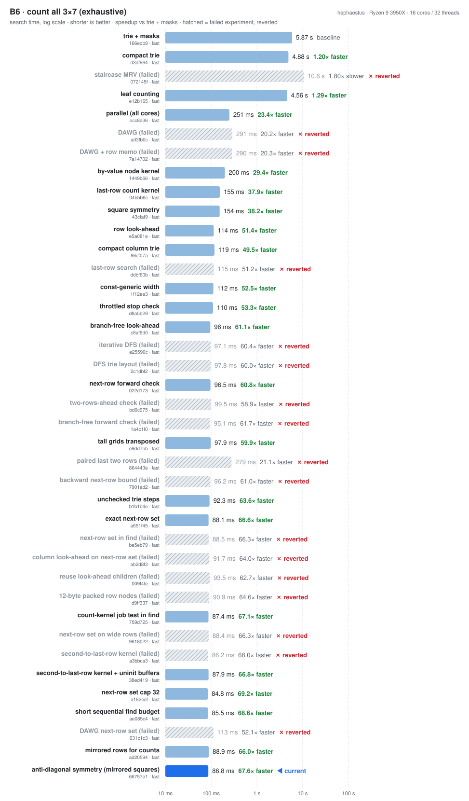
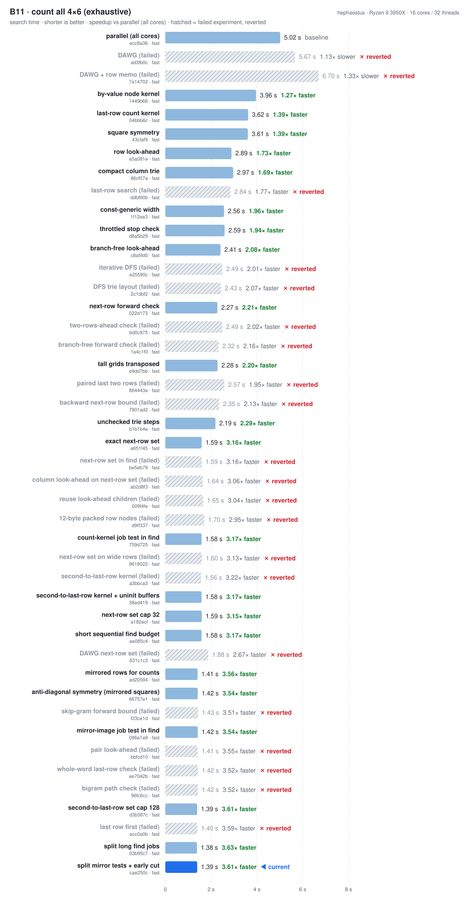
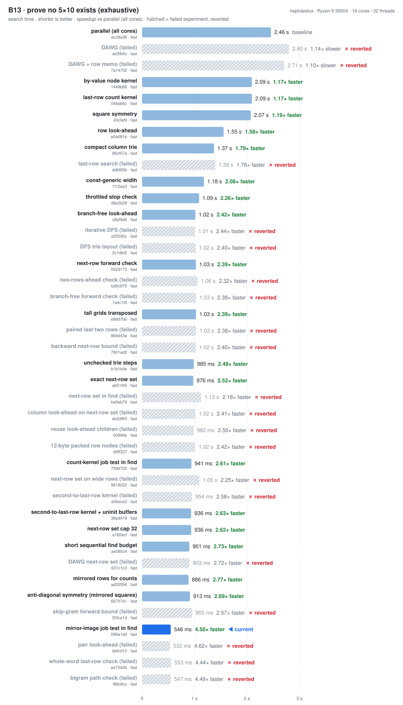
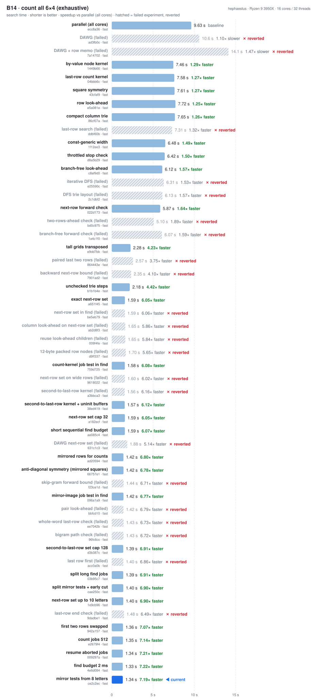

# Benchmark progress

Generated by `scripts/charts.py` from [`bench-log.csv`](bench-log.csv) — do not edit by hand.
Each bar is one optimization step (the latest run of its `--label`). Time = median search time
reported by the binary (dictionary load excluded). Details of each step: [`journal.md`](journal.md).

> ⚠️ *nodes* are not comparable across solvers: naive counts placed row words, trie counts cells.

Status: ✅ kept · ❌ failed experiment, reverted (it never stays in the code) · ⭐ the code in the tree now.
*vs previous* compares with the previous **kept** step, the code each experiment started from.

## B1 · count all 3×3 (exhaustive)

| | Step | Commit | Date | Profile | Time | vs baseline | vs previous | Nodes | Result |
|---|---|---|---|---|---:|---:|---:|---:|---|
| ✅ | naive | `60c0927` | 2026-11-07 | fast | 11.9 s | — | — | 2,034,829 | solutions=1909732 |
| ✅ | trie + masks | `60c0927` | 2026-11-07 | fast | 77.1 ms | 154× | 154× | 4,031,868 | solutions=1909732 |
| ✅ | compact trie | `d3df964` | 2026-11-07 | fast | 73.9 ms | 160× | 1.04× | 4,031,868 | solutions=1909732 |
| ❌ | ~~staircase MRV (failed)~~ | `072145f` | 2026-11-07 | fast | 90.7 ms | 131× | 0.81× | 4,063,089 | solutions=1909732 |
| ✅ | leaf counting | `e12b165` | 2026-11-07 | fast | 31.5 ms | 376× | 2.34× | 2,122,136 | solutions=1909732 |
| ✅ | parallel 22 threads | `ecc8a36` | 2026-11-07 | fast | 7.82 ms | 1,515× | 4.03× | 2,122,136 | solutions=1909732 |
| ❌ | ~~DAWG (failed)~~ | `ad3fb0c` | 2026-11-07 | fast | 6.73 ms | 1,761× | 1.16× | 2,122,136 | solutions=1909732 |
| ❌ | ~~DAWG + row memo (failed)~~ | `7a14702` | 2026-11-07 | fast | 7.15 ms | 1,657× | 1.09× | 2,122,136 | solutions=1909732 |
| ✅ | by-value node kernel | `6da98c6` | 2026-11-07 | fast | 6.37 ms | 1,861× | 1.23× | 2,122,136 | solutions=1909732 |
| ✅ | last-row count kernel | `04bbb6c` | 2026-11-07 | fast | 5.94 ms | 1,996× | 1.07× | 2,122,136 | solutions=1909732 |
| ✅ | square symmetry | `43cfaf9` | 2026-11-07 | fast | 3.54 ms | 3,348× | 1.68× | 1,102,846 | solutions=1909732 |
| ✅ | row look-ahead | `e5a081e` | 2026-11-07 | fast | 3.45 ms | 3,434× | 1.03× | 1,049,457 | solutions=1909732 |
| ✅ | compact column trie | `86cf07a` | 2026-11-07 | fast | 3.47 ms | 3,419× | 1.00× | 1,049,457 | solutions=1909732 |
| ❌ | ~~last-row search (failed)~~ | `ddbf60b` | 2026-11-07 | fast | 3.82 ms | 3,101× | 0.91× | 1,049,457 | solutions=1909732 |
| ✅ | const-generic width | `1f12ee3` | 2026-11-07 | fast | 3.24 ms | 3,656× | 1.07× | 1,049,457 | solutions=1909732 |
| ✅ | throttled stop check | `d8a5b29` | 2026-11-07 | fast | 3.72 ms | 3,185× | 0.87× | 1,049,457 | solutions=1909732 |
| ✅ | branch-free look-ahead | `c8af9d0` | 2026-11-07 | fast | 3.73 ms | 3,182× | 1.00× | 1,001,786 | solutions=1909732 |
| ❌ | ~~iterative DFS (failed)~~ | `e25590c` | 2026-11-07 | fast | 3.23 ms | 3,664× | 1.15× | 1,001,786 | solutions=1909732 |
| ❌ | ~~DFS trie layout (failed)~~ | `2c1dbf2` | 2026-11-07 | fast | 2.93 ms | 4,049× | 1.27× | 1,001,786 | solutions=1909732 |
| ✅ | next-row forward check | `022d173` | 2026-11-07 | fast | 3.13 ms | 3,789× | 1.19× | 994,996 | solutions=1909732 |
| ❌ | ~~two-rows-ahead check (failed)~~ | `bd0c975` | 2026-11-07 | fast | 3.37 ms | 3,517× | 0.93× | 994,996 | solutions=1909732 |
| ❌ | ~~branch-free forward check (failed)~~ | `1a4c1f0` | 2026-11-07 | fast | 3.46 ms | 3,428× | 0.90× | 994,996 | solutions=1909732 |
| ⭐ | **tall grids transposed** | `e9dd7bb` | 2026-11-07 | fast | 3.35 ms | 3,540× | 0.93× | 994,996 | solutions=1909732 |
| ❌ | ~~paired last two rows (failed)~~ | `864443e` | 2026-11-07 | fast | 3.5 ms | 3,389× | 0.96× | 994,996 | solutions=1909732 |
| ❌ | ~~backward next-row bound (failed)~~ | `7901ad2` | 2026-11-07 | fast | 3.12 ms | 3,799× | 1.07× | 994,995 | solutions=1909732 |

## B2 · find first 5×6

| | Step | Commit | Date | Profile | Time | vs baseline | vs previous | Nodes | Result |
|---|---|---|---|---|---:|---:|---:|---:|---|
| ✅ | naive | `60c0927` | 2026-11-07 | fast | 2.34 s | — | — | 1,919 | found |
| ✅ | trie + masks | `60c0927` | 2026-11-07 | fast | 900 µs | 2,600× | 2,600× | 22,841 | found |
| ✅ | compact trie | `d3df964` | 2026-11-07 | fast | 691 µs | 3,386× | 1.30× | 22,841 | found |
| ❌ | ~~staircase MRV (failed)~~ | `072145f` | 2026-11-07 | fast | 2.6 ms | 899× | 0.27× | 67,477 | found |
| ✅ | leaf counting | `e12b165` | 2026-11-07 | fast | 718 µs | 3,259× | 0.96× | 22,841 | found |
| ✅ | parallel 22 threads | `ecc8a36` | 2026-11-07 | fast | 732 µs | 3,197× | 0.98× | 22,841 | found |
| ❌ | ~~DAWG (failed)~~ | `ad3fb0c` | 2026-11-07 | fast | 849 µs | 2,756× | 0.86× | 22,841 | found |
| ❌ | ~~DAWG + row memo (failed)~~ | `7a14702` | 2026-11-07 | fast | 811 µs | 2,885× | 0.90× | 22,841 | found |
| ✅ | by-value node kernel | `6da98c6` | 2026-11-07 | fast | 586 µs | 3,993× | 1.25× | 22,840 | found |
| ✅ | last-row count kernel | `04bbb6c` | 2026-11-07 | fast | 588 µs | 3,979× | 1.00× | 22,840 | found |
| ✅ | square symmetry | `43cfaf9` | 2026-11-07 | fast | 393 µs | 5,954× | 1.50× | 22,840 | found |
| ✅ | row look-ahead | `e5a081e` | 2026-11-07 | fast | 354 µs | 6,610× | 1.11× | 12,444 | found |
| ✅ | compact column trie | `86cf07a` | 2026-11-07 | fast | 510 µs | 4,588× | 0.69× | 12,444 | found |
| ❌ | ~~last-row search (failed)~~ | `ddbf60b` | 2026-11-07 | fast | 552 µs | 4,239× | 0.92× | 12,381 | found |
| ✅ | const-generic width | `1f12ee3` | 2026-11-07 | fast | 492 µs | 4,756× | 1.04× | 12,444 | found |
| ✅ | throttled stop check | `d8a5b29` | 2026-11-07 | fast | 340 µs | 6,882× | 1.45× | 12,444 | found |
| ✅ | branch-free look-ahead | `c8af9d0` | 2026-11-07 | fast | 447 µs | 5,235× | 0.76× | 9,611 | found |
| ❌ | ~~iterative DFS (failed)~~ | `e25590c` | 2026-11-07 | fast | 456 µs | 5,131× | 0.98× | 9,611 | found |
| ❌ | ~~DFS trie layout (failed)~~ | `2c1dbf2` | 2026-11-07 | fast | 438 µs | 5,342× | 1.02× | 9,611 | found |
| ✅ | next-row forward check | `022d173` | 2026-11-07 | fast | 392 µs | 5,969× | 1.14× | 7,220 | found |
| ❌ | ~~two-rows-ahead check (failed)~~ | `bd0c975` | 2026-11-07 | fast | 398 µs | 5,879× | 0.98× | 7,220 | found |
| ❌ | ~~branch-free forward check (failed)~~ | `1a4c1f0` | 2026-11-07 | fast | 404 µs | 5,792× | 0.97× | 7,220 | found |
| ⭐ | **tall grids transposed** | `e9dd7bb` | 2026-11-07 | fast | 390 µs | 6,000× | 1.01× | 7,220 | found |
| ❌ | ~~paired last two rows (failed)~~ | `864443e` | 2026-11-07 | fast | 394 µs | 5,939× | 0.99× | 7,220 | found |
| ❌ | ~~backward next-row bound (failed)~~ | `7901ad2` | 2026-11-07 | fast | 391 µs | 5,984× | 1.00× | 7,220 | found |

## B3 · find first 6×6

| | Step | Commit | Date | Profile | Time | vs baseline | vs previous | Nodes | Result |
|---|---|---|---|---|---:|---:|---:|---:|---|
| ✅ | naive | `60c0927` | 2026-11-07 | fast | 5.65 s | — | — | 4,505 | found |
| ✅ | trie + masks | `60c0927` | 2026-11-07 | fast | 1.91 ms | 2,958× | 2,958× | 49,782 | found |
| ✅ | compact trie | `d3df964` | 2026-11-07 | fast | 1.41 ms | 4,012× | 1.36× | 49,782 | found |
| ❌ | ~~staircase MRV (failed)~~ | `072145f` | 2026-11-07 | fast | 535 µs | 10,566× | 2.63× | 12,263 | found |
| ✅ | leaf counting | `e12b165` | 2026-11-07 | fast | 1.44 ms | 3,917× | 0.98× | 49,782 | found |
| ✅ | parallel 22 threads | `ecc8a36` | 2026-11-07 | fast | 1.51 ms | 3,736× | 0.95× | 49,782 | found |
| ❌ | ~~DAWG (failed)~~ | `ad3fb0c` | 2026-11-07 | fast | 1.65 ms | 3,428× | 0.92× | 49,782 | found |
| ❌ | ~~DAWG + row memo (failed)~~ | `7a14702` | 2026-11-07 | fast | 1.64 ms | 3,449× | 0.92× | 49,782 | found |
| ✅ | by-value node kernel | `6da98c6` | 2026-11-07 | fast | 1.23 ms | 4,599× | 1.23× | 49,781 | found |
| ✅ | last-row count kernel | `04bbb6c` | 2026-11-07 | fast | 1.2 ms | 4,707× | 1.02× | 49,781 | found |
| ✅ | square symmetry | `43cfaf9` | 2026-11-07 | fast | 1.22 ms | 4,641× | 0.99× | 49,781 | found |
| ✅ | row look-ahead | `e5a081e` | 2026-11-07 | fast | 718 µs | 7,873× | 1.70× | 26,012 | found |
| ✅ | compact column trie | `86cf07a` | 2026-11-07 | fast | 977 µs | 5,786× | 0.73× | 26,012 | found |
| ❌ | ~~last-row search (failed)~~ | `ddbf60b` | 2026-11-07 | fast | 967 µs | 5,846× | 1.01× | 26,011 | found |
| ✅ | const-generic width | `1f12ee3` | 2026-11-07 | fast | 896 µs | 6,309× | 1.09× | 26,012 | found |
| ✅ | throttled stop check | `d8a5b29` | 2026-11-07 | fast | 909 µs | 6,219× | 0.99× | 26,012 | found |
| ✅ | branch-free look-ahead | `c8af9d0` | 2026-11-07 | fast | 799 µs | 7,075× | 1.14× | 19,902 | found |
| ❌ | ~~iterative DFS (failed)~~ | `e25590c` | 2026-11-07 | fast | 793 µs | 7,128× | 1.01× | 19,902 | found |
| ❌ | ~~DFS trie layout (failed)~~ | `2c1dbf2` | 2026-11-07 | fast | 538 µs | 10,507× | 1.49× | 19,902 | found |
| ✅ | next-row forward check | `022d173` | 2026-11-07 | fast | 603 µs | 9,374× | 1.33× | 12,839 | found |
| ❌ | ~~two-rows-ahead check (failed)~~ | `bd0c975` | 2026-11-07 | fast | 614 µs | 9,206× | 0.98× | 12,839 | found |
| ❌ | ~~branch-free forward check (failed)~~ | `1a4c1f0` | 2026-11-07 | fast | 601 µs | 9,406× | 1.00× | 12,839 | found |
| ⭐ | **tall grids transposed** | `e9dd7bb` | 2026-11-07 | fast | 593 µs | 9,533× | 1.02× | 12,839 | found |
| ❌ | ~~paired last two rows (failed)~~ | `864443e` | 2026-11-07 | fast | 614 µs | 9,206× | 0.97× | 12,839 | found |
| ❌ | ~~backward next-row bound (failed)~~ | `7901ad2` | 2026-11-07 | fast | 632 µs | 8,944× | 0.94× | 12,839 | found |

## B4 · count all 4×4 (exhaustive)

| | Step | Commit | Date | Profile | Time | vs baseline | vs previous | Nodes | Result |
|---|---|---|---|---|---:|---:|---:|---:|---|
| ✅ | trie + masks | `166edb9` | 2026-11-07 | fast | 37.5 s | — | — | 1,435,800,420 | solutions=136245247 |
| ✅ | compact trie | `d3df964` | 2026-11-07 | fast | 33.7 s | 1.11× | 1.11× | 1,435,800,420 | solutions=136245247 |
| ❌ | ~~staircase MRV (failed)~~ | `072145f` | 2026-11-07 | fast | 37.8 s | 0.99× | 0.89× | 1,232,007,295 | solutions=136245247 |
| ✅ | leaf counting | `e12b165` | 2026-11-07 | fast | 26.8 s | 1.40× | 1.26× | 1,299,555,173 | solutions=136245247 |
| ✅ | parallel 22 threads | `ecc8a36` | 2026-11-07 | fast | 1.48 s | 25.3× | 18.0× | 1,299,555,173 | solutions=136245247 |
| ❌ | ~~DAWG (failed)~~ | `ad3fb0c` | 2026-11-07 | fast | 1.64 s | 22.9× | 0.90× | 1,299,555,173 | solutions=136245247 |
| ❌ | ~~DAWG + row memo (failed)~~ | `7a14702` | 2026-11-07 | fast | 2.46 s | 15.2× | 0.60× | 1,186,892,215 | solutions=136245247 |
| ✅ | by-value node kernel | `6da98c6` | 2026-11-07 | fast | 1.12 s | 33.6× | 1.33× | 1,299,555,173 | solutions=136245247 |
| ✅ | last-row count kernel | `04bbb6c` | 2026-11-07 | fast | 923 ms | 40.7× | 1.21× | 1,299,555,173 | solutions=136245247 |
| ✅ | square symmetry | `43cfaf9` | 2026-11-07 | fast | 471 ms | 79.6× | 1.96× | 660,528,401 | solutions=136245247 |
| ✅ | row look-ahead | `e5a081e` | 2026-11-07 | fast | 520 ms | 72.2× | 0.91× | 559,509,989 | solutions=136245247 |
| ✅ | compact column trie | `86cf07a` | 2026-11-07 | fast | 508 ms | 73.9× | 1.02× | 559,509,989 | solutions=136245247 |
| ❌ | ~~last-row search (failed)~~ | `ddbf60b` | 2026-11-07 | fast | 525 ms | 71.5× | 0.97× | 559,509,989 | solutions=136245247 |
| ✅ | const-generic width | `1f12ee3` | 2026-11-07 | fast | 486 ms | 77.3× | 1.05× | 559,509,989 | solutions=136245247 |
| ✅ | throttled stop check | `d8a5b29` | 2026-11-07 | fast | 488 ms | 76.9× | 1.00× | 559,509,989 | solutions=136245247 |
| ✅ | branch-free look-ahead | `c8af9d0` | 2026-11-07 | fast | 454 ms | 82.6× | 1.07× | 434,317,924 | solutions=136245247 |
| ❌ | ~~iterative DFS (failed)~~ | `e25590c` | 2026-11-07 | fast | 479 ms | 78.3× | 0.95× | 434,317,924 | solutions=136245247 |
| ❌ | ~~DFS trie layout (failed)~~ | `2c1dbf2` | 2026-11-07 | fast | 480 ms | 78.1× | 0.95× | 434,317,924 | solutions=136245247 |
| ✅ | next-row forward check | `022d173` | 2026-11-07 | fast | 452 ms | 83.0× | 1.00× | 397,315,658 | solutions=136245247 |
| ❌ | ~~two-rows-ahead check (failed)~~ | `bd0c975` | 2026-11-07 | fast | 443 ms | 84.7× | 1.02× | 397,275,206 | solutions=136245247 |
| ❌ | ~~branch-free forward check (failed)~~ | `1a4c1f0` | 2026-11-07 | fast | 434 ms | 86.6× | 1.04× | 397,315,658 | solutions=136245247 |
| ⭐ | **tall grids transposed** | `e9dd7bb` | 2026-11-07 | fast | 437 ms | 85.8× | 1.03× | 397,315,658 | solutions=136245247 |
| ❌ | ~~paired last two rows (failed)~~ | `864443e` | 2026-11-07 | fast | 426 ms | 88.1× | 1.03× | 221,286,896 | solutions=136245247 |
| ❌ | ~~backward next-row bound (failed)~~ | `7901ad2` | 2026-11-07 | fast | 437 ms | 85.8× | 1.00× | 396,848,007 | solutions=136245247 |

## B5 · count all 4×5 (exhaustive)

| | Step | Commit | Date | Profile | Time | vs baseline | vs previous | Nodes | Result |
|---|---|---|---|---|---:|---:|---:|---:|---|
| ✅ | trie + masks | `166edb9` | 2026-11-07 | fast | 153 s | — | — | 5,169,522,478 | solutions=114846713 |
| ✅ | compact trie | `d3df964` | 2026-11-07 | fast | 130 s | 1.18× | 1.18× | 5,169,522,478 | solutions=114846713 |
| ❌ | ~~staircase MRV (failed)~~ | `072145f` | 2026-11-07 | fast | 189 s | 0.81× | 0.69× | 5,745,769,138 | solutions=114846713 |
| ✅ | leaf counting | `e12b165` | 2026-11-07 | fast | 120 s | 1.27× | 1.08× | 5,054,675,765 | solutions=114846713 |
| ✅ | parallel 22 threads | `ecc8a36` | 2026-11-07 | fast | 6.43 s | 23.8× | 18.7× | 5,054,675,765 | solutions=114846713 |
| ❌ | ~~DAWG (failed)~~ | `ad3fb0c` | 2026-11-07 | fast | 6.89 s | 22.2× | 0.93× | 5,054,675,765 | solutions=114846713 |
| ❌ | ~~DAWG + row memo (failed)~~ | `7a14702` | 2026-11-07 | fast | 8.44 s | 18.1× | 0.76× | 5,005,168,405 | solutions=114846713 |
| ✅ | by-value node kernel | `6da98c6` | 2026-11-07 | fast | 4.84 s | 31.6× | 1.33× | 5,054,675,765 | solutions=114846713 |
| ✅ | last-row count kernel | `04bbb6c` | 2026-11-07 | fast | 4.30 s | 35.6× | 1.13× | 5,054,675,765 | solutions=114846713 |
| ✅ | square symmetry | `43cfaf9` | 2026-11-07 | fast | 4.32 s | 35.4× | 0.99× | 5,054,675,765 | solutions=114846713 |
| ✅ | row look-ahead | `e5a081e` | 2026-11-07 | fast | 4.21 s | 36.3× | 1.03× | 3,364,600,156 | solutions=114846713 |
| ✅ | compact column trie | `86cf07a` | 2026-11-07 | fast | 4.14 s | 37.0× | 1.02× | 3,364,600,156 | solutions=114846713 |
| ❌ | ~~last-row search (failed)~~ | `ddbf60b` | 2026-11-07 | fast | 4.17 s | 36.7× | 0.99× | 3,364,600,156 | solutions=114846713 |
| ✅ | const-generic width | `1f12ee3` | 2026-11-07 | fast | 3.89 s | 39.4× | 1.06× | 3,364,600,156 | solutions=114846713 |
| ✅ | throttled stop check | `d8a5b29` | 2026-11-07 | fast | 3.89 s | 39.4× | 1.00× | 3,364,600,156 | solutions=114846713 |
| ✅ | branch-free look-ahead | `c8af9d0` | 2026-11-07 | fast | 3.51 s | 43.7× | 1.11× | 2,436,976,174 | solutions=114846713 |
| ❌ | ~~iterative DFS (failed)~~ | `e25590c` | 2026-11-07 | fast | 3.64 s | 42.0× | 0.96× | 2,436,976,174 | solutions=114846713 |
| ❌ | ~~DFS trie layout (failed)~~ | `2c1dbf2` | 2026-11-07 | fast | 3.63 s | 42.1× | 0.97× | 2,436,976,174 | solutions=114846713 |
| ✅ | next-row forward check | `022d173` | 2026-11-07 | fast | 3.36 s | 45.5× | 1.04× | 2,142,627,416 | solutions=114846713 |
| ❌ | ~~two-rows-ahead check (failed)~~ | `bd0c975` | 2026-11-07 | fast | 3.40 s | 45.0× | 0.99× | 2,142,095,698 | solutions=114846713 |
| ❌ | ~~branch-free forward check (failed)~~ | `1a4c1f0` | 2026-11-07 | fast | 3.25 s | 47.0× | 1.03× | 2,142,627,416 | solutions=114846713 |
| ⭐ | **tall grids transposed** | `e9dd7bb` | 2026-11-07 | fast | 3.26 s | 47.0× | 1.03× | 2,142,627,416 | solutions=114846713 |
| ❌ | ~~paired last two rows (failed)~~ | `864443e` | 2026-11-07 | fast | 3.51 s | 43.6× | 0.93× | 946,918,563 | solutions=114846713 |
| ❌ | ~~backward next-row bound (failed)~~ | `7901ad2` | 2026-11-07 | fast | 3.30 s | 46.4× | 0.99× | 2,139,564,798 | solutions=114846713 |

## B6 · count all 3×7 (exhaustive)

| | Step | Commit | Date | Profile | Time | vs baseline | vs previous | Nodes | Result |
|---|---|---|---|---|---:|---:|---:|---:|---|
| ✅ | trie + masks | `166edb9` | 2026-11-07 | fast | 16.3 s | — | — | 489,739,310 | solutions=4453472 |
| ✅ | compact trie | `d3df964` | 2026-11-07 | fast | 12.7 s | 1.29× | 1.29× | 489,739,310 | solutions=4453472 |
| ❌ | ~~staircase MRV (failed)~~ | `072145f` | 2026-11-07 | fast | 25.8 s | 0.63× | 0.49× | 799,291,031 | solutions=4453472 |
| ✅ | leaf counting | `e12b165` | 2026-11-07 | fast | 12.1 s | 1.34× | 1.04× | 485,285,838 | solutions=4453472 |
| ✅ | parallel 22 threads | `ecc8a36` | 2026-11-07 | fast | 628 ms | 26.0× | 19.3× | 485,285,838 | solutions=4453472 |
| ❌ | ~~DAWG (failed)~~ | `ad3fb0c` | 2026-11-07 | fast | 735 ms | 22.2× | 0.85× | 485,285,838 | solutions=4453472 |
| ❌ | ~~DAWG + row memo (failed)~~ | `7a14702` | 2026-11-07 | fast | 721 ms | 22.6× | 0.87× | 485,285,838 | solutions=4453472 |
| ✅ | by-value node kernel | `6da98c6` | 2026-11-07 | fast | 484 ms | 33.7× | 1.30× | 485,285,838 | solutions=4453472 |
| ✅ | last-row count kernel | `04bbb6c` | 2026-11-07 | fast | 397 ms | 41.1× | 1.22× | 485,285,838 | solutions=4453472 |
| ✅ | square symmetry | `43cfaf9` | 2026-11-07 | fast | 398 ms | 41.0× | 1.00× | 485,285,838 | solutions=4453472 |
| ✅ | row look-ahead | `e5a081e` | 2026-11-07 | fast | 343 ms | 47.6× | 1.16× | 182,615,542 | solutions=4453472 |
| ✅ | compact column trie | `86cf07a` | 2026-11-07 | fast | 335 ms | 48.7× | 1.02× | 182,615,542 | solutions=4453472 |
| ❌ | ~~last-row search (failed)~~ | `ddbf60b` | 2026-11-07 | fast | 340 ms | 48.0× | 0.98× | 182,615,542 | solutions=4453472 |
| ✅ | const-generic width | `1f12ee3` | 2026-11-07 | fast | 326 ms | 50.0× | 1.03× | 182,615,542 | solutions=4453472 |
| ✅ | throttled stop check | `d8a5b29` | 2026-11-07 | fast | 324 ms | 50.4× | 1.01× | 182,615,542 | solutions=4453472 |
| ✅ | branch-free look-ahead | `c8af9d0` | 2026-11-07 | fast | 254 ms | 64.1× | 1.27× | 136,298,665 | solutions=4453472 |
| ❌ | ~~iterative DFS (failed)~~ | `e25590c` | 2026-11-07 | fast | 259 ms | 62.9× | 0.98× | 136,298,665 | solutions=4453472 |
| ❌ | ~~DFS trie layout (failed)~~ | `2c1dbf2` | 2026-11-07 | fast | 268 ms | 60.9× | 0.95× | 136,298,665 | solutions=4453472 |
| ✅ | next-row forward check | `022d173` | 2026-11-07 | fast | 250 ms | 65.1× | 1.02× | 132,592,160 | solutions=4453472 |
| ❌ | ~~two-rows-ahead check (failed)~~ | `bd0c975` | 2026-11-07 | fast | 259 ms | 62.9× | 0.97× | 132,592,160 | solutions=4453472 |
| ❌ | ~~branch-free forward check (failed)~~ | `1a4c1f0` | 2026-11-07 | fast | 258 ms | 63.2× | 0.97× | 132,592,160 | solutions=4453472 |
| ⭐ | **tall grids transposed** | `e9dd7bb` | 2026-11-07 | fast | 247 ms | 66.0× | 1.01× | 132,592,160 | solutions=4453472 |
| ❌ | ~~paired last two rows (failed)~~ | `864443e` | 2026-11-07 | fast | 732 ms | 22.3× | 0.34× | 238,449,733 | solutions=4453472 |
| ❌ | ~~backward next-row bound (failed)~~ | `7901ad2` | 2026-11-07 | fast | 260 ms | 62.8× | 0.95× | 132,590,961 | solutions=4453472 |

## B7 · find first 7×7

| | Step | Commit | Date | Profile | Time | vs baseline | vs previous | Nodes | Result |
|---|---|---|---|---|---:|---:|---:|---:|---|
| ✅ | trie + masks | `166edb9` | 2026-11-07 | fast | 5.02 s | — | — | 141,510,783 | found |
| ✅ | compact trie | `d3df964` | 2026-11-07 | fast | 3.96 s | 1.27× | 1.27× | 141,510,783 | found |
| ❌ | ~~staircase MRV (failed)~~ | `072145f` | 2026-11-07 | fast | 7.89 s | 0.64× | 0.50× | 214,037,348 | found |
| ✅ | leaf counting | `e12b165` | 2026-11-07 | fast | 4.10 s | 1.23× | 0.97× | 141,510,783 | found |
| ✅ | parallel 22 threads | `ecc8a36` | 2026-11-07 | fast | 698 ms | 7.20× | 5.87× | 157,038,815 | found |
| ❌ | ~~DAWG (failed)~~ | `ad3fb0c` | 2026-11-07 | fast | 608 ms | 8.27× | 1.15× | 157,586,299 | found |
| ❌ | ~~DAWG + row memo (failed)~~ | `7a14702` | 2026-11-07 | fast | 695 ms | 7.23× | 1.00× | 157,530,723 | found |
| ✅ | by-value node kernel | `6da98c6` | 2026-11-07 | fast | 462 ms | 10.9× | 1.51× | 159,127,185 | found |
| ✅ | last-row count kernel | `04bbb6c` | 2026-11-07 | fast | 477 ms | 10.5× | 0.97× | 158,604,931 | found |
| ✅ | square symmetry | `43cfaf9` | 2026-11-07 | fast | 608 ms | 8.27× | 0.79× | 159,148,928 | found |
| ✅ | row look-ahead | `e5a081e` | 2026-11-07 | fast | 439 ms | 11.4× | 1.38× | 55,119,689 | found |
| ✅ | compact column trie | `86cf07a` | 2026-11-07 | fast | 413 ms | 12.2× | 1.06× | 56,870,056 | found |
| ❌ | ~~last-row search (failed)~~ | `ddbf60b` | 2026-11-07 | fast | 408 ms | 12.3× | 1.01× | 55,190,603 | found |
| ✅ | const-generic width | `1f12ee3` | 2026-11-07 | fast | 370 ms | 13.6× | 1.12× | 54,535,752 | found |
| ✅ | throttled stop check | `d8a5b29` | 2026-11-07 | fast | 313 ms | 16.0× | 1.18× | 55,604,492 | found |
| ✅ | branch-free look-ahead | `c8af9d0` | 2026-11-07 | fast | 291 ms | 17.3× | 1.08× | 43,868,432 | found |
| ❌ | ~~iterative DFS (failed)~~ | `e25590c` | 2026-11-07 | fast | 327 ms | 15.4× | 0.89× | 44,224,599 | found |
| ❌ | ~~DFS trie layout (failed)~~ | `2c1dbf2` | 2026-11-07 | fast | 264 ms | 19.0× | 1.10× | 43,428,196 | found |
| ✅ | next-row forward check | `022d173` | 2026-11-07 | fast | 286 ms | 17.6× | 1.02× | 35,683,279 | found |
| ❌ | ~~two-rows-ahead check (failed)~~ | `bd0c975` | 2026-11-07 | fast | 294 ms | 17.1× | 0.97× | 35,657,392 | found |
| ❌ | ~~branch-free forward check (failed)~~ | `1a4c1f0` | 2026-11-07 | fast | 432 ms | 11.6× | 0.66× | 36,737,933 | found |
| ⭐ | **tall grids transposed** | `e9dd7bb` | 2026-11-07 | fast | 300 ms | 16.8× | 0.95× | 35,926,381 | found |
| ❌ | ~~paired last two rows (failed)~~ | `864443e` | 2026-11-07 | fast | 282 ms | 17.8× | 1.06× | 34,977,454 | found |
| ❌ | ~~backward next-row bound (failed)~~ | `7901ad2` | 2026-11-07 | fast | 396 ms | 12.7× | 0.76× | 35,869,980 | found |

## B8 · find first 6×7

| | Step | Commit | Date | Profile | Time | vs baseline | vs previous | Nodes | Result |
|---|---|---|---|---|---:|---:|---:|---:|---|
| ✅ | trie + masks | `166edb9` | 2026-11-07 | fast | 4.04 s | — | — | 117,670,090 | found |
| ✅ | compact trie | `d3df964` | 2026-11-07 | fast | 3.27 s | 1.24× | 1.24× | 117,670,090 | found |
| ❌ | ~~staircase MRV (failed)~~ | `072145f` | 2026-11-07 | fast | 6.36 s | 0.63× | 0.51× | 173,754,350 | found |
| ✅ | leaf counting | `e12b165` | 2026-11-07 | fast | 3.39 s | 1.19× | 0.96× | 117,670,090 | found |
| ✅ | parallel 22 threads | `ecc8a36` | 2026-11-07 | fast | 626 ms | 6.45× | 5.42× | 120,820,550 | found |
| ❌ | ~~DAWG (failed)~~ | `ad3fb0c` | 2026-11-07 | fast | 594 ms | 6.80× | 1.05× | 120,691,906 | found |
| ❌ | ~~DAWG + row memo (failed)~~ | `7a14702` | 2026-11-07 | fast | 637 ms | 6.33× | 0.98× | 121,022,023 | found |
| ✅ | by-value node kernel | `6da98c6` | 2026-11-07 | fast | 394 ms | 10.2× | 1.59× | 120,902,270 | found |
| ✅ | last-row count kernel | `04bbb6c` | 2026-11-07 | fast | 564 ms | 7.16× | 0.70× | 120,838,089 | found |
| ✅ | square symmetry | `43cfaf9` | 2026-11-07 | fast | 552 ms | 7.31× | 1.02× | 120,887,650 | found |
| ✅ | row look-ahead | `e5a081e` | 2026-11-07 | fast | 413 ms | 9.77× | 1.34× | 46,110,613 | found |
| ✅ | compact column trie | `86cf07a` | 2026-11-07 | fast | 354 ms | 11.4× | 1.17× | 45,624,156 | found |
| ❌ | ~~last-row search (failed)~~ | `ddbf60b` | 2026-11-07 | fast | 467 ms | 8.65× | 0.76× | 45,614,993 | found |
| ✅ | const-generic width | `1f12ee3` | 2026-11-07 | fast | 282 ms | 14.3× | 1.26× | 45,679,334 | found |
| ✅ | throttled stop check | `d8a5b29` | 2026-11-07 | fast | 294 ms | 13.7× | 0.96× | 46,420,838 | found |
| ✅ | branch-free look-ahead | `c8af9d0` | 2026-11-07 | fast | 273 ms | 14.8× | 1.08× | 36,415,982 | found |
| ❌ | ~~iterative DFS (failed)~~ | `e25590c` | 2026-11-07 | fast | 467 ms | 8.64× | 0.58× | 36,301,319 | found |
| ❌ | ~~DFS trie layout (failed)~~ | `2c1dbf2` | 2026-11-07 | fast | 234 ms | 17.2× | 1.17× | 36,483,160 | found |
| ✅ | next-row forward check | `022d173` | 2026-11-07 | fast | 256 ms | 15.8× | 1.07× | 31,520,070 | found |
| ❌ | ~~two-rows-ahead check (failed)~~ | `bd0c975` | 2026-11-07 | fast | 394 ms | 10.2× | 0.65× | 31,084,090 | found |
| ❌ | ~~branch-free forward check (failed)~~ | `1a4c1f0` | 2026-11-07 | fast | 408 ms | 9.88× | 0.63× | 31,333,531 | found |
| ⭐ | **tall grids transposed** | `e9dd7bb` | 2026-11-07 | fast | 231 ms | 17.5× | 1.11× | 31,362,556 | found |
| ❌ | ~~paired last two rows (failed)~~ | `864443e` | 2026-11-07 | fast | 234 ms | 17.2× | 0.98× | 31,620,121 | found |
| ❌ | ~~backward next-row bound (failed)~~ | `7901ad2` | 2026-11-07 | fast | 305 ms | 13.2× | 0.76× | 31,315,893 | found |

## B9 · find first 5×9

| | Step | Commit | Date | Profile | Time | vs baseline | vs previous | Nodes | Result |
|---|---|---|---|---|---:|---:|---:|---:|---|
| ✅ | trie + masks | `166edb9` | 2026-11-07 | fast | 23.8 s | — | — | 604,041,773 | found |
| ✅ | compact trie | `d3df964` | 2026-11-07 | fast | 17.8 s | 1.34× | 1.34× | 604,041,773 | found |
| ❌ | ~~staircase MRV (failed)~~ | `072145f` | 2026-11-07 | fast | 62.8 s | 0.38× | 0.28× | 1,819,147,498 | found |
| ✅ | leaf counting | `e12b165` | 2026-11-07 | fast | 18.0 s | 1.32× | 0.98× | 604,041,773 | found |
| ✅ | parallel 22 threads | `ecc8a36` | 2026-11-07 | fast | 1.06 s | 22.4× | 17.0× | 610,338,537 | found |
| ❌ | ~~DAWG (failed)~~ | `ad3fb0c` | 2026-11-07 | fast | 1.14 s | 20.9× | 0.93× | 608,074,075 | found |
| ❌ | ~~DAWG + row memo (failed)~~ | `7a14702` | 2026-11-07 | fast | 1.14 s | 20.9× | 0.93× | 608,125,901 | found |
| ✅ | by-value node kernel | `6da98c6` | 2026-11-07 | fast | 863 ms | 27.6× | 1.23× | 608,264,071 | found |
| ✅ | last-row count kernel | `04bbb6c` | 2026-11-07 | fast | 906 ms | 26.3× | 0.95× | 607,918,285 | found |
| ✅ | square symmetry | `43cfaf9` | 2026-11-07 | fast | 875 ms | 27.2× | 1.04× | 608,152,499 | found |
| ✅ | row look-ahead | `e5a081e` | 2026-11-07 | fast | 748 ms | 31.8× | 1.17× | 237,520,689 | found |
| ✅ | compact column trie | `86cf07a` | 2026-11-07 | fast | 691 ms | 34.5× | 1.08× | 237,653,498 | found |
| ❌ | ~~last-row search (failed)~~ | `ddbf60b` | 2026-11-07 | fast | 709 ms | 33.6× | 0.97× | 237,573,187 | found |
| ✅ | const-generic width | `1f12ee3` | 2026-11-07 | fast | 608 ms | 39.1× | 1.14× | 238,417,829 | found |
| ✅ | throttled stop check | `d8a5b29` | 2026-11-07 | fast | 606 ms | 39.3× | 1.00× | 239,671,344 | found |
| ✅ | branch-free look-ahead | `c8af9d0` | 2026-11-07 | fast | 506 ms | 47.0× | 1.20× | 186,928,429 | found |
| ❌ | ~~iterative DFS (failed)~~ | `e25590c` | 2026-11-07 | fast | 499 ms | 47.7× | 1.01× | 187,060,045 | found |
| ❌ | ~~DFS trie layout (failed)~~ | `2c1dbf2` | 2026-11-07 | fast | 501 ms | 47.5× | 1.01× | 187,015,999 | found |
| ✅ | next-row forward check | `022d173` | 2026-11-07 | fast | 517 ms | 46.0× | 0.98× | 157,551,855 | found |
| ❌ | ~~two-rows-ahead check (failed)~~ | `bd0c975` | 2026-11-07 | fast | 549 ms | 43.4× | 0.94× | 157,549,514 | found |
| ❌ | ~~branch-free forward check (failed)~~ | `1a4c1f0` | 2026-11-07 | fast | 538 ms | 44.2× | 0.96× | 157,538,338 | found |
| ⭐ | **tall grids transposed** | `e9dd7bb` | 2026-11-07 | fast | 534 ms | 44.6× | 0.97× | 157,771,656 | found |
| ❌ | ~~paired last two rows (failed)~~ | `864443e` | 2026-11-07 | fast | 506 ms | 47.0× | 1.06× | 157,785,037 | found |
| ❌ | ~~backward next-row bound (failed)~~ | `7901ad2` | 2026-11-07 | fast | 531 ms | 44.8× | 1.00× | 157,552,124 | found |

## B10 · count all 5×5 (exhaustive)

| | Step | Commit | Date | Profile | Time | vs baseline | vs previous | Nodes | Result |
|---|---|---|---|---|---:|---:|---:|---:|---|
| ✅ | by-value node kernel | `1449b66` | 2026-11-07 | fast | 30.6 s | — | — | 30,730,973,507 | solutions=80364530 |
| ✅ | last-row count kernel | `04bbb6c` | 2026-11-07 | fast | 30.9 s | 0.99× | 0.99× | 30,730,973,507 | solutions=80364530 |
| ✅ | square symmetry | `43cfaf9` | 2026-11-07 | fast | 15.9 s | 1.92× | 1.94× | 15,549,963,977 | solutions=80364530 |
| ✅ | row look-ahead | `e5a081e` | 2026-11-07 | fast | 14.4 s | 2.12× | 1.11× | 9,533,780,804 | solutions=80364530 |
| ✅ | compact column trie | `86cf07a` | 2026-11-07 | fast | 13.8 s | 2.21× | 1.04× | 9,533,780,804 | solutions=80364530 |
| ❌ | ~~last-row search (failed)~~ | `ddbf60b` | 2026-11-07 | fast | 13.8 s | 2.23× | 1.01× | 9,533,780,804 | solutions=80364530 |
| ✅ | const-generic width | `1f12ee3` | 2026-11-07 | fast | 12.5 s | 2.45× | 1.11× | 9,533,780,804 | solutions=80364530 |
| ✅ | throttled stop check | `d8a5b29` | 2026-11-07 | fast | 12.6 s | 2.43× | 0.99× | 9,533,780,804 | solutions=80364530 |
| ✅ | branch-free look-ahead | `c8af9d0` | 2026-11-07 | fast | 11.4 s | 2.68× | 1.10× | 6,875,817,435 | solutions=80364530 |
| ❌ | ~~iterative DFS (failed)~~ | `e25590c` | 2026-11-07 | fast | 13.0 s | 2.36× | 0.88× | 6,875,817,435 | solutions=80364530 |
| ❌ | ~~DFS trie layout (failed)~~ | `2c1dbf2` | 2026-11-07 | fast | 12.1 s | 2.54× | 0.95× | 6,875,817,435 | solutions=80364530 |
| ✅ | next-row forward check | `022d173` | 2026-11-07 | fast | 10.4 s | 2.93× | 1.09× | 5,393,001,298 | solutions=80364530 |
| ❌ | ~~two-rows-ahead check (failed)~~ | `bd0c975` | 2026-11-07 | fast | 10.8 s | 2.83× | 0.97× | 5,151,710,138 | solutions=80364530 |
| ❌ | ~~branch-free forward check (failed)~~ | `1a4c1f0` | 2026-11-07 | fast | 10.3 s | 2.97× | 1.01× | 5,393,001,298 | solutions=80364530 |
| ⭐ | **tall grids transposed** | `e9dd7bb` | 2026-11-07 | fast | 10.3 s | 2.97× | 1.01× | 5,393,001,298 | solutions=80364530 |
| ❌ | ~~paired last two rows (failed)~~ | `864443e` | 2026-11-07 | fast | 12.7 s | 2.40× | 0.81× | 4,069,141,452 | solutions=80364530 |
| ❌ | ~~backward next-row bound (failed)~~ | `7901ad2` | 2026-11-07 | fast | 11.7 s | 2.61× | 0.88× | 5,039,898,387 | solutions=80364530 |

## B11 · count all 4×6 (exhaustive)

| | Step | Commit | Date | Profile | Time | vs baseline | vs previous | Nodes | Result |
|---|---|---|---|---|---:|---:|---:|---:|---|
| ✅ | by-value node kernel | `1449b66` | 2026-11-07 | fast | 9.50 s | — | — | 9,588,114,365 | solutions=37812638 |
| ✅ | last-row count kernel | `04bbb6c` | 2026-11-07 | fast | 8.96 s | 1.06× | 1.06× | 9,588,114,365 | solutions=37812638 |
| ✅ | square symmetry | `43cfaf9` | 2026-11-07 | fast | 9.12 s | 1.04× | 0.98× | 9,588,114,365 | solutions=37812638 |
| ✅ | row look-ahead | `e5a081e` | 2026-11-07 | fast | 7.64 s | 1.24× | 1.19× | 4,952,123,756 | solutions=37812638 |
| ✅ | compact column trie | `86cf07a` | 2026-11-07 | fast | 7.43 s | 1.28× | 1.03× | 4,952,123,756 | solutions=37812638 |
| ❌ | ~~last-row search (failed)~~ | `ddbf60b` | 2026-11-07 | fast | 7.44 s | 1.28× | 1.00× | 4,952,123,756 | solutions=37812638 |
| ✅ | const-generic width | `1f12ee3` | 2026-11-07 | fast | 7.01 s | 1.35× | 1.06× | 4,952,123,756 | solutions=37812638 |
| ✅ | throttled stop check | `d8a5b29` | 2026-11-07 | fast | 6.94 s | 1.37× | 1.01× | 4,952,123,756 | solutions=37812638 |
| ✅ | branch-free look-ahead | `c8af9d0` | 2026-11-07 | fast | 6.21 s | 1.53× | 1.12× | 3,714,990,647 | solutions=37812638 |
| ❌ | ~~iterative DFS (failed)~~ | `e25590c` | 2026-11-07 | fast | 6.45 s | 1.47× | 0.96× | 3,714,990,647 | solutions=37812638 |
| ❌ | ~~DFS trie layout (failed)~~ | `2c1dbf2` | 2026-11-07 | fast | 6.59 s | 1.44× | 0.94× | 3,714,990,647 | solutions=37812638 |
| ✅ | next-row forward check | `022d173` | 2026-11-07 | fast | 5.81 s | 1.63× | 1.07× | 3,243,793,909 | solutions=37812638 |
| ❌ | ~~two-rows-ahead check (failed)~~ | `bd0c975` | 2026-11-07 | fast | 5.93 s | 1.60× | 0.98× | 3,242,807,579 | solutions=37812638 |
| ❌ | ~~branch-free forward check (failed)~~ | `1a4c1f0` | 2026-11-07 | fast | 5.85 s | 1.62× | 0.99× | 3,243,793,909 | solutions=37812638 |
| ⭐ | **tall grids transposed** | `e9dd7bb` | 2026-11-07 | fast | 5.69 s | 1.67× | 1.02× | 3,243,793,909 | solutions=37812638 |
| ❌ | ~~paired last two rows (failed)~~ | `864443e` | 2026-11-07 | fast | 6.96 s | 1.36× | 0.82× | 1,629,669,482 | solutions=37812638 |
| ❌ | ~~backward next-row bound (failed)~~ | `7901ad2` | 2026-11-07 | fast | 5.88 s | 1.62× | 0.97× | 3,239,551,826 | solutions=37812638 |

## B12 · find first 6×8

| | Step | Commit | Date | Profile | Time | vs baseline | vs previous | Nodes | Result |
|---|---|---|---|---|---:|---:|---:|---:|---|
| ✅ | by-value node kernel | `1449b66` | 2026-11-07 | fast | 5.10 s | — | — | 4,132,728,056 | found |
| ✅ | last-row count kernel | `04bbb6c` | 2026-11-07 | fast | 5.25 s | 0.97× | 0.97× | 4,132,932,128 | found |
| ✅ | square symmetry | `43cfaf9` | 2026-11-07 | fast | 5.24 s | 0.97× | 1.00× | 4,132,541,447 | found |
| ✅ | row look-ahead | `e5a081e` | 2026-11-07 | fast | 3.87 s | 1.32× | 1.35× | 1,514,385,525 | found |
| ✅ | compact column trie | `86cf07a` | 2026-11-07 | fast | 3.74 s | 1.36× | 1.04× | 1,514,358,809 | found |
| ❌ | ~~last-row search (failed)~~ | `ddbf60b` | 2026-11-07 | fast | 3.73 s | 1.37× | 1.00× | 1,514,240,914 | found |
| ✅ | const-generic width | `1f12ee3` | 2026-11-07 | fast | 3.41 s | 1.50× | 1.10× | 1,514,323,680 | found |
| ✅ | throttled stop check | `d8a5b29` | 2026-11-07 | fast | 3.18 s | 1.60× | 1.07× | 1,514,229,284 | found |
| ✅ | branch-free look-ahead | `c8af9d0` | 2026-11-07 | fast | 2.51 s | 2.03× | 1.27× | 1,160,859,256 | found |
| ❌ | ~~iterative DFS (failed)~~ | `e25590c` | 2026-11-07 | fast | 2.52 s | 2.03× | 1.00× | 1,160,948,957 | found |
| ❌ | ~~DFS trie layout (failed)~~ | `2c1dbf2` | 2026-11-07 | fast | 2.58 s | 1.98× | 0.97× | 1,160,896,403 | found |
| ✅ | next-row forward check | `022d173` | 2026-11-07 | fast | 2.49 s | 2.05× | 1.01× | 1,009,874,380 | found |
| ❌ | ~~two-rows-ahead check (failed)~~ | `bd0c975` | 2026-11-07 | fast | 2.56 s | 1.99× | 0.97× | 1,009,822,614 | found |
| ❌ | ~~branch-free forward check (failed)~~ | `1a4c1f0` | 2026-11-07 | fast | 2.47 s | 2.07× | 1.01× | 1,009,905,272 | found |
| ⭐ | **tall grids transposed** | `e9dd7bb` | 2026-11-07 | fast | 2.43 s | 2.10× | 1.02× | 1,009,922,905 | found |
| ❌ | ~~paired last two rows (failed)~~ | `864443e` | 2026-11-07 | fast | 2.43 s | 2.10× | 1.00× | 1,009,948,684 | found |
| ❌ | ~~backward next-row bound (failed)~~ | `7901ad2` | 2026-11-07 | fast | 2.60 s | 1.96× | 0.94× | 1,009,858,645 | found |

## B13 · prove no 5×10 exists (exhaustive)

| | Step | Commit | Date | Profile | Time | vs baseline | vs previous | Nodes | Result |
|---|---|---|---|---|---:|---:|---:|---:|---|
| ✅ | by-value node kernel | `1449b66` | 2026-11-07 | fast | 4.94 s | — | — | 3,802,792,308 | no solution: 5x10 exhausted |
| ✅ | last-row count kernel | `04bbb6c` | 2026-11-07 | fast | 4.89 s | 1.01× | 1.01× | 3,802,792,308 | no solution: 5x10 exhausted |
| ✅ | square symmetry | `43cfaf9` | 2026-11-07 | fast | 5.04 s | 0.98× | 0.97× | 3,802,792,308 | no solution: 5x10 exhausted |
| ✅ | row look-ahead | `e5a081e` | 2026-11-07 | fast | 3.68 s | 1.34× | 1.37× | 1,432,485,110 | no solution: 5x10 exhausted |
| ✅ | compact column trie | `86cf07a` | 2026-11-07 | fast | 3.53 s | 1.40× | 1.04× | 1,432,485,110 | no solution: 5x10 exhausted |
| ❌ | ~~last-row search (failed)~~ | `ddbf60b` | 2026-11-07 | fast | 3.61 s | 1.37× | 0.98× | 1,432,466,342 | no solution: 5x10 exhausted |
| ✅ | const-generic width | `1f12ee3` | 2026-11-07 | fast | 3.19 s | 1.55× | 1.11× | 1,432,485,110 | no solution: 5x10 exhausted |
| ✅ | throttled stop check | `d8a5b29` | 2026-11-07 | fast | 2.96 s | 1.67× | 1.08× | 1,432,485,237 | no solution: 5x10 exhausted |
| ✅ | branch-free look-ahead | `c8af9d0` | 2026-11-07 | fast | 2.66 s | 1.86× | 1.11× | 1,139,376,699 | no solution: 5x10 exhausted |
| ❌ | ~~iterative DFS (failed)~~ | `e25590c` | 2026-11-07 | fast | 2.60 s | 1.90× | 1.02× | 1,139,376,699 | no solution: 5x10 exhausted |
| ❌ | ~~DFS trie layout (failed)~~ | `2c1dbf2` | 2026-11-07 | fast | 2.66 s | 1.86× | 1.00× | 1,139,376,699 | no solution: 5x10 exhausted |
| ✅ | next-row forward check | `022d173` | 2026-11-07 | fast | 2.53 s | 1.95× | 1.05× | 976,239,922 | no solution: 5x10 exhausted |
| ❌ | ~~two-rows-ahead check (failed)~~ | `bd0c975` | 2026-11-07 | fast | 2.49 s | 1.98× | 1.02× | 976,239,922 | no solution: 5x10 exhausted |
| ❌ | ~~branch-free forward check (failed)~~ | `1a4c1f0` | 2026-11-07 | fast | 2.54 s | 1.95× | 1.00× | 976,239,922 | no solution: 5x10 exhausted |
| ⭐ | **tall grids transposed** | `e9dd7bb` | 2026-11-07 | fast | 2.57 s | 1.92× | 0.99× | 976,239,922 | no solution: 5x10 exhausted |
| ❌ | ~~paired last two rows (failed)~~ | `864443e` | 2026-11-07 | fast | 2.51 s | 1.97× | 1.02× | 976,239,922 | no solution: 5x10 exhausted |
| ❌ | ~~backward next-row bound (failed)~~ | `7901ad2` | 2026-11-07 | fast | 2.54 s | 1.95× | 1.01× | 976,239,922 | no solution: 5x10 exhausted |

## B14 · count all 6×4 (exhaustive)

| | Step | Commit | Date | Profile | Time | vs baseline | vs previous | Nodes | Result |
|---|---|---|---|---|---:|---:|---:|---:|---|
| ✅ | B14 baseline (tall count) | `c539608` | 2026-11-07 | fast | 14.3 s | — | — | 7,691,811,606 | solutions=37812638 |
| ⭐ | **tall grids transposed** | `e9dd7bb` | 2026-11-07 | fast | 5.69 s | 2.51× | 2.51× | 3,243,793,909 | solutions=37812638 |
| ❌ | ~~paired last two rows (failed)~~ | `864443e` | 2026-11-07 | fast | 6.94 s | 2.06× | 0.82× | 1,629,669,482 | solutions=37812638 |
| ❌ | ~~backward next-row bound (failed)~~ | `7901ad2` | 2026-11-07 | fast | 5.76 s | 2.48× | 0.99× | 3,239,551,826 | solutions=37812638 |
