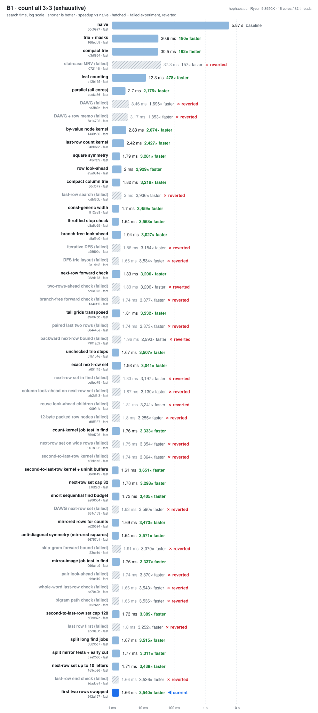
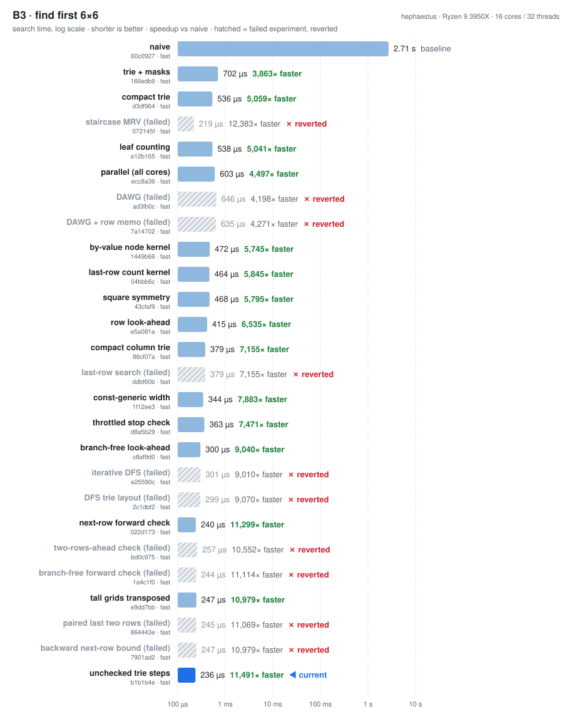
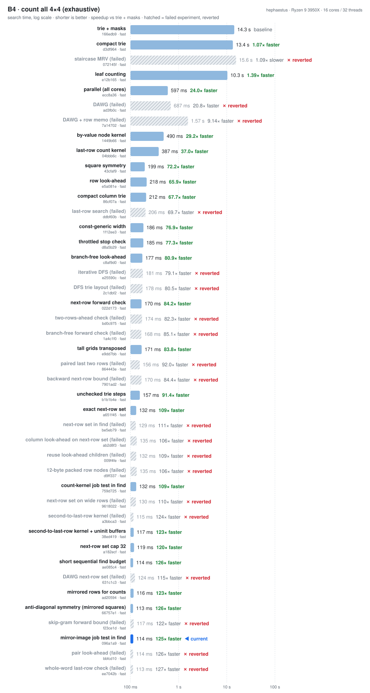
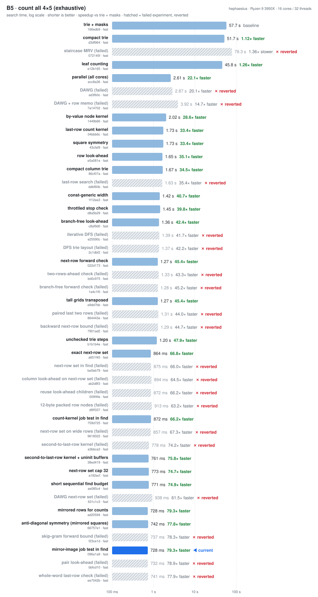
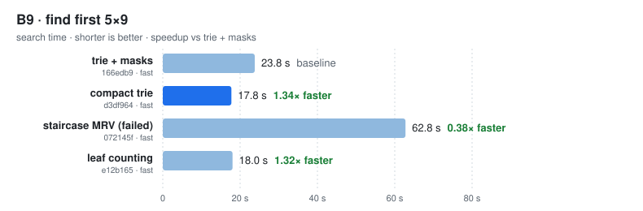

# Benchmark progress

Generated by `scripts/charts.py` from [`bench-log.csv`](bench-log.csv) — do not edit by hand.
Each bar is one optimization step (the latest run of its `--label`). Time = median search time
reported by the binary (dictionary load excluded). Details of each step: [`journal.md`](journal.md).

> ⚠️ *nodes* are not comparable across solvers: naive counts placed row words, trie counts cells.

## B1 · count all 3×3 (exhaustive)

| Step | Commit | Date | Profile | Time | vs baseline | vs previous | Nodes | Result |
|---|---|---|---|---:|---:|---:|---:|---|
| naive | `60c0927` | 2026-11-07 | fast | 11.85 s | — | — | 2,034,829 | solutions=1909732 |
| trie + masks | `60c0927` | 2026-11-07 | fast | 77.1 ms | 154× | 154× | 4,031,868 | solutions=1909732 |

## B2 · find first 5×6

| Step | Commit | Date | Profile | Time | vs baseline | vs previous | Nodes | Result |
|---|---|---|---|---:|---:|---:|---:|---|
| naive | `60c0927` | 2026-11-07 | fast | 2.34 s | — | — | 1,919 | found |
| trie + masks | `60c0927` | 2026-11-07 | fast | 900 µs | 2,600× | 2,600× | 22,841 | found |

## B3 · find first 6×6

| Step | Commit | Date | Profile | Time | vs baseline | vs previous | Nodes | Result |
|---|---|---|---|---:|---:|---:|---:|---|
| naive | `60c0927` | 2026-11-07 | fast | 5.65 s | — | — | 4,505 | found |
| trie + masks | `60c0927` | 2026-11-07 | fast | 1.91 ms | 2,958× | 2,958× | 49,782 | found |

## B4 · count all 4×4 (exhaustive)

| Step | Commit | Date | Profile | Time | vs baseline | vs previous | Nodes | Result |
|---|---|---|---|---:|---:|---:|---:|---|
| trie + masks | `166edb9` | 2026-11-07 | fast | 37.52 s | — | — | 1,435,800,420 | solutions=136245247 |

## B5 · count all 4×5 (exhaustive)

| Step | Commit | Date | Profile | Time | vs baseline | vs previous | Nodes | Result |
|---|---|---|---|---:|---:|---:|---:|---|
| trie + masks | `166edb9` | 2026-11-07 | fast | 153.06 s | — | — | 5,169,522,478 | solutions=114846713 |

## B6 · count all 3×7 (exhaustive)

| Step | Commit | Date | Profile | Time | vs baseline | vs previous | Nodes | Result |
|---|---|---|---|---:|---:|---:|---:|---|
| trie + masks | `166edb9` | 2026-11-07 | fast | 16.31 s | — | — | 489,739,310 | solutions=4453472 |

## B7 · find first 7×7

| Step | Commit | Date | Profile | Time | vs baseline | vs previous | Nodes | Result |
|---|---|---|---|---:|---:|---:|---:|---|
| trie + masks | `166edb9` | 2026-11-07 | fast | 5.02 s | — | — | 141,510,783 | found |

## B8 · find first 6×7

| Step | Commit | Date | Profile | Time | vs baseline | vs previous | Nodes | Result |
|---|---|---|---|---:|---:|---:|---:|---|
| trie + masks | `166edb9` | 2026-11-07 | fast | 4.04 s | — | — | 117,670,090 | found |

## B9 · find first 5×9

| Step | Commit | Date | Profile | Time | vs baseline | vs previous | Nodes | Result |
|---|---|---|---|---:|---:|---:|---:|---|
| trie + masks | `166edb9` | 2026-11-07 | fast | 23.79 s | — | — | 604,041,773 | found |
