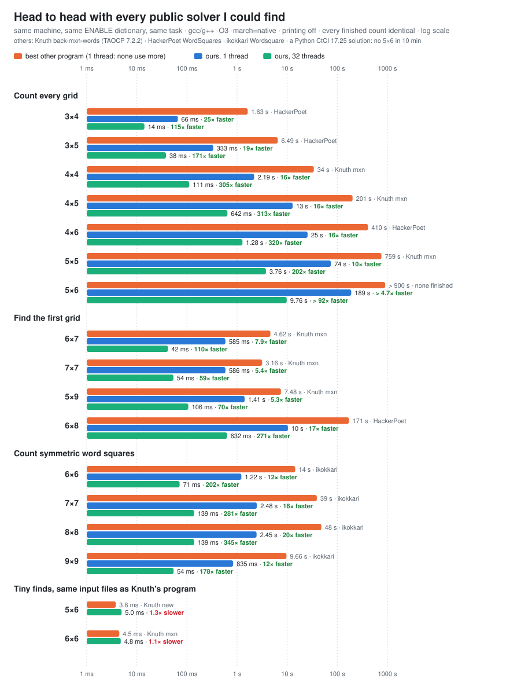
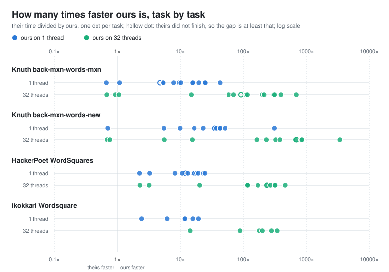
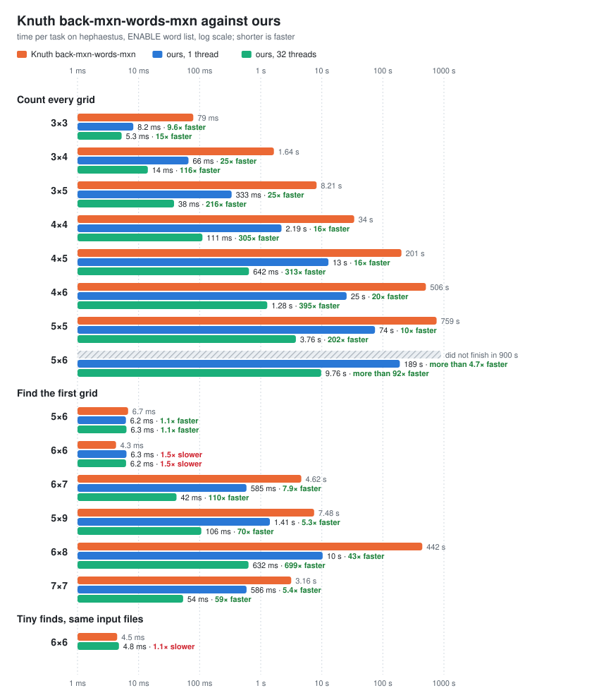
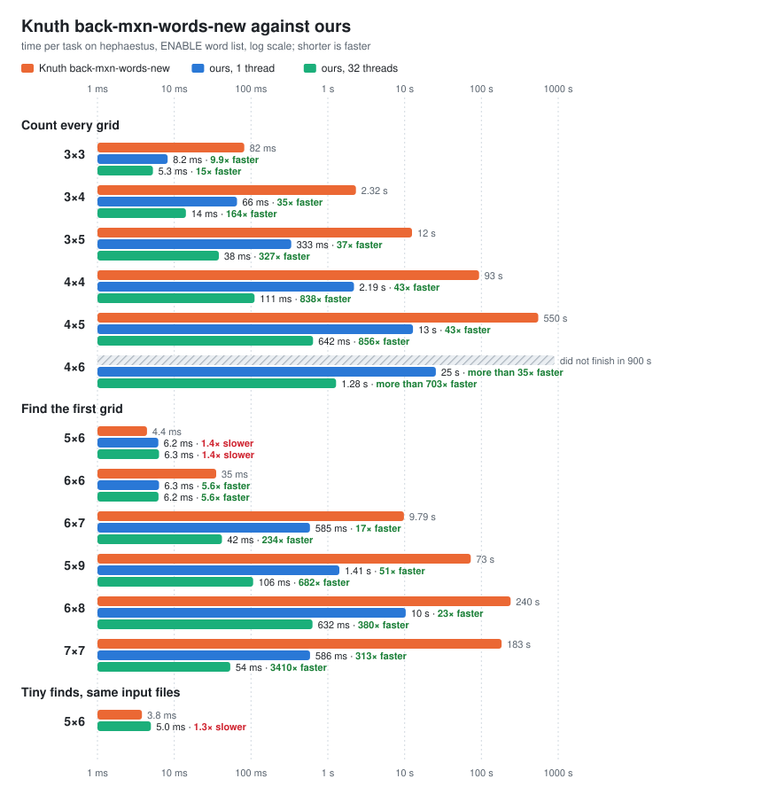
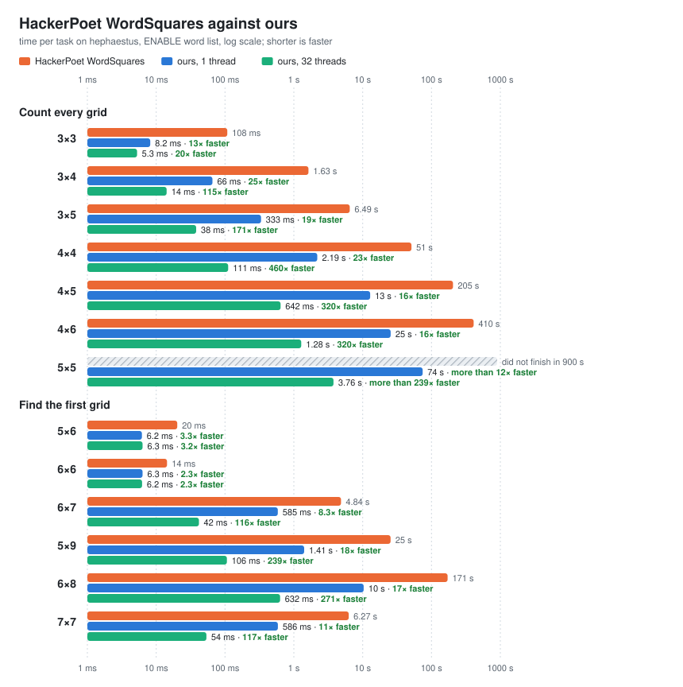
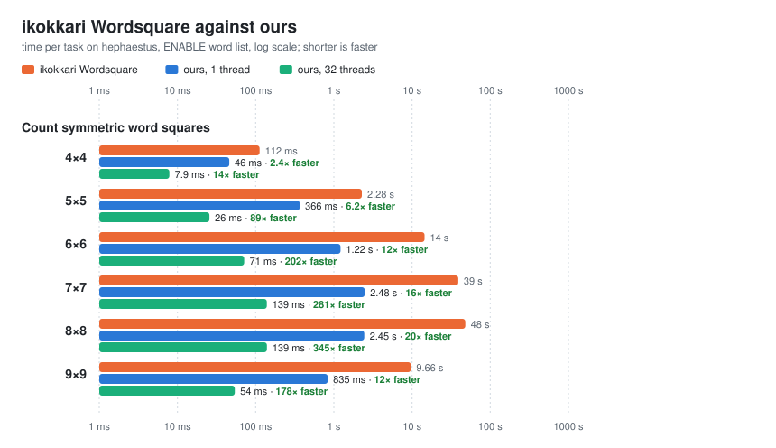

# Other solvers

I searched for public programs that solve the same problem and raced every one I could build against this solver. They all ran on hephaestus (Ryzen 9 3950X), on the ENABLE word list (172,823 words), and on the same tasks. Every count that finished matches ours exactly. Raw numbers are in [`competitors.csv`](competitors.csv), and the journal entry of 2026-11-23 has the method.

## How the race was run

- C and C++ programs were compiled with `gcc` or `g++ -O3 -march=native`.
- Solution printing was turned off in every program, ours included. For `find`, each program stops at its first grid.
- I changed only what the task needed: the word list, the grid size, size limits that were too small for ENABLE, and counting or stopping instead of printing. The search code is untouched.
- Times are wall-clock, start to finish. Each time is the median of 7 runs when a run took under 10 s, and a single run otherwise. Counts were stopped after 15 minutes and finds after 10.
- Ours ran once on 1 thread and once on all 32. None of the other programs can use more than one core.

## The gap, task by task

Each dot is one task, placed at the other program's time divided by ours. The dots near or below 1× are tasks that take every program a few milliseconds, where starting the process and loading the words is most of the time. On the tasks that take longer than 0.1 s:

| Program | Ours on 1 thread | Ours on 32 threads | Did not finish |
|---|---|---|---|
| Knuth `back-mxn-words-mxn` | 5.3 to 43 times faster | 59 to 699 times faster | count 5×6 (15 min) |
| Knuth `back-mxn-words-new` | 17 to 313 times faster | 164 to 3,410 times faster | count 4×6 (15 min) |
| HackerPoet `WordSquares` | 8.3 to 25 times faster | 20 to 460 times faster | count 5×5 (15 min) |
| ikokkari `Wordsquare` | 2.4 to 20 times faster | 14 to 345 times faster | none |
| Noah Nelson's Python | not measurable | not measurable | find 5×6 (10 min; ours: 6 ms) |

The only wins against us are tiny finds, all by Knuth's programs: 5×6 in 3.8 to 4.4 ms and 6×6 in 4.3 to 4.5 ms, where ours takes 4.8 to 6.3 ms. Our search itself takes about 0.1 ms on these; the rest is startup.

## Knuth: back-mxn-words-mxn and back-mxn-words-new

Source: [`back-mxn-words-mxn.w`](https://cs.stanford.edu/~knuth/programs/back-mxn-words-mxn.w) and [`back-mxn-words-new.w`](https://cs.stanford.edu/~knuth/programs/back-mxn-words-new.w), from [Knuth's programs page](https://cs.stanford.edu/~knuth/programs.html). CWEB, converted to C with `ctangle`. Copies fetched on 2026-11-23 have SHA-256 prefixes `1cc7ad458f9d` (mxn) and `93ff339c4ef6` (new).

Donald Knuth wrote these as examples of backtracking for *The Art of Computer Programming*, section 7.2.2; his notes name 5×6 as the case he had in mind for the book. Both take a file of m-letter words and a file of n-letter words and find every m×n grid. His first version filled one whole column per level; `back-mxn-words-new` keeps that and adds a better data structure for the column words. `back-mxn-words-mxn`, written about a week later, fills the grid one cell at a time, as this solver does.

To run them on ENABLE, I raised `maxmwds` to 40,000, `maxtriesize` to 4,000,000 and `maxm`/`maxn` to 15. I kept the built-in memory-access counter, because the variant without it ran slower. For `find`, the program exits after the first grid.

`-mxn` is the stronger of the two and the closest rival overall. `-new` loses badly on larger grids (find 7×7: 183 s against 0.59 s for ours on one thread) but is the fastest program in the race on the 5×6 find.

## HackerPoet: WordSquares

Source: [github.com/HackerPoet/WordSquares](https://github.com/HackerPoet/WordSquares), commit `617ad8d` (2025-02-28), MIT license. C++.

A "simple C++ solver for dense word grids" that goes with a [YouTube video](https://youtu.be/zWIsnrxL-Zc). It searches with a trie and can filter words by frequency. Its settings are constants at the top of `main.cpp`. I made the grid size settable at compile time, pointed it at ENABLE with no frequency file (so no word is filtered), turned off its filter for unique words, and made it count grids instead of printing them, or exit at the first grid for `find`. It also needed two missing `#include` lines to build with the current `g++`.

It is the most even of the programs: 8 to 25 times slower than ours on one thread on every task over 0.1 s.

## ikokkari: Wordsquare

Source: [github.com/ikokkari/Wordsquare](https://github.com/ikokkari/Wordsquare), commit `d20bd7a` (2024-09-13), GPL-3.0 license. C.

Its author used it for an exhaustive search showing that no 9×9 double word square exists in English. It fills rows and columns alternately and propagates constraints to the empty cells. It only does squares, so I raced it on symmetric word squares (row i equals column i), with its `DOUBLE` switch set to 0, its rule against repeated words turned off to match ours, and ENABLE as the word list. With that, its counts match ours exactly, for example 2,555,155 symmetric 4×4 squares.

Compared with ours it is closest on the smallest square (4×4, 2.4 times slower) and falls behind as squares grow (8×8: 48 s against 2.4 s).

## Noah Nelson: WordRectangle.py

Source: [gist eea646be1f5abc859cda1583f1f58a78](https://gist.github.com/NoahNelson/eea646be1f5abc859cda1583f1f58a78) (2017), a solution to *Cracking the Coding Interview* problem 17.25. Python.

It places one whole word per row and checks column prefixes, the textbook approach and the same idea as our naive reference. It did not find a 5×6 in 10 minutes. Our naive solver, written the same way in Rust, takes 1.09 s, and our main solver takes 6 ms.

## Our own naive solver, for scale

`src/naive.rs` is never optimized and serves as the reference. It is slower than all three C and C++ programs (count 3×3: 4.95 s, against 0.08 s for Knuth's), so the lead comes from the search, not from the language.

## What I did not find

I found no other program or published result that settles every grid size for a large dictionary, and none that runs in parallel. If you know one I missed, open an issue and I will race it.
